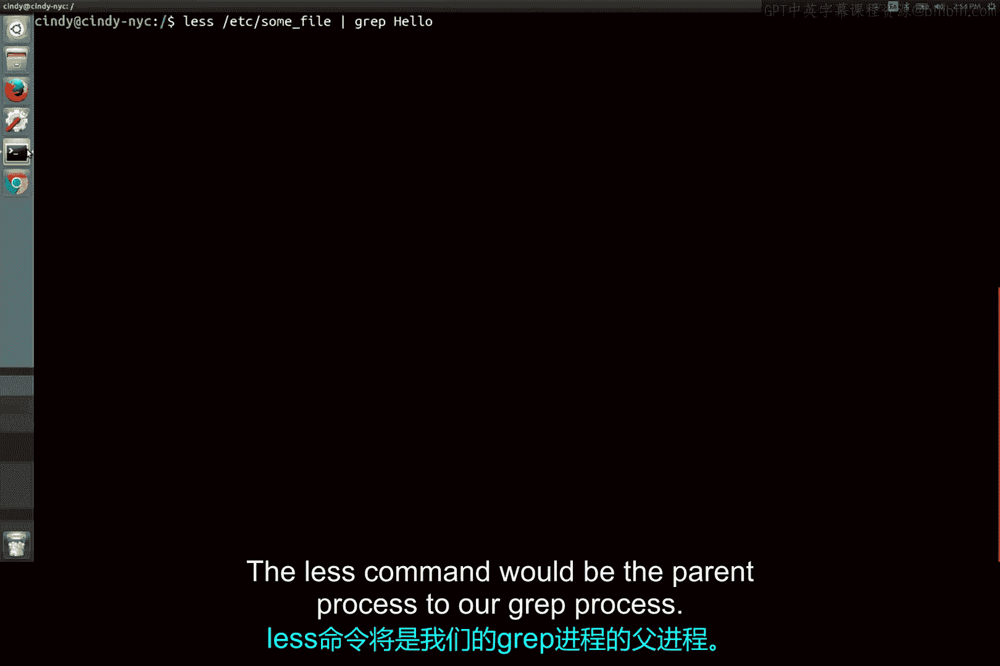
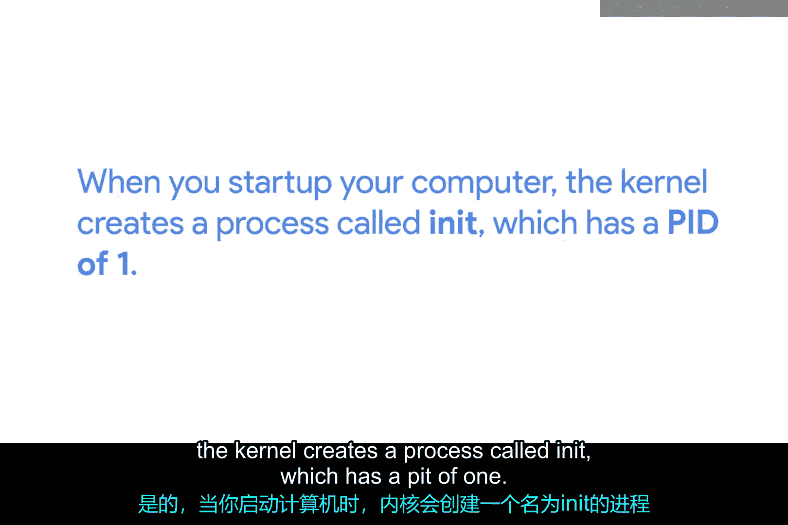

# 谷歌《IT支持（计算机网络⧸操作系统，第2、3课⧸共5课）｜Google IT Support》中英字幕deepseek p177 83_Linux进程创建与终止.zh_en -BV1uyqcYpExr_p177-

In Linux， processes have a parent child relationship。

 this means that every process that you launch comes from another process。

Let's check out this command。

The less command would be the parent process to our GrP process。

If all processes come from another process， there must be an initial process that started this all。

 right？Yes， there is。When you start up your computer， the kernel creates a process called a knit。

 which has a pit of one。

And it starts up other processes that we need to get our computer up and running。

There are more nuances to process creation than this。

 but I wanted to introduce the parent process concept since you'll see them when we start managing processes。

What about what happens when we're done with our processes？When your processes complete their task。

 they'll generally terminate automatically。Once a process terminates。

 it will release all the resources it was using back to the kernel so that they can be used for another process。

You can also manually terminate a process which will discuss how to do in an upcoming lesson。

