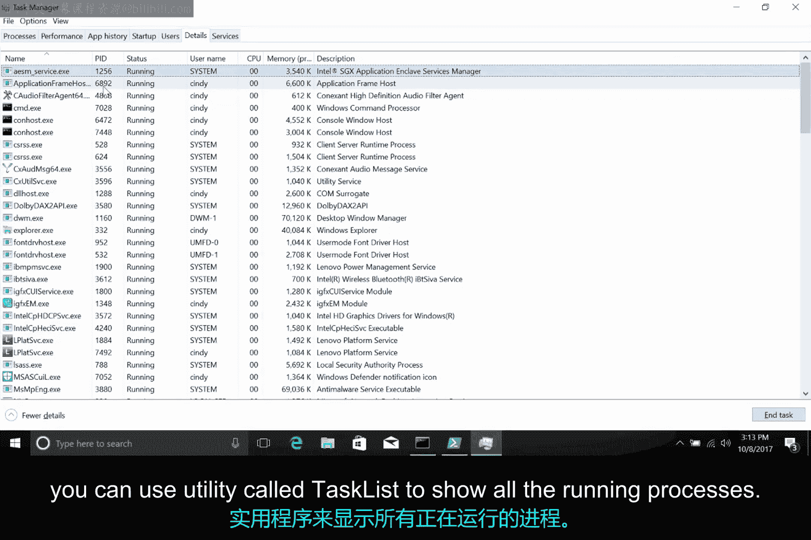
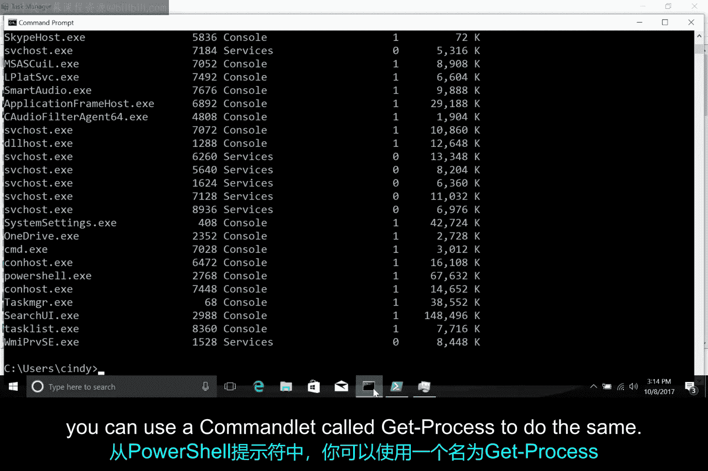
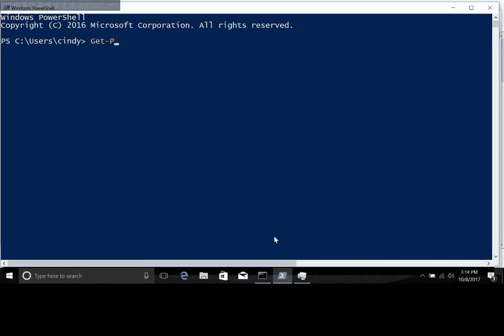

# 谷歌《IT支持（计算机网络⧸操作系统，第2、3课⧸共5课）｜Google IT Support》中英字幕deepseek p179 85_Windows读取进程信息.zh_en -BV1uyqcYpExr_p179-

It might feel like we're starting to get into the weeds here。

 so let's take a step back and think about what processes really are and what they represent in the context of an operating system。

You can think of processes as programs in motion。Consider all the code for your Internet browser。

 It sits there on your hard drive quietly waiting for its time to shine。 Once you start it up。

 the operating system takes that resting code， then turns it into a running。

 responding working application。😊，In other words， it becomes a process you interact with。

 launch and halt processes all the time on computers。

 although the OS usually takes care of all that behind the scenes。By learning about processes。

 you're taking a peek behind the curtain at how operating systems really work。

This knowledge is both fascinating and powerful， especially when applied by a savvy IT support specialist to solve problems。

Keep all that in mind as we take a look at how you can pull back the curtain even further。Next。

 we'll learn about the different ways you can investigate which processes are running on a Windows computer and more methods of interacting with them on the Windows operating system。

 the task manager or taskmgrR。E is one method of obtaining process information。

You can open it with the Control Shi Escape key combination or by locating it using the start menu。

If you click on the Prosses tab， you should see a list of the processes that the current user is running along with a few of the system level processes that the user can see。

Information about each process is broken out into columns in the task manager。

The task manager tells you what application or image the process is running。

 along with the user who launched it and the CPU or memory resources it's using。To kill a process。

 you can select any of the process rows and click the End taskask button in the lower right corner。

We can demonstrate this by launching another notepad。 process from the command line。

 then switching over to the task manager， selecting the notepad EX process and ending it。

I already have Nopa open， so I'm just going to click on it， click End taskask。In an earlier lesson。

 we talked about starting and ending Windows processes。

 remember that we use the Task kill command to stop a process by its identification number or PI。

So how do we get that PID number Well in task manager， you can click on the details menu option。

In here you can see a whole bunch of other information you can get the task manager to display。

 including the PID。You can also see this information from both the command prompt and Powerhell。

From the command prompt， you can use a utility called T L to show all the running processes。

From a PowerShell prompt， you can use a command lit called get dash Pro to do the same。

There are lots of ways you can get process information from the Windows operating system。

 we've included links to the documentation of both task lists and get dashash process in the supplementary reading in case you want to dive deeper into either of these tools。

