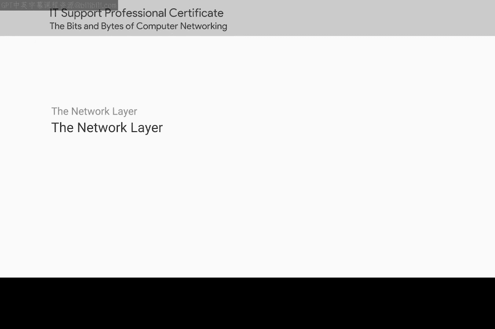
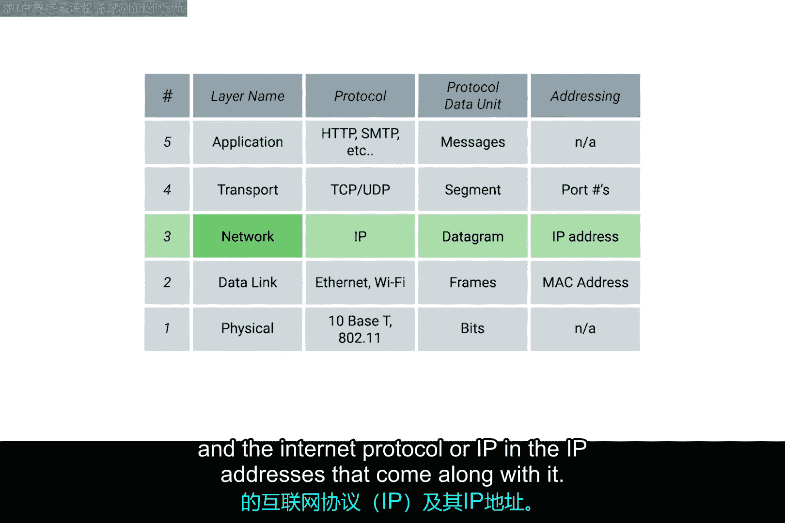

# 谷歌《IT支持（计算机网络⧸操作系统，第2、3课⧸共5课）｜Google IT Support》中英字幕deepseek p18 16_网络层.zh_en -BV1uyqcYpExr_p18-

On a local area network or LAN， nodes can communicate with each other through their physical Mac addresses。

 This works well on small scale because switches can quickly learn the Mac addresses connected to each other ports to four transmissions appropriately。

But Mac addressing isn't a scheme that scales well Every single network interface on the planet has a unique Mac address and they aren't ordered in any sort of systematic way。

 There's no way of knowing where on the planet a certain Mac address might be at any one point in time。

 so it's not ideal for communicating across distances。Later on in this lesson。

 when we introduce ARP or address resolution protocol。

 you'll see that the way that nodes learn about each other's physical addressing isn't translatable to anything besides a single network segment anyway。

Clearly we need another solution。And that is the network layer and the Internet protocol or IP and the IP addresses that come along with it by the end of this lesson。

 you'll be able to identify in IP address， describe how IP dataograms are encapsulated inside the payload of an ethernet frame and correctly identify and describe the many fields of an IP datagram header。

