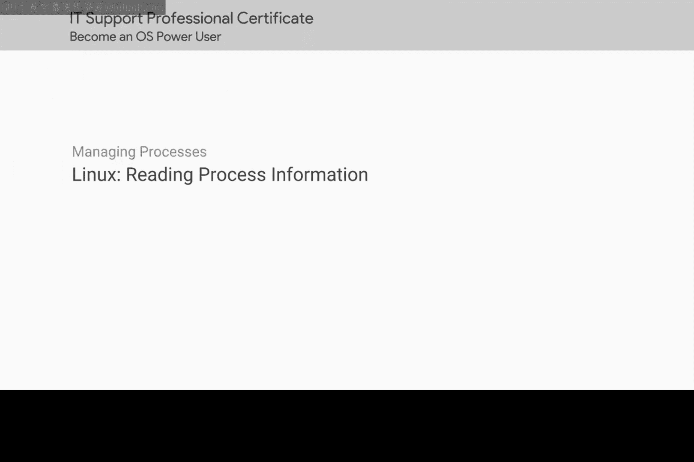
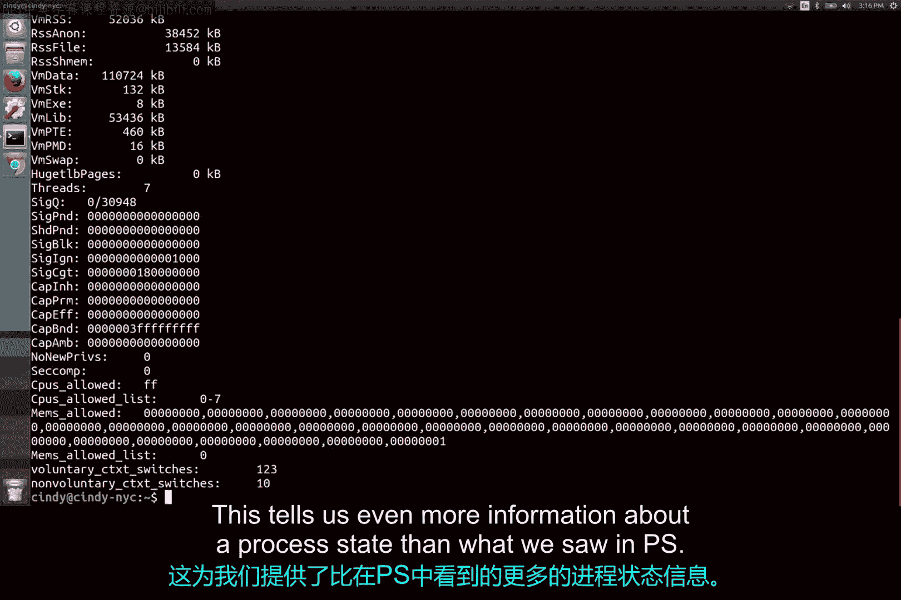

# 谷歌《IT支持（计算机网络⧸操作系统，第2、3课⧸共5课）｜Google IT Support》中英字幕deepseek p180 86_Linux读取进程信息.zh_en -BV1uyqcYpExr_p180-

Okay， now let's talk about how to view the processes running on our system and Linux we'll be using the PS command so let's just go ahead and run that command with the dash X flag and see what happens。

This shows you a snapshot of the current processes you have running on your system。

The PS output can be overwhelming to look at it first， but don't worry。

 we'll walk through how to read this output。Let's start from right to left here。

P ID or PID is the process ID。Remember， processes get a unique ID when they're launched。TTY。

 this is the terminal associated with the process we won't talk about this field。

 but you can read more about it in the man pages linked right after this video。

Stat this is the process status if you see an R here。

 it means the process is running or it's waiting to run。

Another common status you'll see is T for stopped， meaning a process that's been suspended。

Another one you might see is an S for interoperable sleep。

Meaning the task is waiting for an event to complete before it resumes。

You can read more about the other types of process statuses in the MA pages。Time。

 this is the total CPU time that the process has taken up。And lastly， command。

 this is the name of the command we're running。Okay， now we're going to enter hard mode here。

 Run this command， P S dash E F。 The E flag is used to get all processes。

 Even the ones run by other users。 The dash F flag is for full。

 which shows you full details about a process。😊，Look at that。

 we have more processes and even more process details， let's break this down。

UID is the user ID of the person who launched the process。Pid is the process I。

And PPI is the parent ID that we discussed in an earlier lesson which launched the process。

C is the number of children processes that this process has。

S time is the start time of the process TTY is the terminal associated with the process。

Time is the total CPU time that the process has taken up。

And CMD or command is the name of the command that we're running。

What if we wanted to search through this output it's super messy right now。

 can you think of a way we can see if the process is running？That's right。 with the Gr command。

 I told you we're going to use it all the time。This will give us a list of processes that have the name Chrome in them。

There's another way to view process information。Remember everything in Linux as a file。

 even processes， to view the files that correspond to processes。

 we can look into the/ proc directory。There are a lot of directories here for every process that's running。

 If you looked inside one of the subdirecties， it'll give you even more information about the process。

Let's look at a sample process status file for PI。1，8，0，5。

This tells us even more information about a process date than what we saw in PS while the slash pro directory is interesting to look at。

 it's not very practical when we need to troubleshoot issues with processes for now stick with the PS EF command to look at process information。

As you can see， we can learn a lot about the processes running on our machine with just a few keystrokes。

In an upcoming lesson， we'll talk about how to use process information to our benefit when figuring out which processes are taking up too many resources。

For now， feel free to learn a little more about the processes that you're running。

 I'll be waiting for you in the next video。