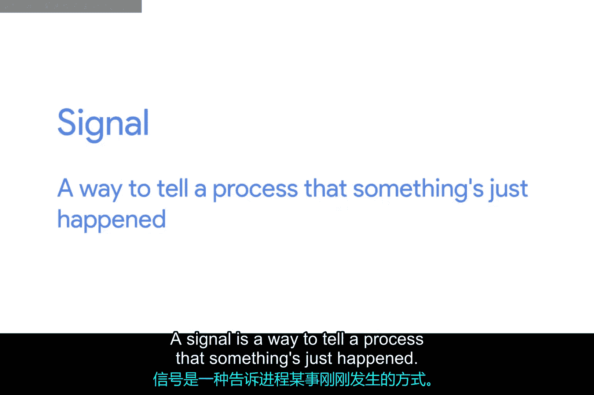
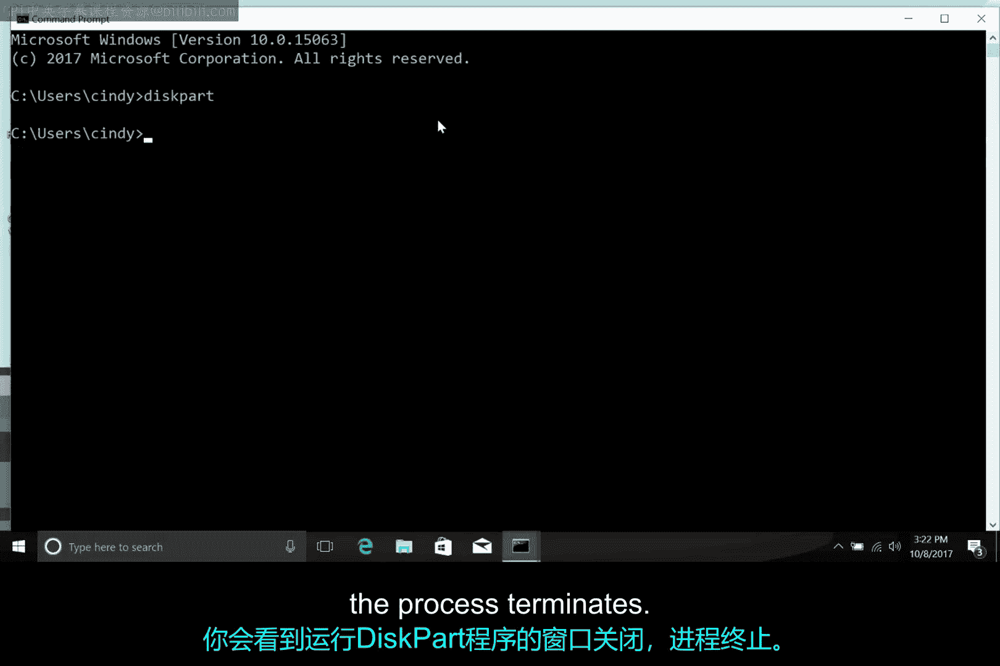

# 谷歌《IT支持（计算机网络⧸操作系统，第2、3课⧸共5课）｜Google IT Support》中英字幕deepseek p181 87_Windows信号.zh_en -BV1uyqcYpExr_p181-

Imagine you're starting up a video game that's taking a while to render its graphics。

 You decide that you don't want to play any more， which leaves you with a few options。

 You can wait for it to finish loading and then quit the game from the menu。

 or you can interrupt the process altogether， telling it to quit at the system level。😊。

This is just one example of a time you might find yourself wanting to close a process before it fully completes。

To tell a process to quit at the system level， we use something called a signal。

A signal is a way to tell a process that something's just happened。

You can generate a signal with special characters on your keyboard and through other processes and software。

One of the most common signals you'll come across is called Sig int。

 which stands for Sign interruptrup。 You can send this signal to a running process with a C C key combination。

Let's say you start the diskP tool we looked at in our discussion on partition formatting。

IJust going to open up command prompt。And then launch disc part。

If you decide you don't want to actually format any disks。

 you can hold down the control key and press C at the same time to send the Sig int signal to the disc part process。

You'll see that the window that the disc part program was running in closes and the process terminates。

There are a few other windows signals that processes can send and receive。But unlike in Linux。

 there isn't an easy way for an end user to issue arbitrary signal commands。

If you're interested in learning more about Windows signals。

 check out the Sign reference link in the supplementary reading。

