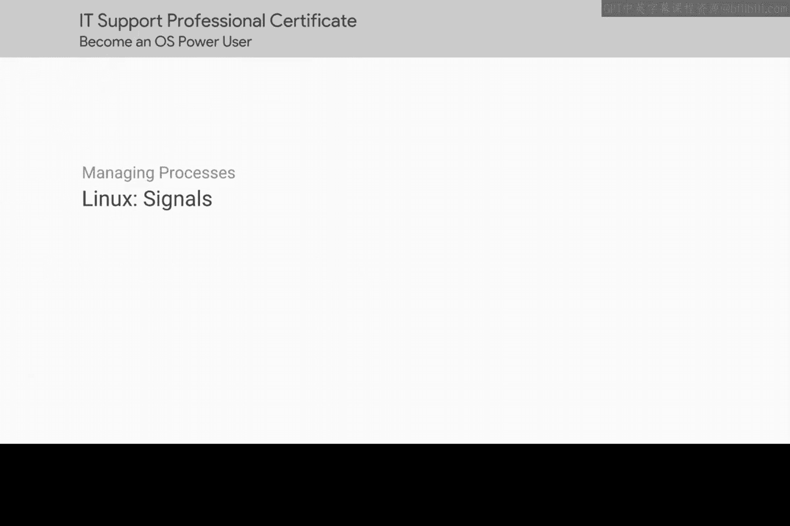
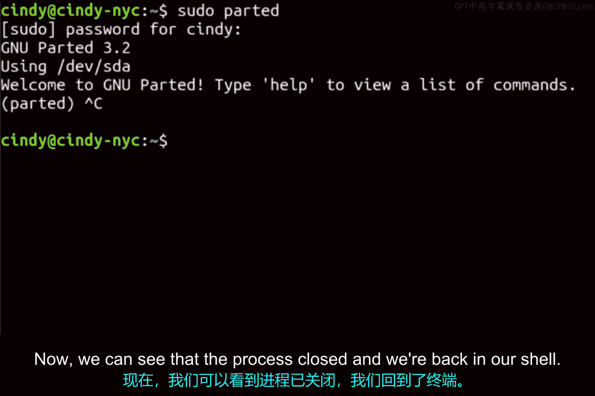

# 谷歌《IT支持（计算机网络⧸操作系统，第2、3课⧸共5课）｜Google IT Support》中英字幕deepseek p182 88_Linux信号.zh_en -BV1uyqcYpExr_p182-

In Linux， there are lots of signals that we can send to processes。

These signals are labeled with names starting with SIG。

Remember the Sig int signal we talked about before， you can use Sig int to interrupt a process。

 and the default action of this signal is to terminate the process that it's interrupting。

 This is true for Linux 2。 You can send a Sig int signal through the keyboard combination control C。

Let's see this in action。I'm going to do the same thing as we did in Windows and start a program like Supartdon。

We can see that we're in the parted tool now， let's interrupt this tool and say we want it to abort the process with the control C keyboard combination。

Now， we can see that the process closed and were back in our shell。

 We were able to interrupt our process midway and terminate it。 Su。

 There are lots of signals used in Linux， and we'll talk about the most common ones in the upcoming lessons。

😊。

