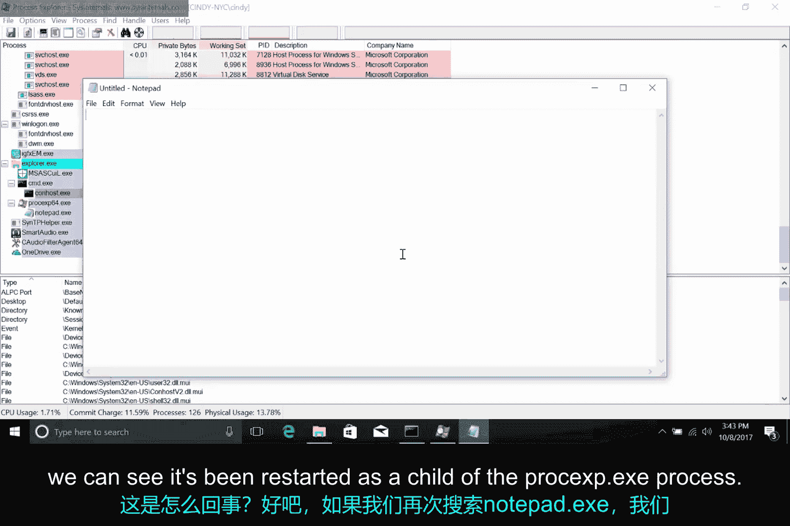
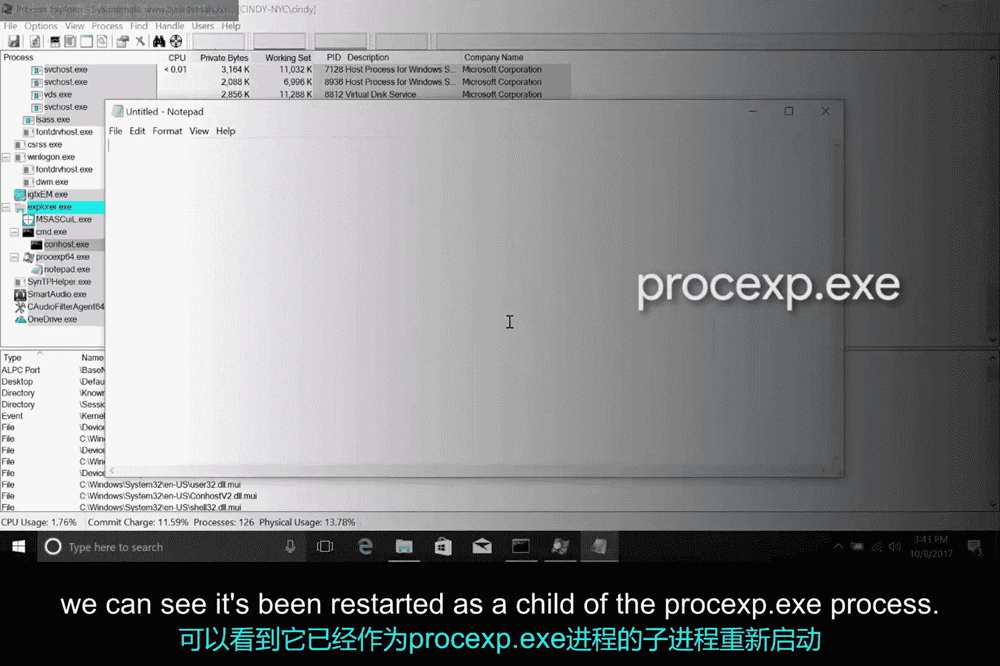
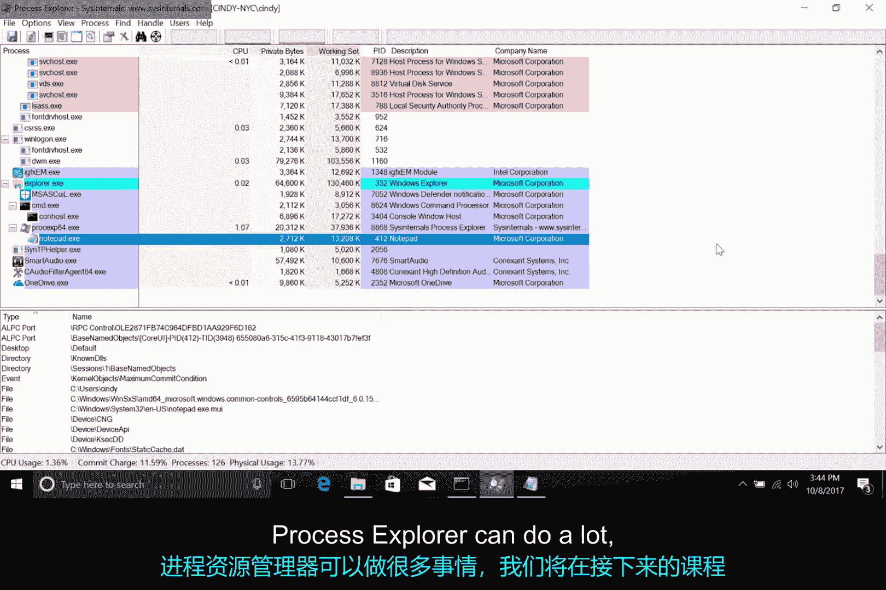

# 谷歌《IT支持（计算机网络⧸操作系统，第2、3课⧸共5课）｜Google IT Support》中英字幕deepseek p183 89_Windows管理进程.zh_en -BV1uyqcYpExr_p183-

In earlier lessons， we talked about processes。 We saw some examples of how to manipulate them with signals。

 Let's expand on that idea of process management by looking at some other things you can do to manipulate processes。

In Windows， we've looked at programs like Task Manager， the PowerShell Commandlet get dash process。

 and the taskless utility to name a few。We've also seen how to send a running process I signal through control C。

But there's another process management tool we haven't talked about。

 which lets you do things like restart or even pause processes。 This tool is called process Explorer。

Process Explorer is a utility Microsoft created to let IT support specialists。

 systems administrators， and other users look at running processes。

Although it doesn't come built into the Windows operating system。

 you can download it from the Microsoft website， which I've linked to in the supplemental reading right after this video。

Once you've downloaded Proces Explorer and started it up。

 you'll be presented with a view of the currently active processes in the top window pane。

You'll also see a list of the files a selected process is using in the bottom window pane。

This can be super handy if you need to figure out which processes use a certain file。

 or if you want to get insight into exactly what a process is doing and how it works。

You can search for a process easily in process Explorer by either pressing C F or clicking on the little binocular button。

Let's go ahead and do a search for the notepad process we opened up earlier。

You should see C backslash Windows backslash system 32 backsnepad。

 listed as one of the search results。If you see something that says notad。mui， don't worry。

 MuUi stands for multilingual user interface and it contains a package of features to support different languages。

Anyways， once you've located the notepad。ex process， notice how it's nested under the command。

ex process in the UI。This indicates that it's a child process of commandda EXE。

If you right click on the Noteepadd。ex process， you'll be given a list of different options that you can use to manage the process。

Check out the ones that say killll process， kill process tree， restart and suspend。

Kill processed does what you might expect。 Sa good to Oad。

 Kill processcesed tree does a little bit more。 It'll kill the process and all of its descendants。

 So any child process started from it will be stopped。Kill processcess tree takes no prisoners。

Restar is another interesting option。 You might be able to guess what it does just by its name。

It'll stop then start the process again。Let's do that with the notepad。

ex process we started from command。ex。Interesting， after the restart， noP。

 doesn't appear as a child of command EX anymore。 What gives。Well， if we search for notpandac again。

 we can see it's been restarted as a child of the Procexp。ex process。

This is the process name for process Explorer。This makes sense since Pro Explorer was the process in charge of starting it again after we terminated it。

But what about the suspend option。Instead of killing a process。

 you can use this option to suspend it and potentially continue it at a later time。

If we right clickSspend the process， we'll see that in the CPU column of process Explorer output。

 the word suspended appears。While a process is suspended。

 it doesn't consume the resources it did when it was active。

 we can kick it off again by right clicking and selecting the resume option。

Process Explorer can do a lot and we'll take a look at some of the monitoring information it can give us in an upcoming lesson。

We won't get into the details of all its features though， so if you're curious。

 you can check out the documentation on Microsoft's website。

We put a link to it for you in the supplementary reading。

