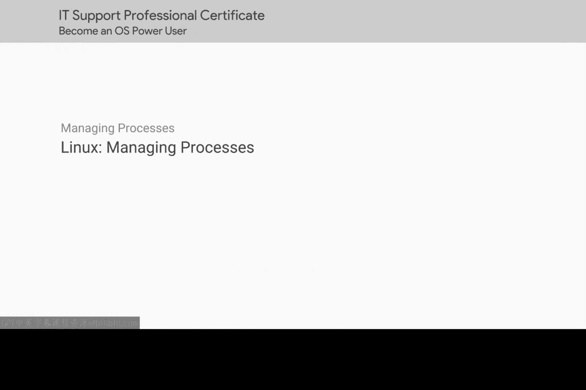
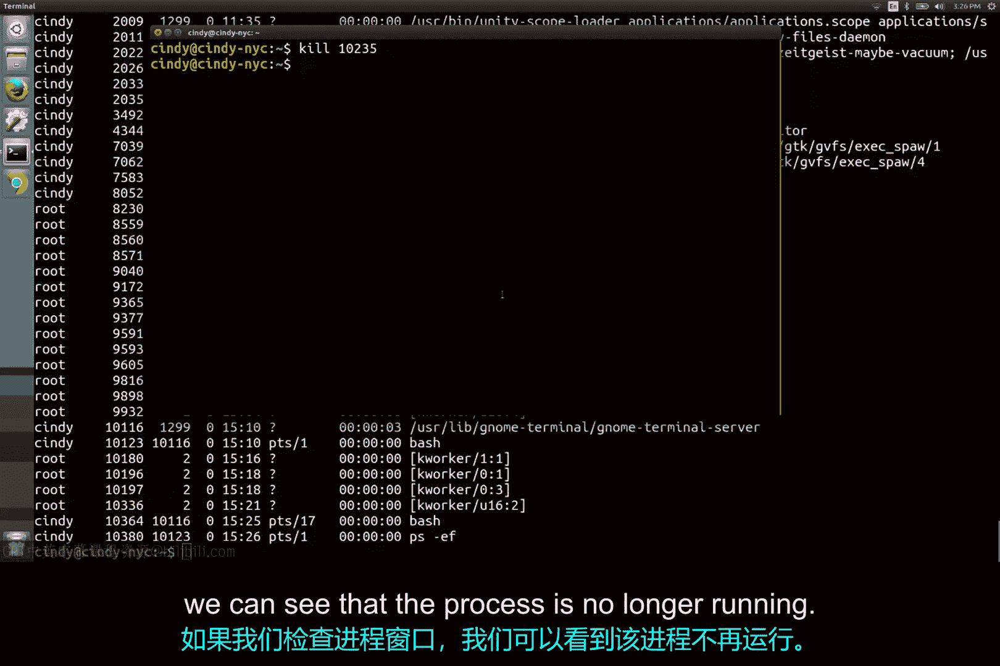
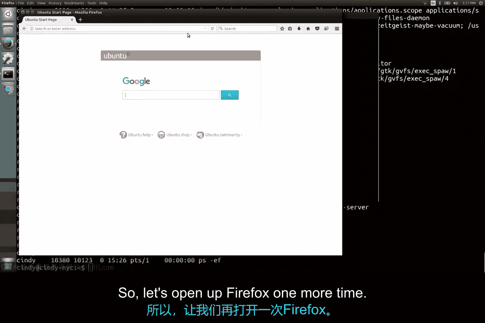
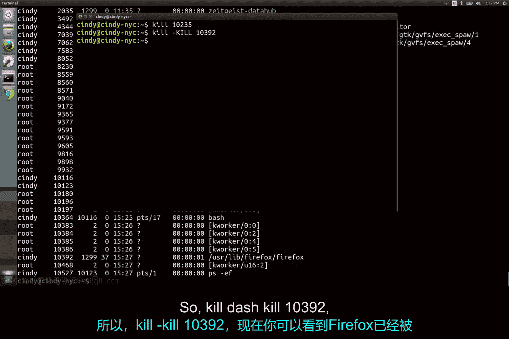
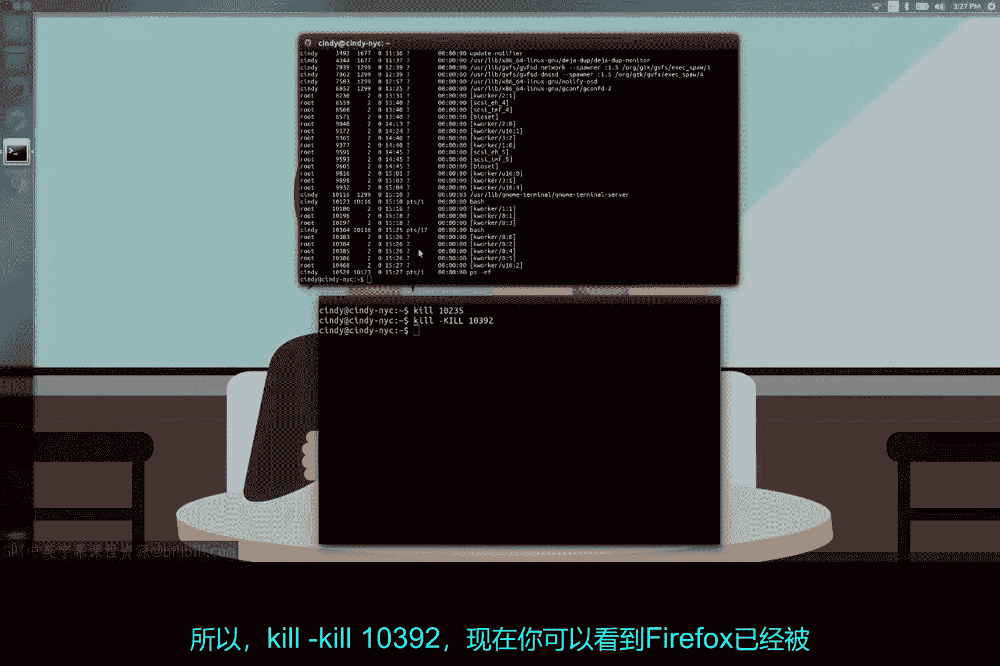
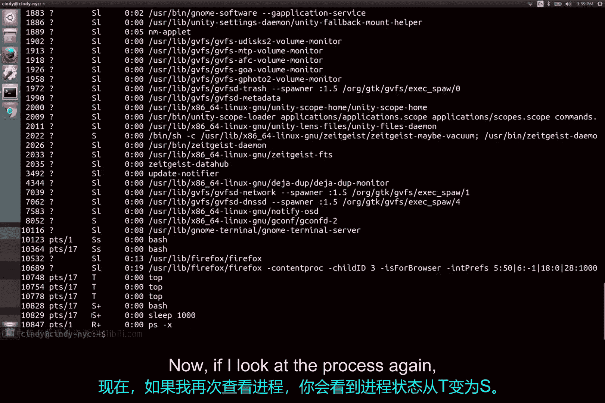

# 谷歌《IT支持（计算机网络⧸操作系统，第2、3课⧸共5课）｜Google IT Support》中英字幕deepseek p184 90_Linux管理进程.zh_en -BV1uyqcYpExr_p184-

Let's talk about how to use signals to manage processes and Linux。 First up， terminating processes。

 we can terminate a process using the kill command。It might sound a bit morbid。

 but that's just how it is in the dog eat dog world of terminating processes。The kill command。

 without any flags， sends a termination signal or sig term。 This will kill the process。

 but it'll give it some time to clean up the resources it was using。

If you don't give the process a chance to clean up some of the files it was working with。

 it could cause file corruption。I'm going to keep a process window open so you can see how our processes get affected as we run these commands。

So to terminate a process， we'll use the kill command along with the pi of the process we want to terminate。

Let's just go ahead and kill this Firefox process。And if we check the process window。

 we can see that the process is no longer running。

The other signal that you might see pop up every now and then is the Sig kill signal。

This will kill your process with a lot of metaphorical fire。

 usingsing a sig term is like telling your process。 Hey， there process。

 I don't really need you to complete right now。 So could you just stop what you're doing。

And using Sig kill is basically telling your process， okay， it's time to die。

The signal does its very best to make sure your process absolutely gets terminated and will kill it without giving it time to clean up。

To send a SIig kill signal， you can add a flag to the kill command kill for Sig kill。

So let's open up Firefox one more time。

So， kill， dash， kill。1，0，3，9，2。

And now you can see that Firefox has been killed。These are the two most common ways to terminate a process。

 but it's important to call out that using kill dash kill is a last resort to terminating a process。

Since it doesn't do any cleanup， you could end up doing more harm to your files than good。

Let's say you had a process running that you didn't want to terminate。

 but maybe you just want to put it on pause you can do this by sending the SG T stop signal for terminal stop。

 which will put your process in a suspended state。To send this。

 you can use the kill command with the flagag dash T stop。

I'm going to run PSX so you can see the status of the processes。We're just going to。P。

This process in a suspended state。 So kill。Dash tees stop。7，5，4。Now you can see the process。

10754 is now in a suspended state。You can also send the SG T stop signal using the keyboard combination control Z。

To resume the execution of the process， you can use the SIG CONT for continuous signal。

Let's go ahead and look at the process table again。

I'm going to go ahead and use that command on this process。Now， if I look at the process again。

 you'll see that the process status turned from a T to an s SG term。

 SGQ and SIG T stop are some of the most common signals you'll see when you're working with processes in Linux。

Now that you have a grasps on these signals， let's use them to help us utilize hardware resources better。

