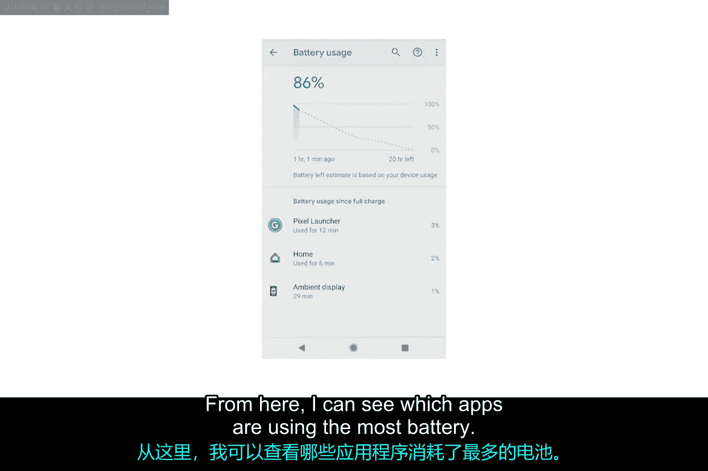

# 谷歌《IT支持（计算机网络⧸操作系统，第2、3课⧸共5课）｜Google IT Support》中英字幕deepseek p185 91_移动应用程序管理.zh_en -BV1uyqcYpExr_p185-

In mobile operating systems like ios and Android， you won't be able to see a list of running processes。

 Instead， you'll manage mobile apps that are running on the O。 When a mobile app is running。

 there will be one or more processes associated with them。

 but those details will be managed by the O。 Let's take a look at how you can manage your running mobile apps and understand how they're using your mobile devices resources。

 As an IT support specialists， you may help end users to troubleshoot slow mobile devices and manage their mobile apps。

 We'll show you examples of what you might see， but you may have to refer to your device's documentation if it doesn't look like these examples。

 First， let's check what apps are currently running on a device by opening the apps which are in ios。

From the app switcher， I can see a list of apps running on this iPhone。

Now let's do the same thing in Android。Great， each of the apps that I have launched is listed here。

 I can scroll through this list and switch to an app by tapping it。Now I can use this calculator。

The app that we're using is called the foreground app。All of these other apps are in the background。

What do you think is happening with the background apps while I'm calculating how many bits are in this megabyte？

The details can be a little complicated， but the basic idea is this。As soon as it can。

 the OS will suspend background mobile apps。 a suspended app is paused but not closed。

The O S can occasionally wake a background rounded app to allow to do some work。

 but it will try to keep apps suspended as much as it can。 Let's go back to the home screen。

Now that I'm on the home screen， all of the apps are backgrounded and there are no foreground apps。

The calculator hasn't been closed。 Each new app that you open will be kept back rounded and usually suspended。

 This helps the device use less battery power。 And pro tipip， as an IT support specialist。

 iss pretty helpful to learn which apps on your mobile device use the most battery power。

 If you have an app that the O S can't suspend because the app keeps working in the background or it's frozen。

 The neck can slow your device and use a battery。 I T support specialist。

 often have to find these misbehaving apps and close or uninstall them。

Let's try closing some of the apps。From the iOS app switchitcher。

 we can swipe up on any of the background apps。This will close the app。

We can do the same thing in Android in this version of Android。

 we can also swipe over here and hit clear all to close all of the apps at once。

You can troubleshoot a misbehaving app by closing apps one at a time and seeing if there is one app in particular that slows the device down。

 Sometimes closing a misbehaving app will be all you need to do to make your device run smoothly again。

Start with the app that's currently being used and see if that helps。

 The app whicher shows you the apps in order from most recently used to least recently used。

Work backwards through time， trying one app at a time。

Remember that this is not something that you should have to do very often to make your device work properly with current versions of ios and Android。

 you shouldn't ever have to close an app for performance reasons unless the app is misbehaving。

It can actually use a more battery to close and reopen an app than it would if you had just left it running。

If you discover that you have an app that's routinely misbehaving。

 you can try resetting it completely by clearing its cache like we saw in an earlier video。

 If the device is still running sluggishly after closing all of the apps。

The next thing to try is to simply restart the device。

 And if restarting the device doesn't fix the performance issues， or it's only a temporary fix。

 then we need to dig deeper。 Let's check the battery use of the apps that we've installed。

On the iPhone， I go to the settings app， thin battery。Then， battery health。

Here I can see how quickly the battery has been used since the last charge。

 I can also see which apps are using the most battery。Let's look at the same settings in Android。

Again， I go to the settings app， and from here， I'll choose battery then more than battery usage。

 From here， I can see which apps are using the most battery。

If I see an app that's using a lot of battery， then it might not be working as it should。

 or maybe it's an app that uses a lot of battery to work。

You'll need to learn which apps the end user needs to know whether or not the battery use is unusual。

