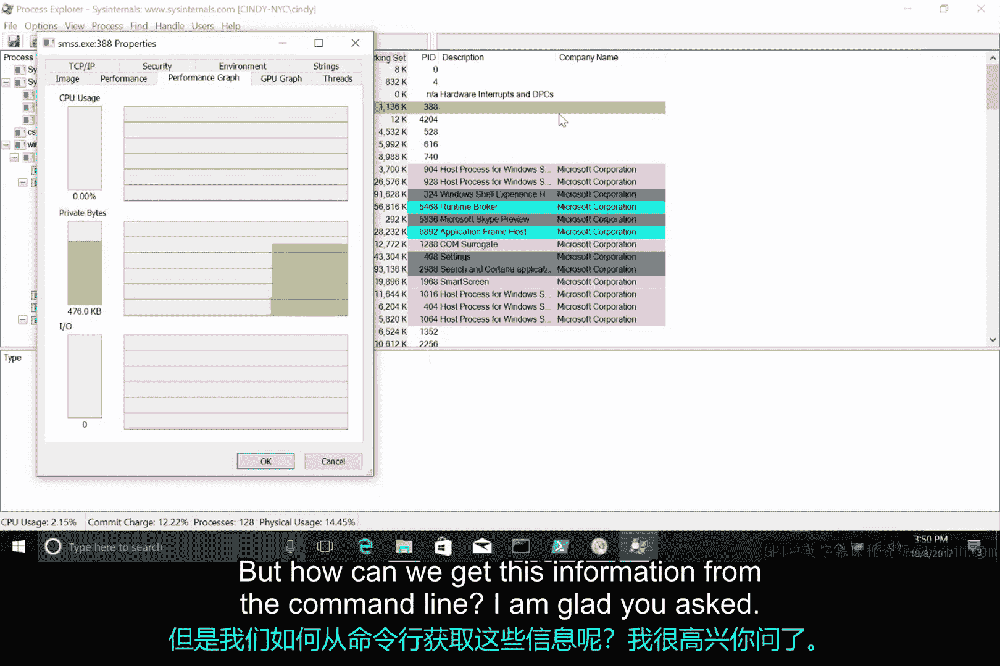
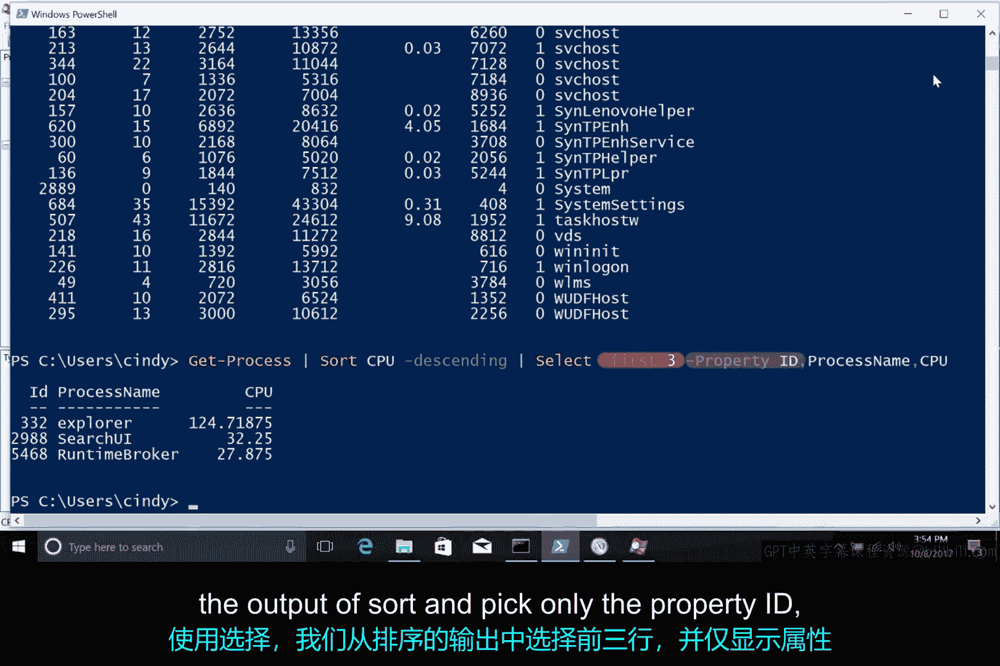

# 谷歌《IT支持（计算机网络⧸操作系统，第2、3课⧸共5课）｜Google IT Support》中英字幕deepseek p186 92_Windows资源监控.zh_en -BV1uyqcYpExr_p186-

You've been doing a great job and we're almost done with this module。Okay。

 now that we spend all this time learning about processes。

 like how to read them and how to manage them， when are we ever going to use these newfound skills？

Well， pretty much all the time。But in IT support role。

 managing processes comemin in handy the most when processes become a little unruly。

Our systems usually have some pretty good ways of monitoring processes and telling us which processes might be having issues。

In Windows， one of the most common ways to quickly take a peek at how the system resources are doing is by using the resource monitoring tool。

You can find it in a couple places， but we'll launch it right from the start menu。Once it opens。

 you'll see five tabs of information。One is an overview of all the resources on the system。

Each other tab is dedicated to displaying information about a particular resource on the system。

You'll also notice that Re Monitor displays process information too。

 along with data about the resources that the process is consuming。

You can get this performance information in a slightly less detailed presentation from process Explorer。

😊，Just select the process you're interested in， right click and choose Properties。From there。

 pick the Performance Graph tab。You can see quick visualizations of the current CPU memory indicated by private bytes and disk activity indicated by IO。

But how can we get this information from the command line？

I'm glad you asked， there are several ways to get this information from the command line。

 but we'll focus on a Powerhell centric one， our friend get dashash process。

We know that if we run get dashash process without any options or flags。

 we get process information for each running process on the system。

If you check out the column headings at the start of the output。

 you'll see things like NPMK values in this column represent the amount of non paged memory the process is using。

And the K stands for the unit kilobytes。 You can see Microsoft's documentation for a full write up of each column in the next supplemental reading。

This is useful， but it's a lot of information， it can be really helpful to filter down to just the data you're interested in。

Let's say you wanted to just display the top three processes using the most CPU。

 you could write this command。Get dash process。Pippe sort。CPU。Descending。Pippe， select。Dash first，3。

 D property。I D， process name。And CPU。And just like that。

 we get the top three CPU hogs on the system。This command might be a little hard to understand。

 So let's go through it step by step。 First， we call the get dash process commandlet to obtain all that process information from the operating system。

Then we use a pipe to connect the output of that command to the sort command。

You might remember pipes from some Linux examples earlier。

We sort the output of get dash process by the CPU column descending to put the biggest numbers first。

Then we pipe that information to the select command。Using Select。

 we pick the first three rows from the output of sort and pick only the property ID。

 name and CPU amount to display。

Now that you've got some knowledge about both the command line and graphical tools Windows provides for investigating resource usage。

 let's have a look at Linux resource monitoring。