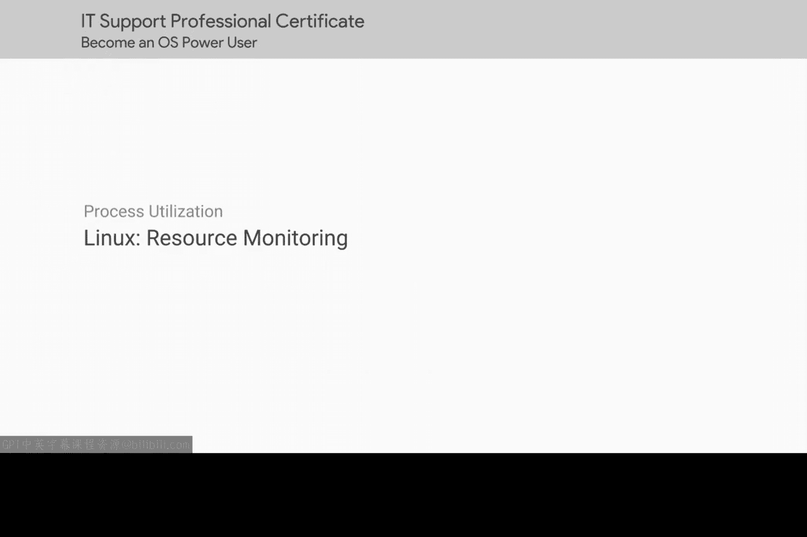
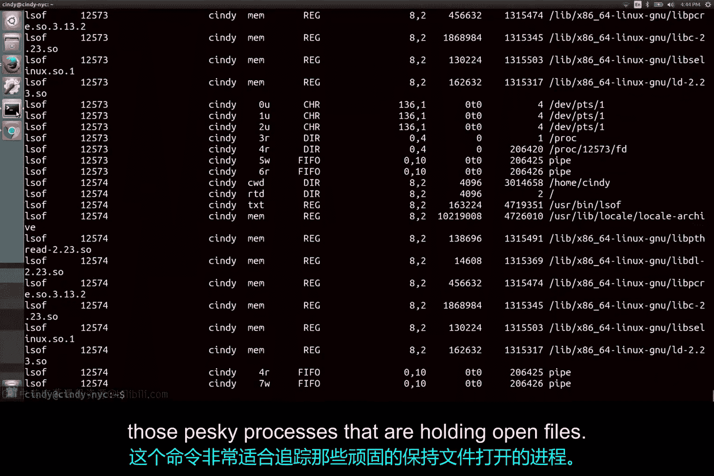

# 谷歌《IT支持（计算机网络⧸操作系统，第2、3课⧸共5课）｜Google IT Support》中英字幕deepseek p187 93_Linux资源监控.zh_en -BV1uyqcYpExr_p187-

A useful command to find out what your system utilization looks like in real time is the top command。

Top shows us the top processes that are using the most resources on our machine。

 We also get a quick snapshot of total tasks running or idle。CPU usage， memory usage， and more。

One of the most common places to check when using the top command are these fields here。

Percentage CPU and percentage mem。 This shows what CPU and memory usage a single task is taking up。

To get out of the top command， just hit the Q key for quit。

A common situation you might encounter is when a user's computer is running a little slow。

It could be for lots of reasons， but one of the most common ones is the overuse of hardware resources。

If you find that a top shows you a certain task is taking up a lot of memory or CPU。

 you should investigate what the process is doing。You might even terminate the process so that it gives back the resources it was using。

Another useful tool for resource utilization is the Uptime command。

This command shows information about the current time， how long your system's been running。

 how many users are logged on， and what the load average of your machine is。

From here we can see the current time is 1643 or 443。

Our system has been up for five hours and eight minutes， and we have one user logged in。

The part that we want to talk about here is the system load average。

 This shows the average CPU load in one，5 and 15 minute intervals。

Lad averages are an interesting metric to read。They become super useful when you need to see how your machine is doing over a certain period of time。

We won't get into load averages here， but you should read about them in the next supplemental reading。

Another command that you can use to help manage processes is the LSOF command。

Let's say you have a USB drive connected to your machine。

 You're working with some of the files on the machine。 Then when you go to eject the USB drive。

 you get an error saying device or resource busy。You've already checked that none of the files on the USB Drive are in use or opened anywhere。

Or so you think。Using the LSOF command， you don't have to wonder。

 it lists open files and what processes are using them。

This command is great for tracking down those pesky processes that are holding open files。

One last thing to call out about hardware utilization is that you can monitor it separately from processes。

If you just wanted to see how your CPU or memory was doing。

 you could use various commands to check their output。

This isn't immediately useful to see on a single machine， but maybe in the future。

 if you manage a fleet of machines， you might want to think about monitoring the hardware utilization for all of your machines at once。

We won't discuss how to do this， but you can read more about it in the supplemental reading。

You've done some really great work in this module。You learned a lot about how to read process information and manage processes。

Something that will be vital for you to know when troubleshooting issues as an IT support specialist。

The next assessments will test you on that new process management knowledge。 Then drum roll， please。

 will be on to the last and final lesson of this course。

 We'll cover some of the essential tools that are used in the role of an I T support specialist。😊。

