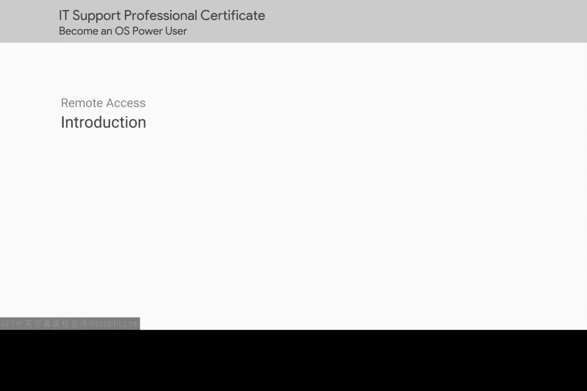

# 谷歌《IT支持（计算机网络⧸操作系统，第2、3课⧸共5课）｜Google IT Support》中英字幕deepseek p188 94_介绍.zh_en -BV1uyqcYpExr_p188-

嗯。You've made it all the way to the last module of this course great job so far you've learned how to navigate both the Windows and Linux operating systems。

 how to set up and manage users along with how to manage software。

You also learned how to work with disks and file systems on top of working with processes and hardware resources that's some seriously great work。

The skills you learn in this course are essential for building a solid technical foundation as an IT support specialist。

Now let's finish strong in the next few lessons we're going to wrap up the course with some of the more practical aspects of operating systems that you'll use all the time in IT support。

Let's get started。