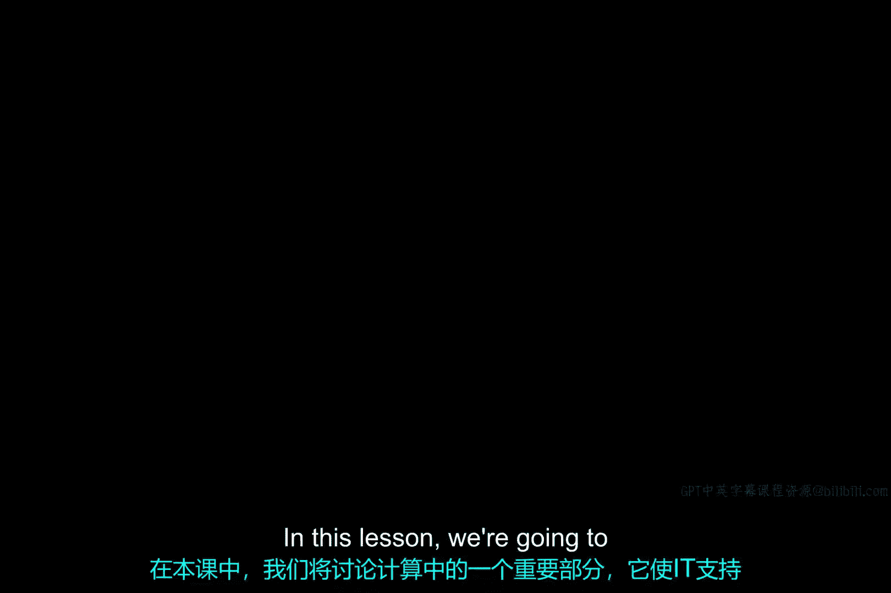
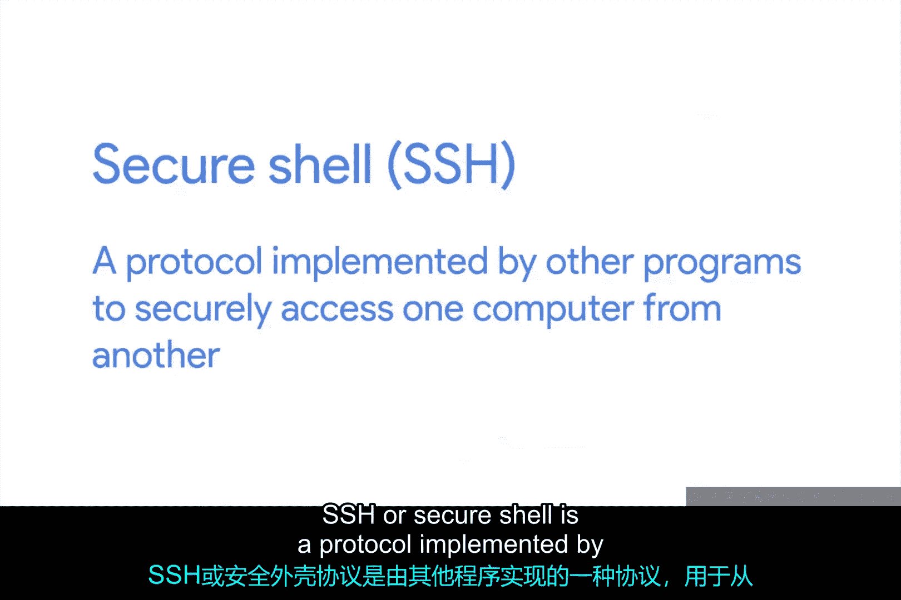
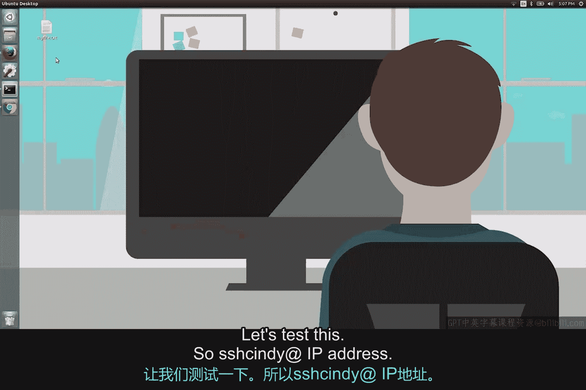
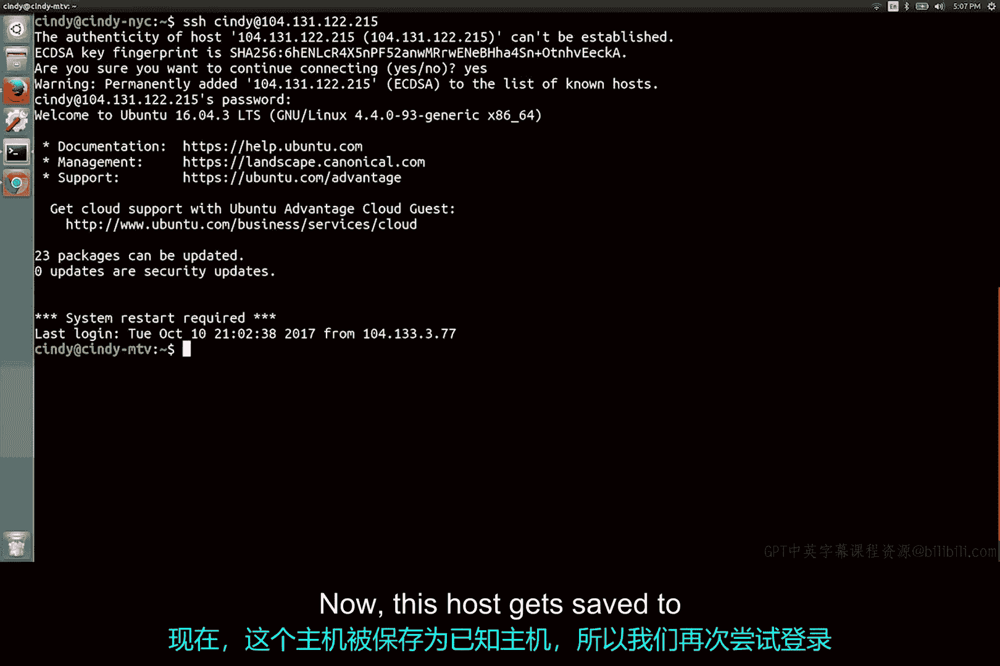
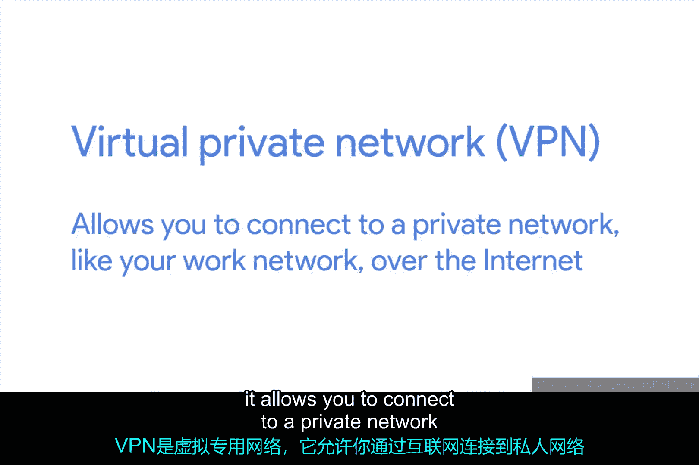

# 谷歌《IT支持（计算机网络⧸操作系统，第2、3课⧸共5课）｜Google IT Support》中英字幕deepseek p189 95_远程连接与SSH.zh_en -BV1uyqcYpExr_p189-

In this lesson， we're going to talk about an important part of computing that makes working in IT support a little easier。

Actually， it makes things a lot easier for just about anyone。Picture this。

 you're on your way to an important meeting， you've been rehearsing for this presentation all week and now you're ready to show the big wigs what you got。

😊，But wait， the slide deck， where is it that' notob on your laptop， where could it be？

It turns out you forgot your only copy on your desktop at home。

It's too late now to turn around and get it， so you sit there dreading the inevitable。

But wait a minute， suddenly you remember that you have a remote connection set up from your laptop to your desktop。

You use this connection to log into your computer at home。And just as if you are sitting at home。

 you're able to grab the file from your desktop and copy it to your laptop。

You then proceed to give one amazing presentation。Consider another scenario。

 you bought a computer at a store and you're having a lot of issues with it。

The store has a computer help desk that can help you with the issues。

 but it's after hours and the stores closed。You really need to get your computer issue fixed。

 so what are your options？Fortunately， the store provides 24/7 tech support online。Now。

 instead of waiting until a physical store is open again。

 you can reach a tech online and have them help you with your issue through a remote connection。

Remote connection makes working in an IT support role much easier since it allows us to manage multiple machines from anywhere in the world。

In this lesson we're going to learn about remote connection SSH or securecure Shell is a protocol implemented by other programs to securely access one computer from another to use SSH。

 you need to have an SSH client installed on the computer you're connecting from。

 along with an SSH server on the computer you're trying to connect to。

Keep in mind that when we say SSH Ser， we don't mean another physical machine that serves a data。

An SH server is just software。 On the remote machine。

 the SSH server is running as a background process。

It constantly checks of a clients trying to connect to it， then will authenticate its request。

The most popular program to use SSH with in Linux is the Open SSH program we'll talk about how to use SSH from a Windows machine using the popular open source program putty。

For now， let's just talk about what happens when you use SSH。

We're going to show you an example of SSching into a remote machine， so first things first。

 to log into a remote machine， we have to have an account on that computer。

We also need the host name or IP address of that computer。

Let's test this。So SSH， Cindy。At。IP address。We get this message， the authenticity of host。

 and then the I P address can't be established。 This message is just saying we've never connected to this machine before。

 And our SS SH client can't really verify we're connecting to a machine we want to connect to。

But we can verify this is the right machine， so let's just go ahead and type yes。

Now， this host gets saved to the computer as a known host。

 so we won't get this message again when we try to log into it。Okay。

 now that we're connected through SSH， any of the text commands that we type are sent securely to the SSH server from here。

 you can even launch an application that'll let you see a GuI instead of working directly in the shell you can read more about how to do that in the supplemental reading。

We can connect to SSH using passwords as you saw earlier。

This way of authenticating to a remote machine is pretty standard， but it's not super secure。

The alternative is using an SSH authentication key。

SSH keys come in a set of two keys called private and public keys。

You can think of them as actual physical keys to a special safe。You can use one key to lock the safe。

 but it won't unlock it。The other key can then only unlock the safe but not lock it。

That's basically how public and private keys work， you can lock something with a public key。

 but you can only unlock it with a private key and vice versa。

This ensures that whatever is in the safe is available to only those with the public and private keys。

You'll learn about the technical details of public and private keys in our IT security course don't worry if this doesn't make sense right now。

 it will。And that's basically how SSH works， not too scary， right？

Another way that you can connect securely to a remote machine is through VPN。

 A VPN is a virtual private network， It allows you to connect to a private network like your work network over the internet。

Think of it as a more sophisticated SSH with a lot more setup。

It allows you to access resources like shared file servers and network devices。

 as if you are connected to your work network。Spoil alert will also touch upon the technical details behind VPN and the IT security course。

 We've covered a lot about remote connections and how they work。

 We'll talk more about the popular remote connection programs for Windows and Linux and how to set them up in the system administration course。

