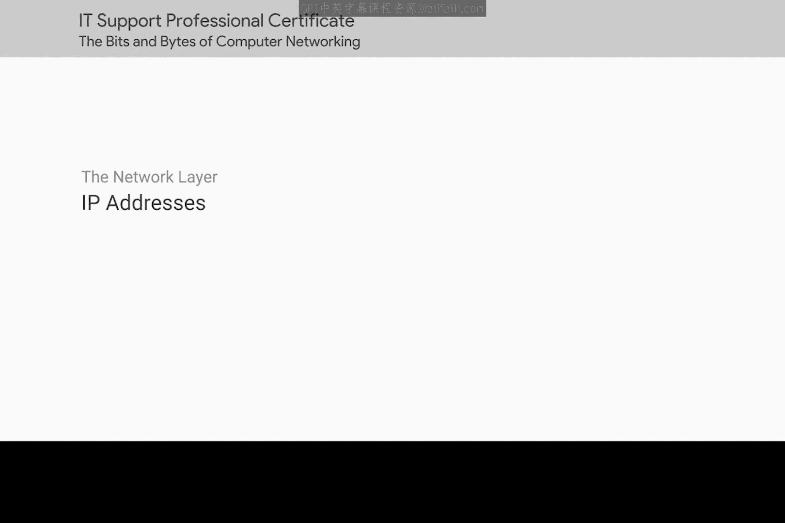
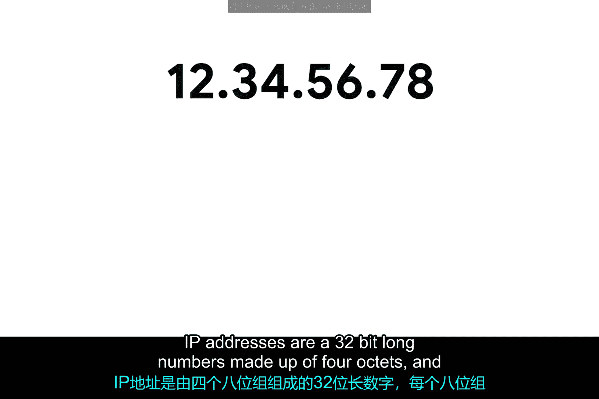
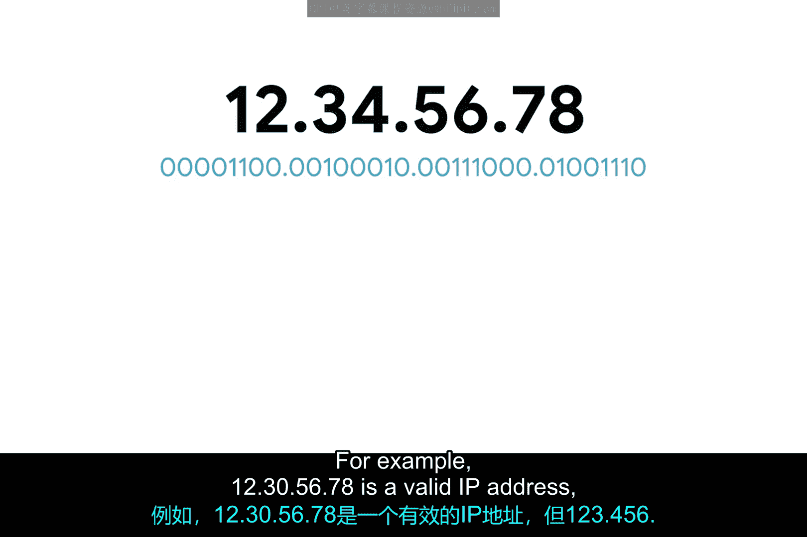
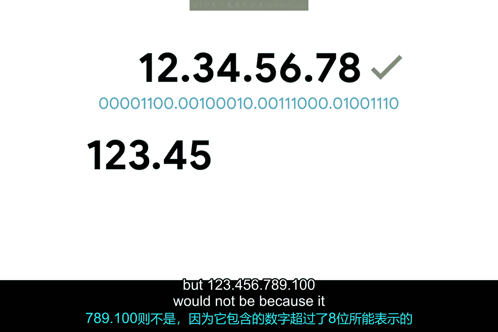
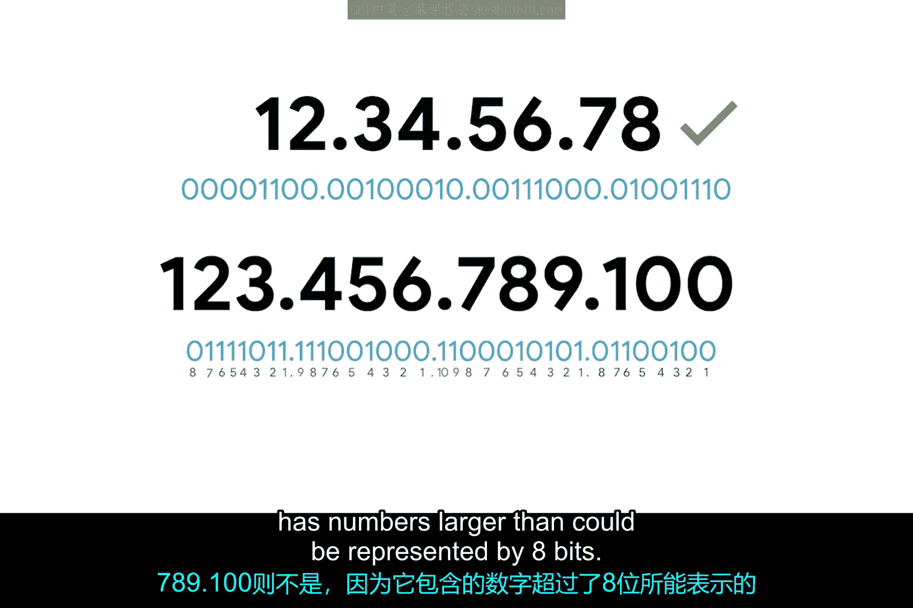
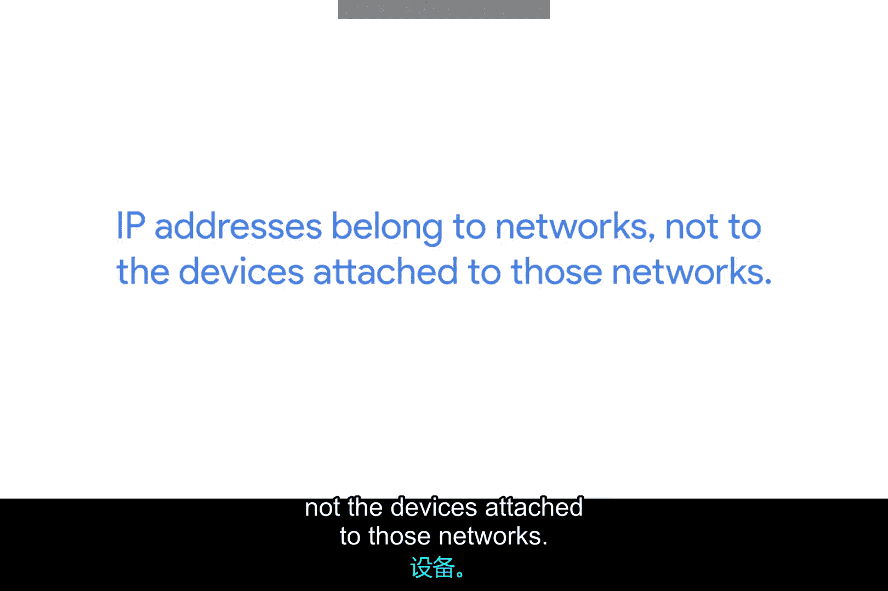
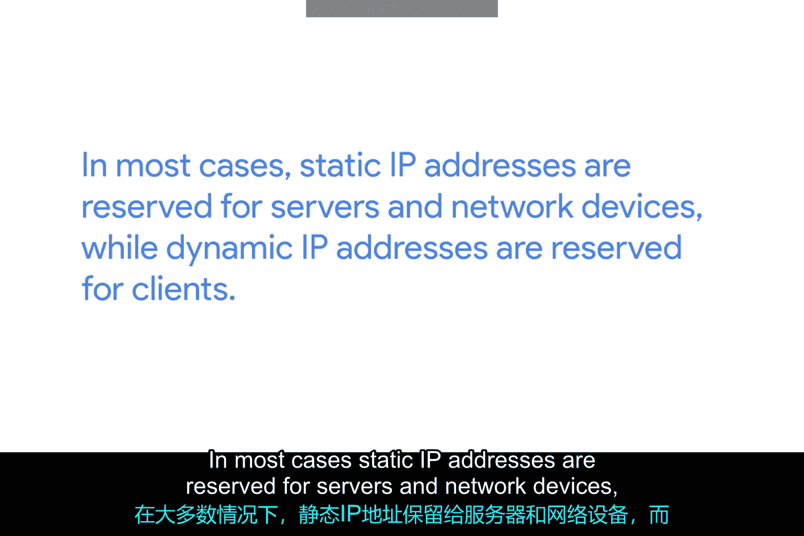
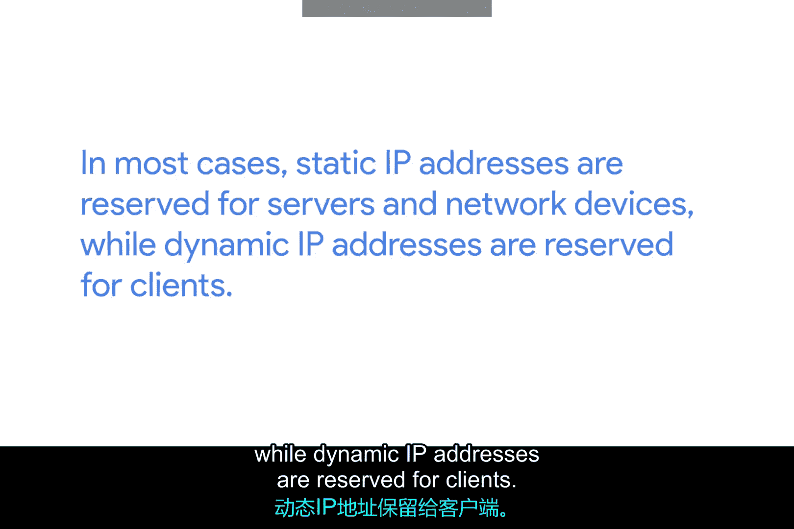

# 谷歌《IT支持（计算机网络⧸操作系统，第2、3课⧸共5课）｜Google IT Support》中英字幕deepseek p19 17_IP地址.zh_en -BV1uyqcYpExr_p19-

IP addresses are 32 bit long numbers made up of fouroctets and eachoctet is normally described in decimal numbers。

Eight bits of data or a singleoct can represent all decimal numbers from 0 to 255。For example， 12。34。

56。78 is a valid IP address， but 123。456。789。100 would not be because it has numbers larger than could be represented by 8 bits This format is known as dotted decimal notation。

We'll deep dive into how some of this works in an upcoming lesson about subneting。

The important thing to know for now is that IP addresses are distributed in large sections to various organizations and companies instead of being determined by hardware vendors。

 this means that IP addresses are more hierarchical and easier to store data about than physical addresses are。

Think of IBM， which owns every single IP that has the number nine as the first DocT at a very high level。

 this means that if an internet router needs to figure out where to send a data packet intended for the IP address 9。

0。0。1， that router only has to know to get it to one of IBM's routers。

That router can handle the rest of the delivery process from there。

It's important to call out that IP addresses belong to the networks。

 not the devices attached to those networks， so your laptop will always have the same Mac address no matter where you use it。

 but it'll have a different IP address assigned to it at an Internet cafe than it would when you're at home。

The land at the Internet cafe or the land at your house would each be individually responsible for handing out an IP address to your laptop if you power it on there。

On a day to day basis， getting an IP address is usually a pretty invisible process。

You'll learn more about some of the technologies that play in a later lesson For now。

 remember that on many modern networks you can connect a new device and an IP address will be assigned to it automatically through a technology known as dynamic host configuration protocol an IP address assigned this way is known as a dynamic IP address。

 The opposite of this is known as a static IP address， which must be configured on a node manually。

In most cases， static IP addresses are reserved for servers and network devices。

 while dynamic IP addresses are reserved for clients。

But there are certainly situations where this might not be true。

