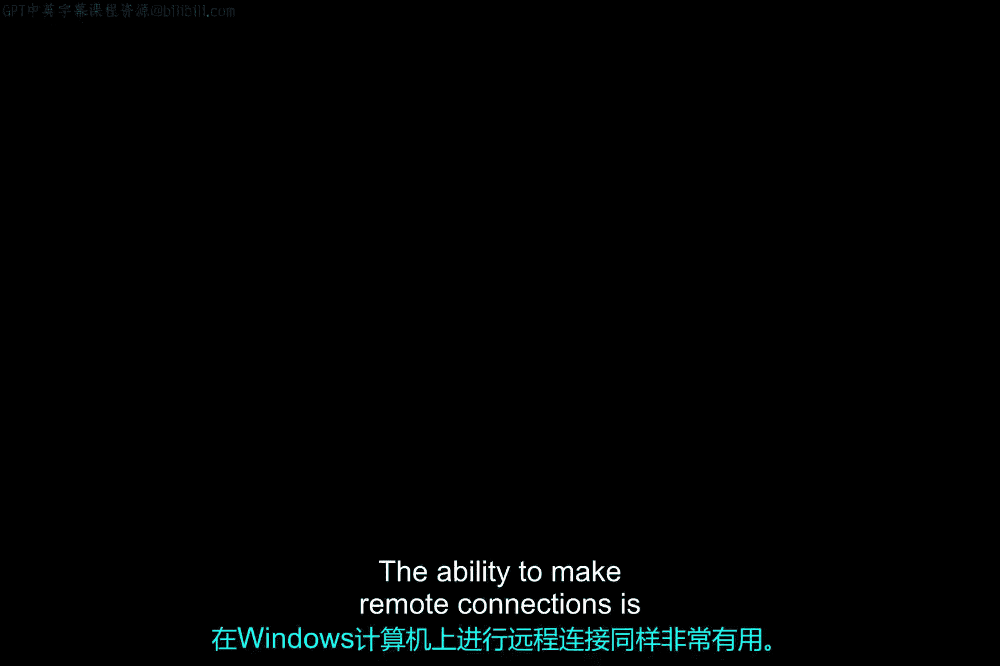
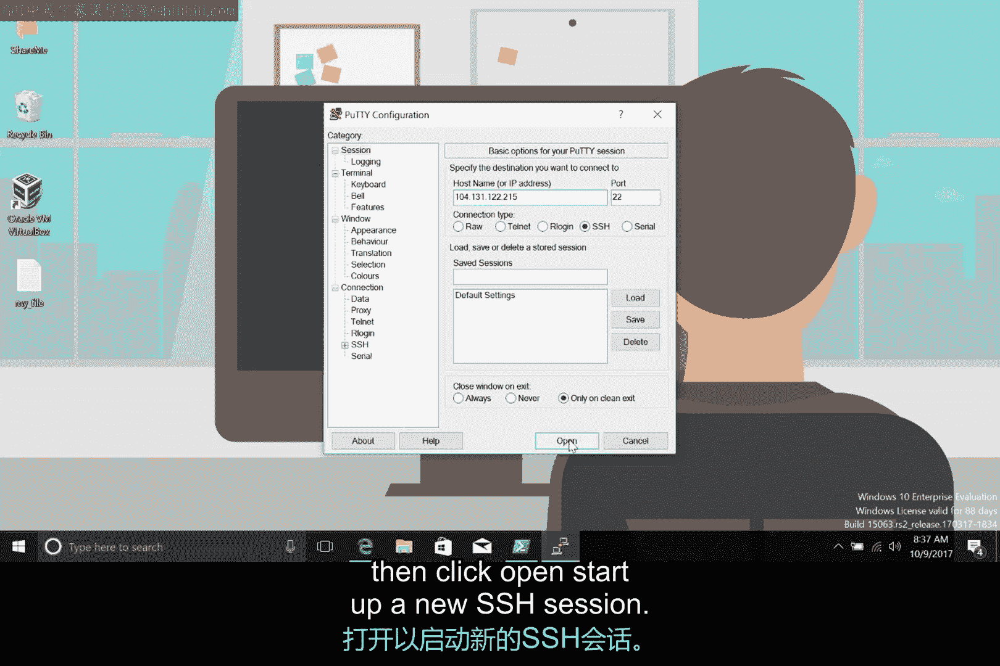
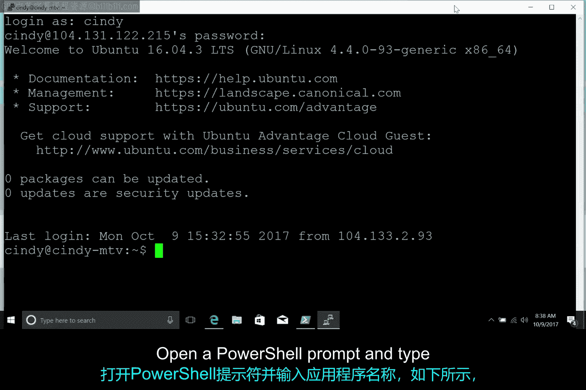
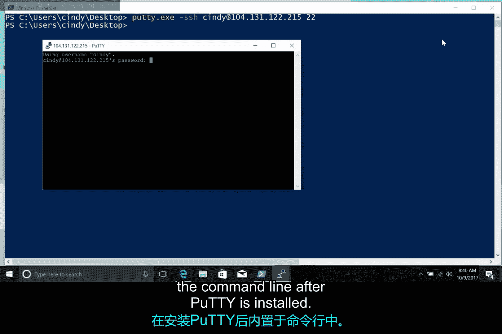
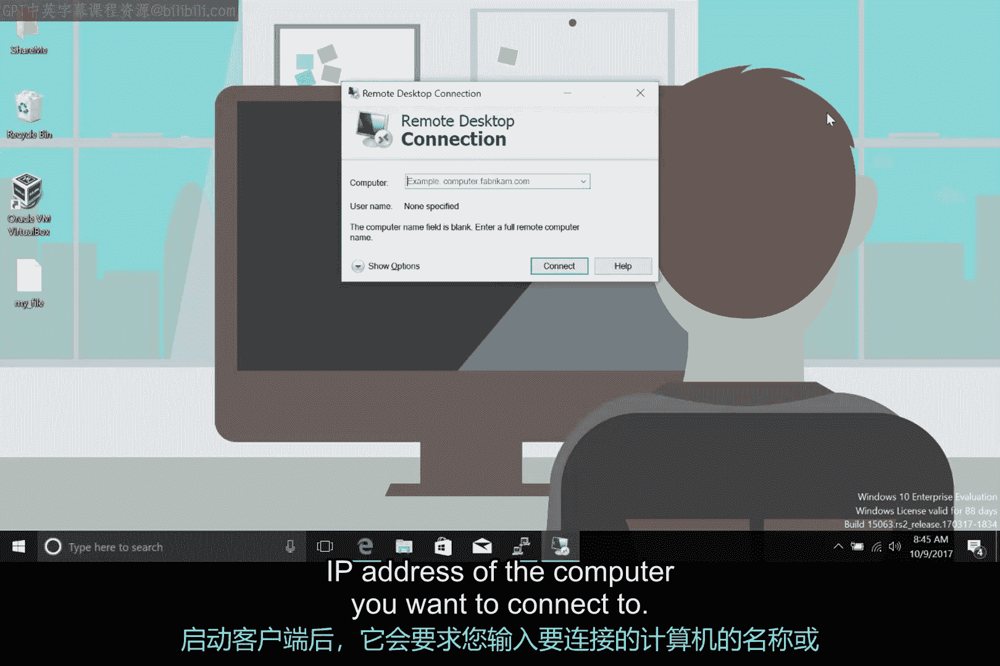

# 谷歌《IT支持（计算机网络⧸操作系统，第2、3课⧸共5课）｜Google IT Support》中英字幕deepseek p190 96_Windows上的远程连接.zh_en -BV1uyqcYpExr_p190-

The ability to make remote connections is equally useful on Windows computers。

 Putty is a free open source software that you can use to make remote connections through several network protocols。

 including SSH。😊。

You can visit the putty website to download the entire software package with a Microsoft installer。

 Those are the MSI files we talked about earlier。Or you can choose a specific executable which provides the functionality you're after。

 like putty。ex。The Puty downloadloads page is linked in the next supplemental reading in case you want to check it out。

Once you've downloaded an installed Puty， you can use it by launching the GuI。

A window will appear showing you the basic options for your connection。Make a note of the host name。

 port， and connection type options。By default， the port is set to 22。

 which is the default port the SSH protocol uses and the connection type is set to SSH All you need to do is type in the host name or IP address of the computer you want to connect to。

Then click Open to start up a new SSH session。

And now I've SSHd into a remote computer。Running putty from the GoI isn't your only option。

You can also use it on the command line。Open a Powerhell prompt and type out the application name like this。

Then tell it you want to connect via SSH by adding the dash SSH option。

You can also provide the user and address in the form of user@ IP address。

And specifying the port at the end， altogether， the command would look something like this。

Pudty also comes with a tool called Planlink or Putty Link。

 which is built into the command line after putty is installed。

You can use Planck to make remote SSH connections too。SSH can be super useful。

 especially if you want to connect from a computer running Windows to a Linux based operating system running remotely Microsoft actually provides another way to connect to other Windows computers called the Re desktop Pro or RDP There are also RDP clients for Linux and OS102 like Real VNC and Microsoft RDP on Mac we'll add some links to these clients in the supplemental Read。

RDP provides users with a graphical user interface to remote computers。

 provided the remote computer has enabled incoming RDP connections。

A client program called the Microsoft Terminal Services Client， or mtsc。

exc is used to create RP connections to remote computers。

You can enable remote connections on your computer by opening up the start menu。

 right clicking on this PC， then selecting properties。From there， select remoteote settings。

And then pick an option from the remote desktop portion of the panel。

 There are some security implications that come with allowing people to remotely connect to your computer。

 You should only let users who you trust， do this。Typically in an industry setting。

 these kinds of settings are usually set by the system administrator for the company's computers that connect to the network once you have allowed connections on the remote computer and provided you're on the list of users allowed to access it。

 you can use the remote desktop Pro client mtsc。 to connect to it from anywhere else on the network。

You can launch the RDP client in a few ways。You can type。

MSTSC at the Runbox or look up remote desktop connections in the start menu。

Once you've launched the client， it'll ask for the name or IP address of the computer you want to connect to The Windows RDP client can also be launched from the command line where you can specify more parameters like slash admin if you want to connect to the remote machine with administrative credentials we've linked to the RDP documentation in the supplementary reading in case you want to learn more。

