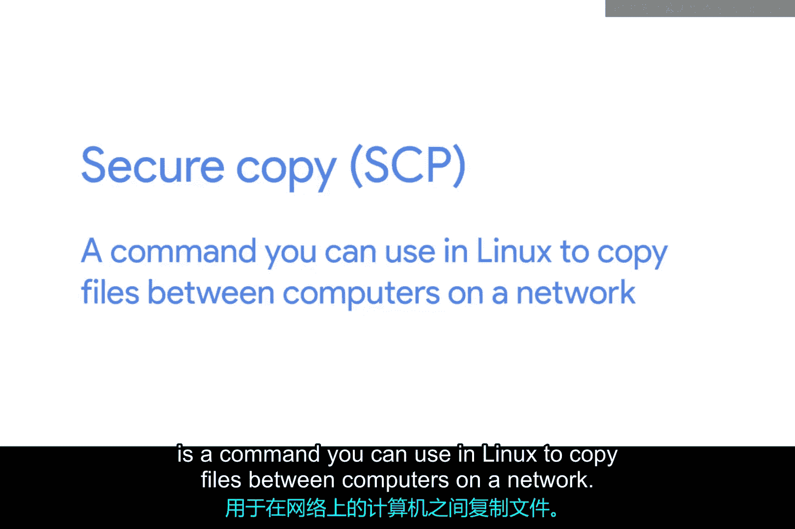
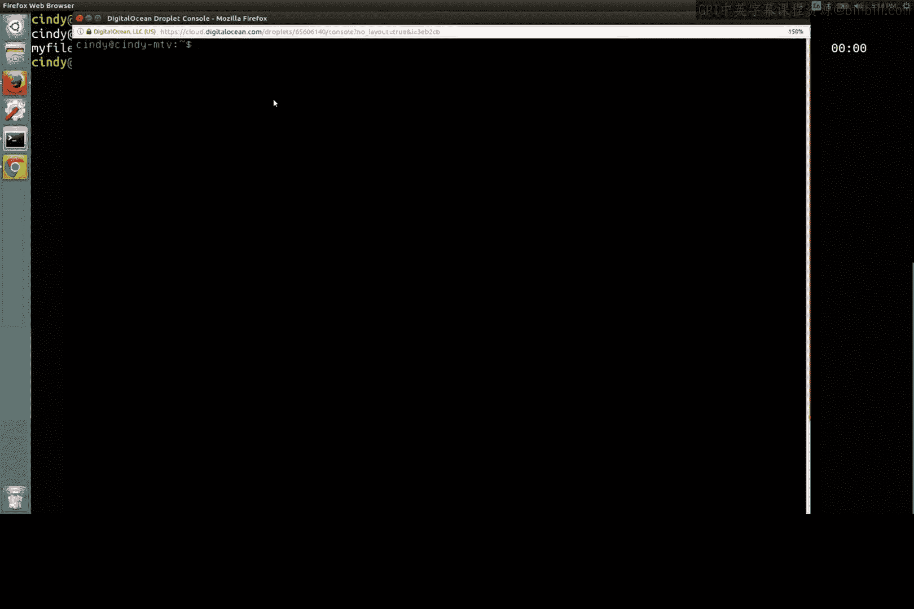

# 谷歌《IT支持（计算机网络⧸操作系统，第2、3课⧸共5课）｜Google IT Support》中英字幕deepseek p191 97_远程连接文件传输.zh_en -BV1uyqcYpExr_p191-

Have you ever tried sending a file over to a coworker， What methods do you use。

 do you attach it to an email and send it， or do you copy the file to a USB drive and then transfer the file that way。

There are lots of ways to transfer files in this lesson we're going to talk about a method that uses remote connection。

SCP or secure copy is a command you can use in Linux to copy files between computers on a network。

It utilizes SSH to transfer the data， so just like you would SSH into a machine。

 you can send a file that way。Let's see this in action。

 let's say we want to copy over a file from our computer to another computer。To do this。

 we can run the SCP command with a few flags。看Cp。Desktop。My file。Over to Cindy。In this command。

 we run the SCP command with the path of the file we want to transfer to the user account， host name。

 and path where we want to copy the file to。Now it prompts us for the login information of the computer we want to send the file to。

After we enter this， we can verify that the file successfully copied over。

There it is。The SCP command is a super useful tool if you need to copy files to and from computers in a network。

You can read more about the command by checking out the Man page。

