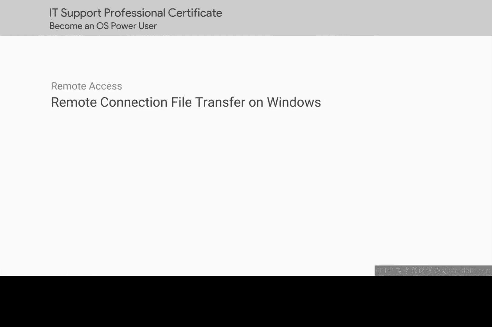
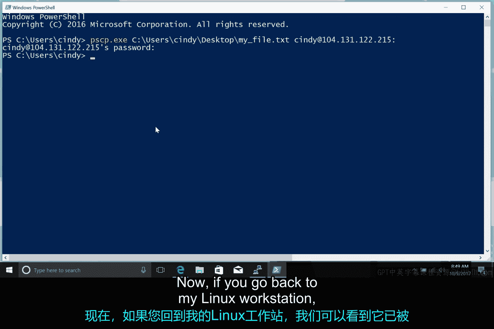
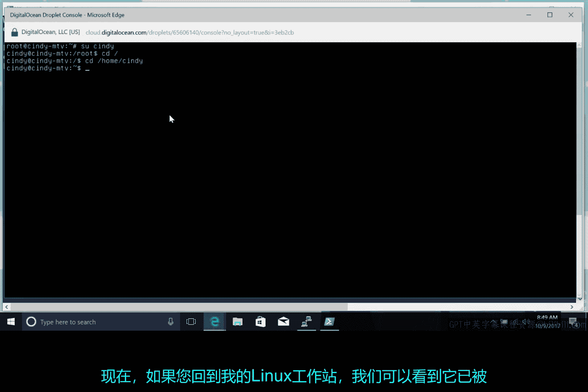
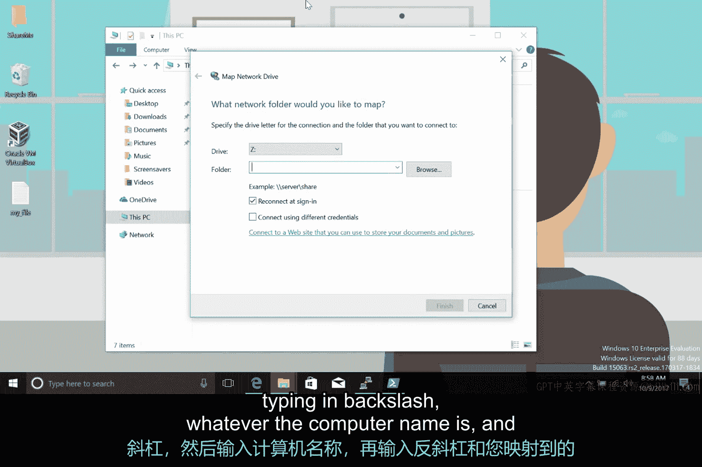
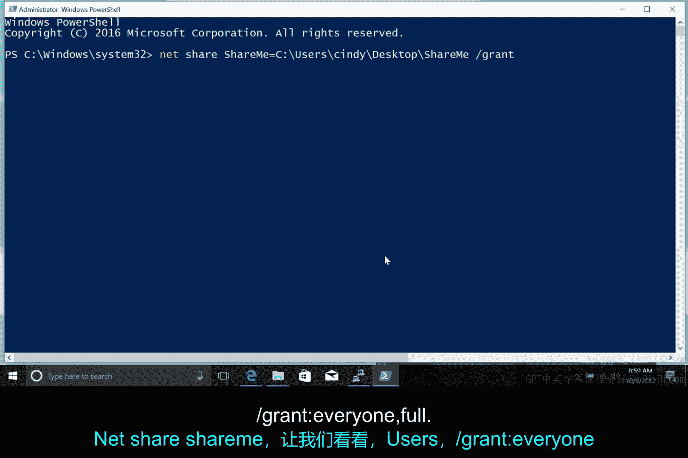
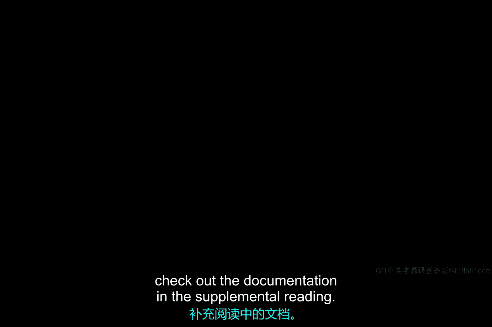

# 谷歌《IT支持（计算机网络⧸操作系统，第2、3课⧸共5课）｜Google IT Support》中英字幕deepseek p192 98_Windows上的远程连接文件传输.zh_en -BV1uyqcYpExr_p192-

How can we share files and data over the network on a Windows computer Well。

 it just so happens that the Puty program we talked about a couple lessons back supports the SCP protocol。

The putty package comes with a tool called the Puty Secu copypy clientient or PSCP。X。

You can use it to copy files in a very similar way to the Linux SCP command。Let's take a look。

PSCP dot E， X。And I'm going to grab a file from my desktop。Then I'm going to copy it。

To my Linux workstation。And then I'm going to add the location of where I want to copy it to。Now。

 if you go back to my Linux workstation。

We can see there was copied。Using Poty or SCP to transfer files can be a little time consuming。

 especially if you need to transfer files to multiple machines。As an alternative。

 Windows came up with a built in mechanism to share files by using the concept of shared folders。

Shared folders do pretty much what you'd expect from their name。

 you tell Windows you want to share a folder or the person or group of people。

 then drop some files into it。Anyone you've shared the folder with can then access those files。

Sharing folders in windows is easy。 Just right click on the folder you want to share。

Then mouse over the share with option。And then pick specific people from here。From here。

 you can add the individual users or groups you want to share the folder with。

There's even an option to add everyone to the sharing permissions， which might be convenient。

 but isn't super secure。Once you've shared the folder。

 you can access it from other computers Start by opening up this PC。Then going into the computer tab。

And from here， you can map the folder directly to your computer with the Ma network Drive option。

Finally， on another computer， you can visit it directly from the Run box by typing in backslash。

 whatever the computer name is， and then backslash the folder name that you mapped it to。

You might be interested to know that you can share folders from the command line too using the Net Share command。

Netshare lets you do the same thing as the GuI Sha workflow。

 and you'll need to specify what kind of permissions you'd like to give which users。

Let's say you wanted to give everyone on your network full permissions to a folder called Shareme。

You could execute this command from an elevated or administrator level PowerShell prompt。Net share。

Share me。Eers。Slash Gr。

Everyone。哦。Users will be able to access the Sha folder by using the same methods we talked about before。

The Net Share command can also be used to list the currently shared folders on your computer by executing it without any arguments。

If you'd like more information on Netshare and its abilities。

 check out the documentation in the supplemental reading。

