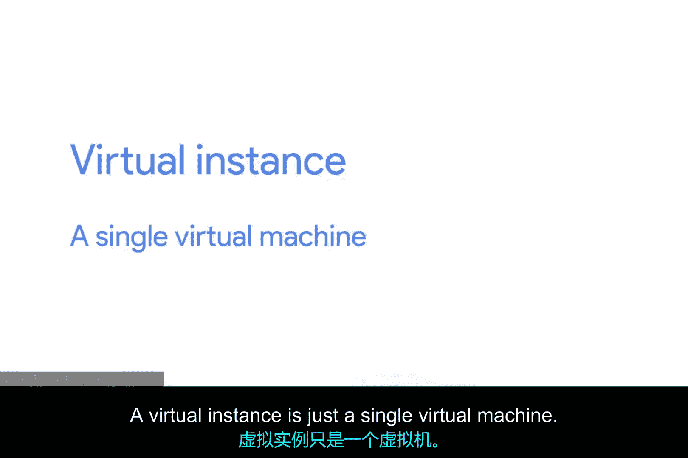
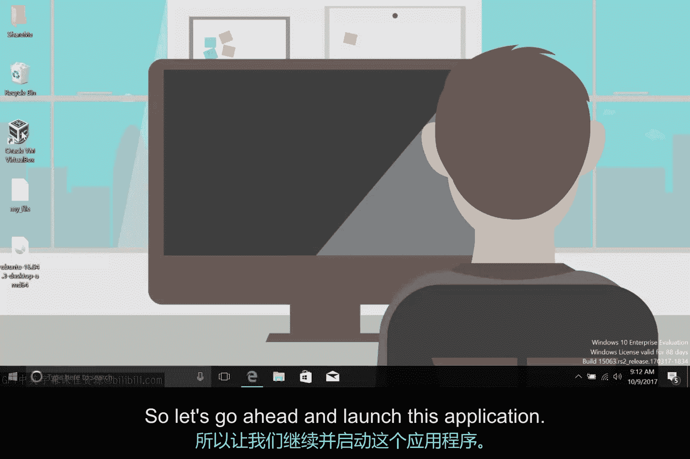
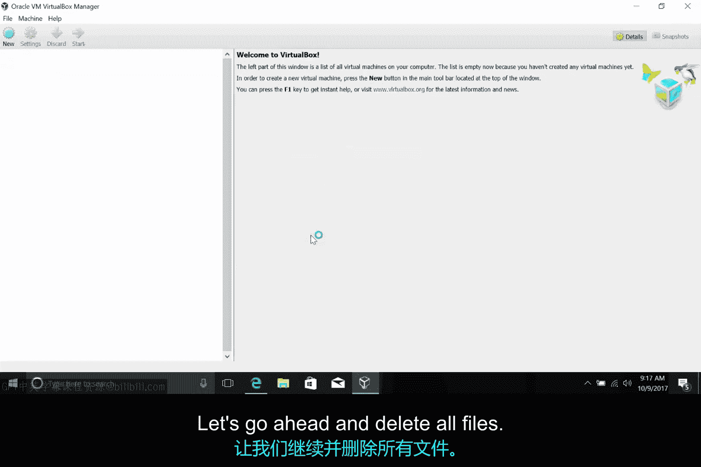

# 谷歌《IT支持（计算机网络⧸操作系统，第2、3课⧸共5课）｜Google IT Support》中英字幕deepseek p193 99_虚拟机.zh_en -BV1uyqcYpExr_p193-

。We've talked a little bit about virtual machines before。

 We've also been using virtual machines throughout the Quickla assessments。In this lesson。

 you're going to learn how to install， manage， and remove a virtual instance。

A virtual instance is just a single virtual machine。

We're going to be using the popular open source virtualization software virtual box to manage virtual instances。

You'll find a link to download virtual box in the reading right after this lesson。

I'm currently using a Windows machine， and in this lesson we're going to set up and virtualize an auntu instance。

I've already installed virtualrtual box of my machine， so let's go ahead and launch this application。

We won't go through all the menu items for virtual box， but we'll talk about some of the main ones。

First up， how do we install a virtual instance？I've already pre downloaded an image of Auntu from their website and saved it onto my desktop。

 but I have to install it somehow。Well to install this。

 I'm just going to click this new button here to create a new VM。I'm going to give my VM a name。

And select the type and version of my OS。I'm just going to stick with the defaults next it asks how much RAM I want to dedicate to this VM。

One gigabytes is more than enough for me， so I'm just going to keep this and then continue。

Now to asks how much hard drive space I want to dedicate to this VM。

I'm just going to keep the default of 10 gigabytes and click Cate。

We're going to keep the default values here and just skip through to the C。Awesome。😊。

You can read more about these options in the supplemental reading。Now in my menu here。

 I can click start。And it'll start the VM。It'll prompt me to select a media to launch from similar to booting a USB drive with the OS image on it。

So I'm just going to select the image I downloaded。And from here， the installationulation starts up。

That's pretty much it。Okay， what if we decide we want to use more than one gigabyte for the OS on a physical machine。

 we'd have to buy more RAM and install it， but since we're using a VM。

 it's as easy as changing a setting。To modify hardware resource allocation to a VM。

 all we need to do is right click on the VM， then click settingsttings。From here。

 we'll be able to change how much RAM we want along with other settings。

We won't discuss the specifics of these settings， but you can see how simple it is to modify a VM instance。

Now， what if we decide we don't want to use this VM anymore？If this was a physical machine。

 we'd have to worry about where to store or recycle the hardware。For virtual machines， though。

 all we need to do is right click and select Remove。From here。

 it asks if we want to remove all files， including the VM install itself。

 or just remove it from the list of VMs。Let's go ahead and delete all files。

And that's it in a nutshell， super simple。If you want to learn more about how to use Vir B or other virtualization software。

 don't forget to check out the supplemental reading。

