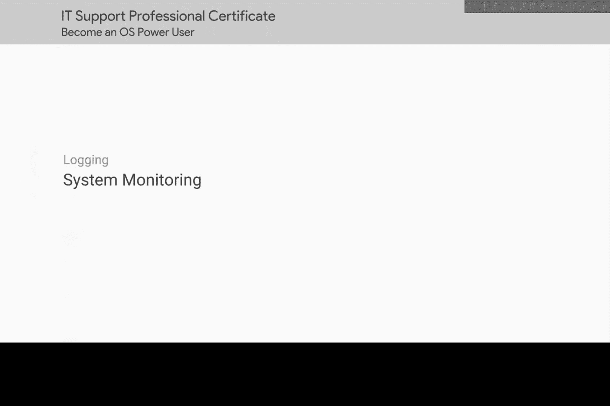
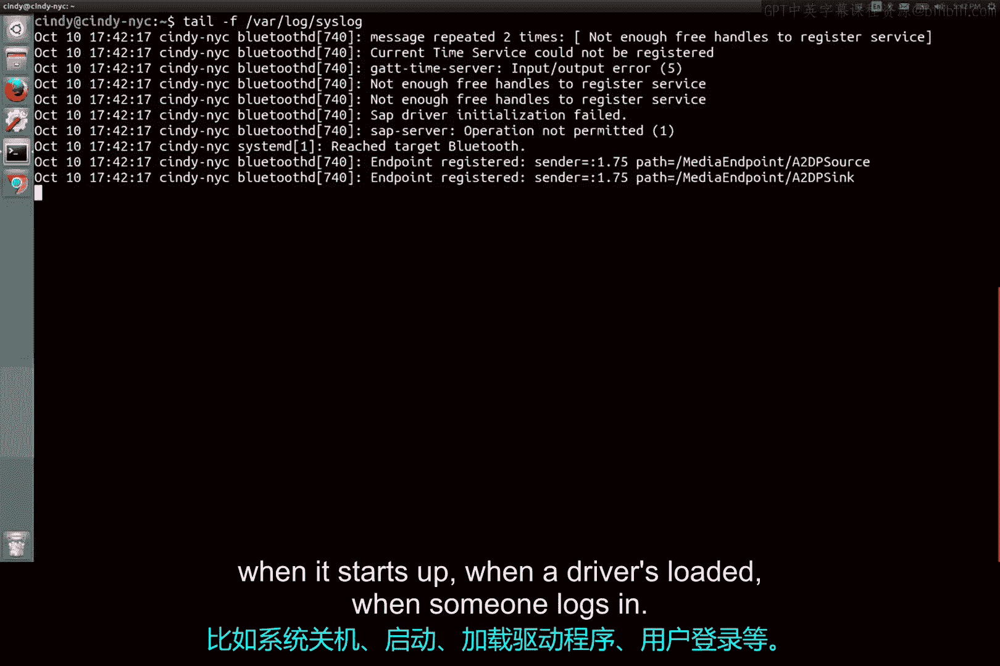
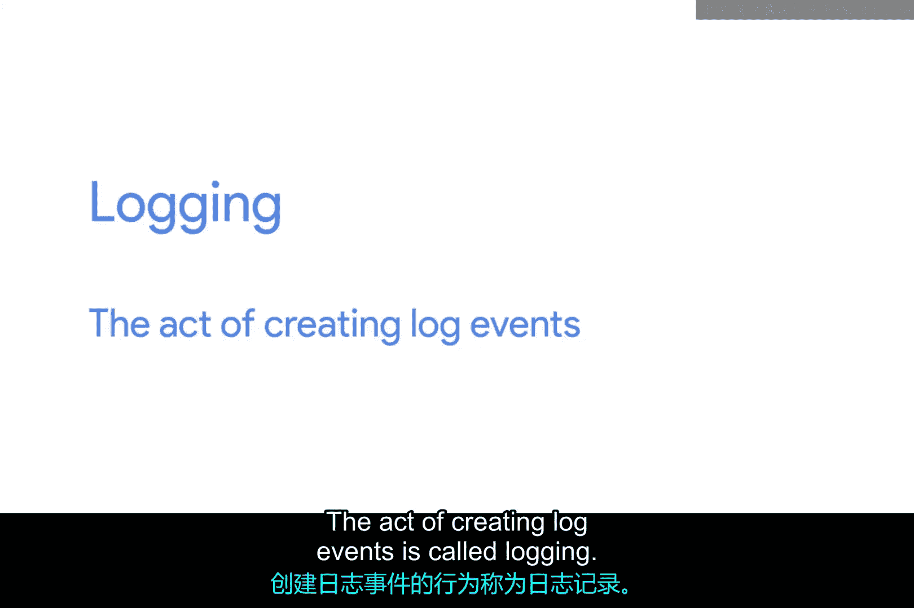

# 谷歌《IT支持（计算机网络⧸操作系统，第2、3课⧸共5课）｜Google IT Support》中英字幕deepseek p194 100_系统监控.zh_en -BV1uyqcYpExr_p194-

。Remember from the first course in our program， technicalnical Support Fundals that we introduced the concept of logs。

A log is like your computer's diary， it records events that happen on your system。

What kind of events？Well， pretty much everything， like when your system shuts down。

 when it starts up， when a driver is loaded， when someone logs in。

 all of these things can be written to a log。

It's also written with a lot of detail。 Los tell you the exact time that an event occurred。

 Who caused the event and more。We'll be looking into some sample log snippets and the upcoming lessons to get a better sense of how to read one。

 the act of creating log events is called logging。 Your system does a pretty good job of logging events right out of the box。

In most systems， there is a service that runs in the background and constantly writes events to logs。

These systems are customizable so you can log any specific field you want， but by default。

 it logs all the essentials。By the end of this lesson。

 you'll learn where all the important logs are kept on the Windows and Linux OSs。

You'll also learn how to read a log and utilize common troubleshooting practices when it comes to logs。

When you're working in IT support， you'll need to gather as much data as you can to troubleshoot an issue。

Lloggs tell us important things like errors that occurred， changes that were made， etc。

They are a reliable source of information。