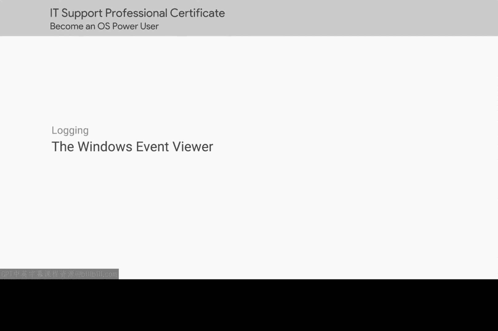
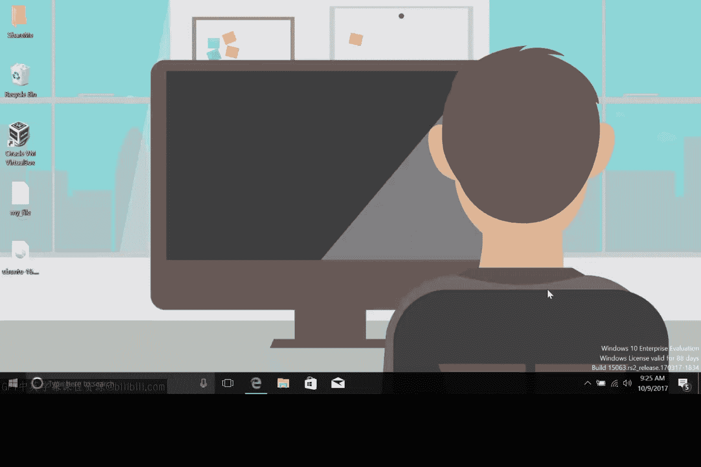
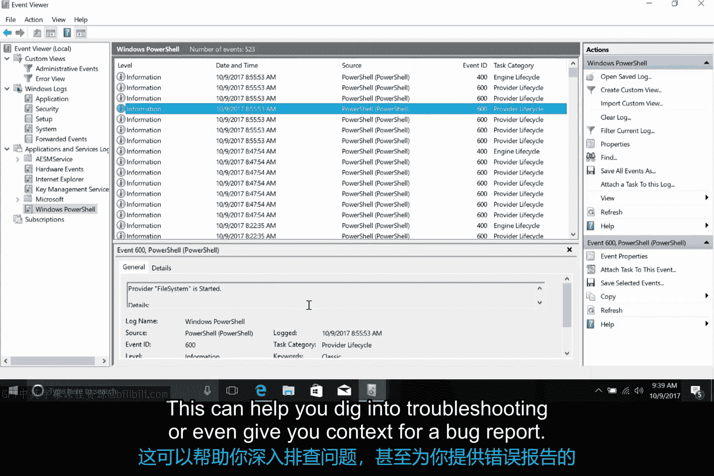

# 谷歌《IT支持（计算机网络⧸操作系统，第2、3课⧸共5课）｜Google IT Support》中英字幕deepseek p195 101_Windows事件查看器.zh_en -BV1uyqcYpExr_p195-

Similar to how we can jot down our life events in a journal， events are also logged on our machines。

And Windows， the events logged by the operating system are stored in an application called the event viewer。

 Whether you're trying to figure out why a computer game keeps crashing or troubleshooting login or access problems。

 or just satisfying your curiosity about what's going on in your system。

 The event viewer is a great first stop。Let's take a look at some of the information it collects and how you can use the event viewer to get answers you're looking for。

You can launch the event viewer either from the start menu or by typing in eventvwr。

msc from the Run box。

The default view the event viewer shows is a summary of potentially important recent events。

 in our case， this isn't super interesting since we're more concerned with any issues that occurred。

Instead， let's take a look at the left hand pane where we can see a few different event groupings。

The first group we see is called custom Views。The event viewer records a lot of information about the system。

 so it can sometimes be a little difficult to tease out the signal like recent events from the noise or the stuff you don't care about。

This is where the concept of custom views comes in handy。With a custom view。

 you can create a filter that will look across all the event logs the event viewer knows about and tease out just the information you're interested in。

Let's say we wanted to only see events of error， severity or hire that were logged in the last hour to do this。

 click on the C custom View option in right hand actions pane。This will bring up a tab called Fter。

From there， click the error and Cri check boxeses。We're going to change the Logged drop down menu to the last hour。

And the event logs we're going to select are just the Windows logs。Then click OK。

Then we're going to give our view a new name。Click OK once more。Once you're done。

 you'll see a new view come up under custom menus or only the events that match your filter are displayed。

The other two categories of logs you'll see in the left hand navigation page are Windows logs and application and services。

The Windows logs categories contain event logs that are generally applied to the whole operating system。

Let's say you're having an issue with a driver failing during startup。

The law called System would be a good place to start。

If you want to see who's been accessing the computer， then you begin investigating the security log。

The other category is called applications and services logs。

 This category contains logs that track events from a single application or operating system component instead of the system wide events of the Windows logs category。

 For example， if you are having trouble with Powerhell and wanting to get more information about it。

 checking out the Powerhell log under applications and services log would be a great first step。

Regardless of its category， each line in a given log in the event viewer represents an event。

Each event contains information grouped in columns about the event， like the logging level。

Information is the lowest level and critical is the highest。

You can also find the date and time the event occurred。

Selecting an event will bring up more detailed information in the bottom pane of the event viewer。

This can help you dig into troubleshooting or even give you context for a bug report。

The Even viewer is a super helpful tool for IT support specialists。

 it can provide you with a lot of really detailed information about the problems any software or hardware might be experiencing on your system。

😊，There's a lot of information in there though， so don't forget about its custom views and filtering capabilities。

More importantly， don't hesitate to poke around the tool and get used to finding things in its interface。

You'll have fun and you'll learn a lot。Next up， the wild World of Linux logs。

