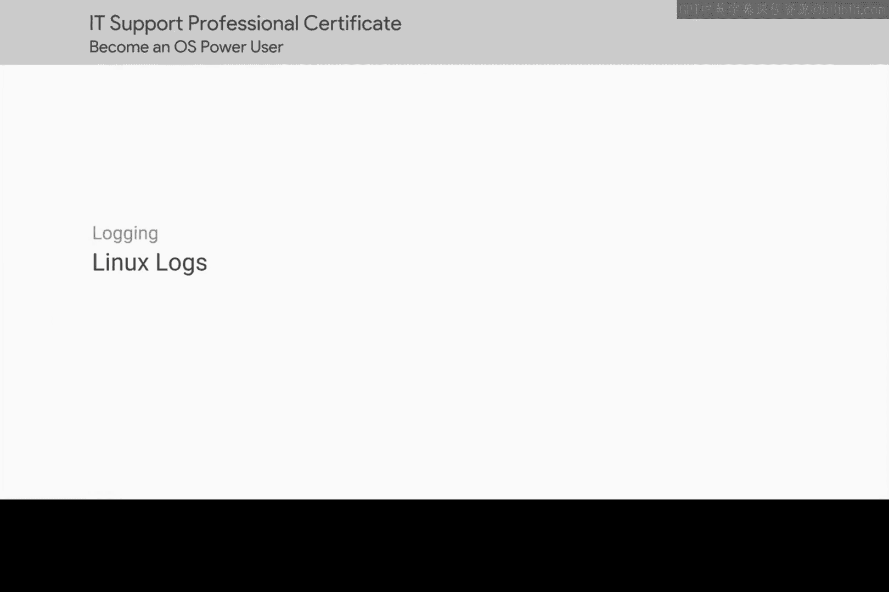
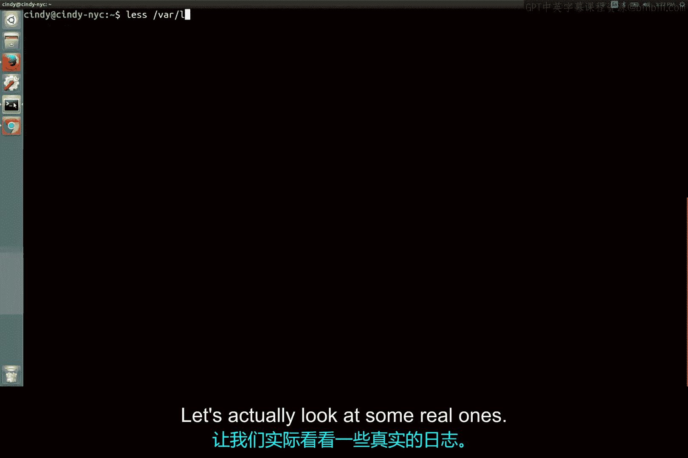

# 谷歌《IT支持（计算机网络⧸操作系统，第2、3课⧸共5课）｜Google IT Support》中英字幕deepseek p196 102_Linux日志.zh_en -BV1uyqcYpExr_p196-

Logs and Linux are stored in the slash bar slash log directory。

 Remember that slash bar directory stands for variable。

 meaning files that constantly change are kept in this directory。

 And it turns out that logs are constantly changing。

If we look at the slash bar s log directory with an LS， it might seem a little intimidating。

Don't worry， each of these log files store specific information that we can figure out by their file names。

Let's check out some of the common ones you'll look at，/var/log/O dotlog。

 authorization and security related events are logged here。

Slash bar slash log s current dot log kernel messages are logged here。

 slash bar slash log slash D messagess。System startup messages are logged here if you encounter an issue at let's say Buddha。

 this is a good place to check for information。It might get a little tiresome to open up each of these log files to find information about eventsLuckily。

 there are also log files that combine the information of other log files。

The downside is that these files are usually very large。

If you have a pretty good idea of where a problem might lie。

 you might want to opt for the smaller and more specific log file。

 The one log file that logs pretty much everything on your system is the slash var s log s cis log file。

The only thing that Cislog doesn't log by default are off events。

When troubleshooting issues with user machines， slash// cis log will usually contain the most comprehensive information about your system。

 so that should be your first stop。Log files output a lot of events， and by that logic。

 they take up a lot of data that has to be stored on our machine somewhere。

We generally just want to see the latest events on our system so we don't need to overload our disk with all this information。

Luckily， our systems also do a good job of cleaning out log files to make room for new ones。

They use something called log rotation to do this in Linux。

 the utility to rotate logs is called log rotate。You might want to investigate an event that happened a month ago。

 so you can change your log rotation settings to make sure not to delete events that are that old。

 We won't discuss how to work with log rotation， but you can read more about it in the supplemental reading。

We've talked about logging in the context of a single machine。

 but if you find yourself managing many systems and want to be able to parse their logs in one central location。

 you can use something called centralized logging。We won't talk about how to do this。

 but if you're interested in setting up a centralized server。

 check out the next supplemental reading Okay， enough talk about what logs are let's actually look at some real ones。

Whoa， this looks super intimidating， but don't worry， we're not going to be reading all of this。

 And the next lesson will teach you how to troubleshoot using logs。 But for now。

 let's just read one line in cis log and parse what it says。

The first field here is the timestamp when the event occurred， pretty straightforward。

But depending on the log， you might see a time format you aren't familiar with。

 like a long string of numbers such as 150-1538594。

Timetamps found in a format like this are referred to as Unix or epoch time。At first。

 you might be baffled by this。 Why would you represent time in this way。

 and just what exactly is the Eunx epoch？The UniX epoch time is used to represent then。

It's the number of seconds since midnight on January 1， 1970。

 a sort of zero hour for Uni Space computers to anchor their concept of time。This means that 150。

153-8594 represents the date time Monday， July 31s。30314 Pacific Standard Time。

Why midnight on January 1st， 1970， is that date the birthday of Euchs or does it mark some other significant event？

The actual answer is much simpler。The original engineers of Euchx at Bell Labs just picked it because it was convenient。

So don't be caught off guard if you see a timestamp like this。

The next field is the host name of the machine the event occurred on。

Next up is the service that the log event is referring to。And last is the event that occurred。

And the next lesson will show you some common troubleshooting tactics when using logs。

