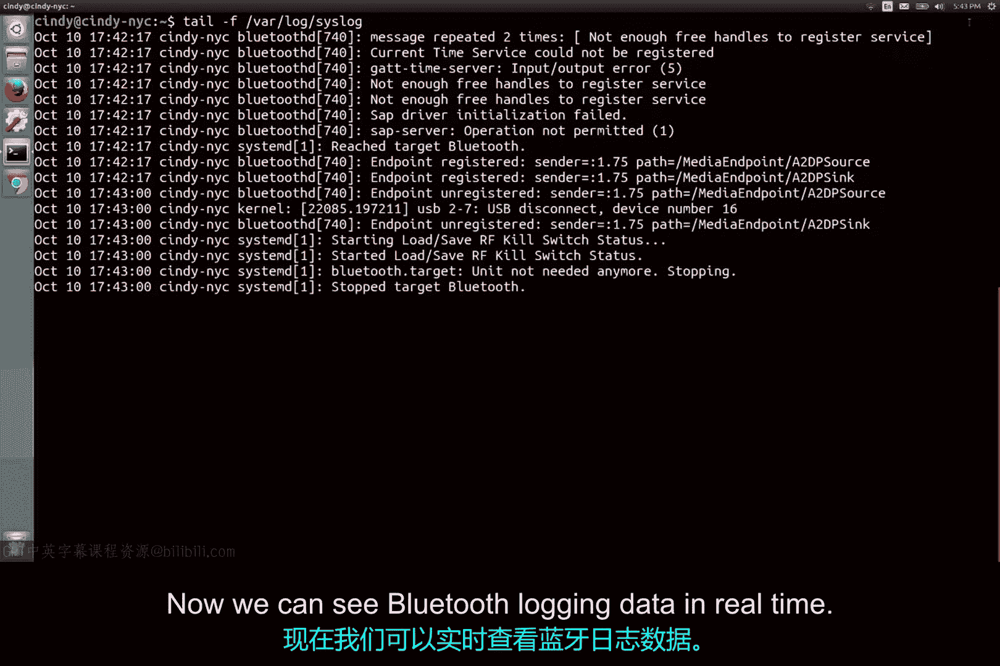

# 谷歌《IT支持（计算机网络⧸操作系统，第2、3课⧸共5课）｜Google IT Support》中英字幕deepseek p197 103_日志工作.zh_en -BV1uyqcYpExr_p197-

Yes， now you've made it to the really fun stuff， let's use the information we learned about logs to actually investigate system issues。

Take the scenario， you're working in an IT support role。

 and one of your users tells you that they leave their computer on all the time。

But they recently woke up to find that the computer had shut down。 What do you do。

Maybe you stay up through the night， keeping a close eye on the computer。

 not taking any breaks to use the restroom or even blink。

You wait and wait and wait until the computer shuts off。Or in a sane and normal world。

 you decide to just look through the system logs。Let's go with that option so where do you begin At first logs can be really messy and daunting to look at we'll talk about the techniques you can use to view logs。

 but rest assured you'll never need to read a log line by line。ふふ。

The first thing you want to do when looking at a log is to search for something specific。

 but what if you're seeing issues with an application and you don't know where to start looking？Well。

 luckily for us， our systems log information in a pretty standard way。

If an application is getting a lot of errors， what do you think you can search for？That's right。

 the word error。What if you're seeing an issue with a specific application。

 what else do you think you can search for？If you guess the application name， you're right。

You've already been able to filter out your logs to look for specific things that you might be seeing。

Let's see this in action。Here we can see the log results that have the word error in them。

If you need to investigate issues that happen around a certain time。

 you can actually do that by checking the timestamps around that time。

You may find the problem that's causing your issue this way。

 or at least get a little closer to figuring out what it is。

When you finally get to a juicy log portion that might help you uncover problems。

 you usually want to start looking at the output from either the top or bottom。

Let's say you're seeing lots of errors。 Each of these errors could be happening because of a root issue。

 If you resolve the root issue， you'll fix the cascading errors。 Take a look at this。

The log is riddled with errors， but if we scroll up。

 we can see the one error that spun up all these others。If we fix that。

 then the other issues will most likely be fixed On the flip side。

 if you aren't seeing any indicators of a problem in a log。

 you might want to work from the bottom until you come across a clue。

Your system could be functioning normally， but when you scroll down to read the output。

 you see a log entry that may be related to your problem。

Another troubleshooting tactic you can use with logs is to check them in real time。

Let's say every time you launch a specific application， it does something abrupt and shuts off。Sure。

 you can check the logs in post and keep track of your time。

 or you can look at the logs in real time。To do this。

 we can use one of the commands we learned in a very early lesson Ta let's take a look at what this means。

 We're going to tail F the sislog file and keep it in an open window。

Then we're going to turn off Bluetooth to show you the events it's logging。

Now we can see Bluetooth logging data in real time。Look at that， we've come full circle。

 I told you those commands would come in handy。Using these simple log tactics will help you throughout your career as an IT support specialist。

You've certainly covered a lot so far。Now you've picked up how to troubleshoot using logs too。

Logs will be one of your best friends when you're faced with a problem machine that leaves no obvious clues。

Talk to the logs and listen to what that sweet sweet log voice is telling you。

 you'll discover the problem in no time。