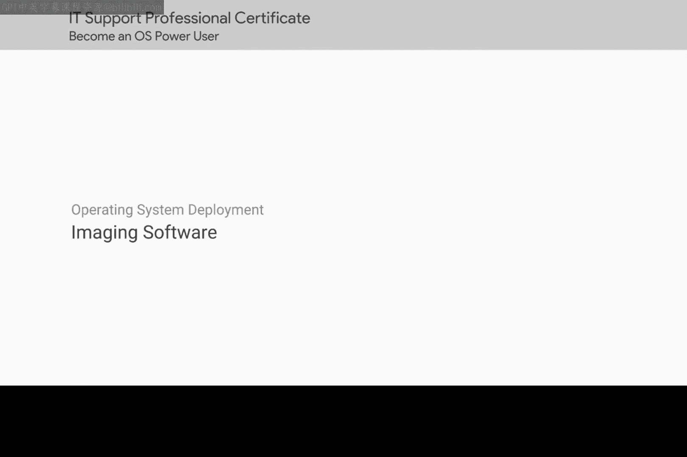

# 谷歌《IT支持（计算机网络⧸操作系统，第2、3课⧸共5课）｜Google IT Support》中英字幕deepseek p198 104_映像软件.zh_en -BV1uyqcYpExr_p198-

We learned how to install an operating system for ourselves。But when you work in an IT support role。

 you have to install operating systems for everyone else。

Installing an operating system with a single USB stick like we did in the very early lessons of this program can get extremely time consuming。

 especially when you need to do it for lots of machines。Fortunately， in the IT world。

 we use fantastic tools to make our jobs easier。Remember that imaging a machine means to format a machine with an image of another machine。

This includes everything from the operating system to the settings in this lesson。

 we're going to briefly touch upon some of the options you can use to image machines and help deploy your operating systems a little easier。

