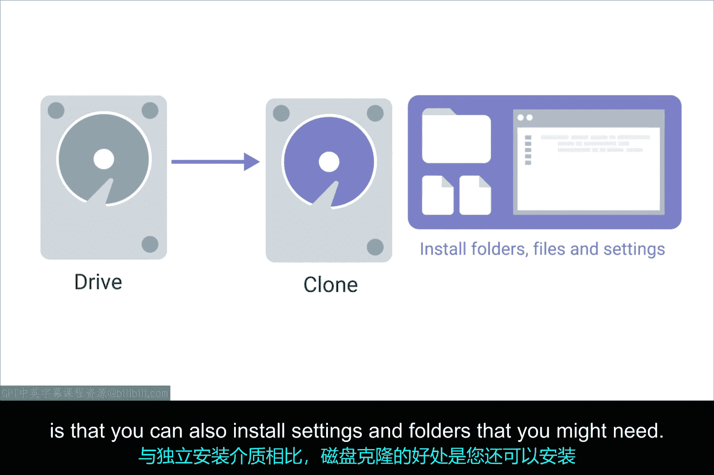
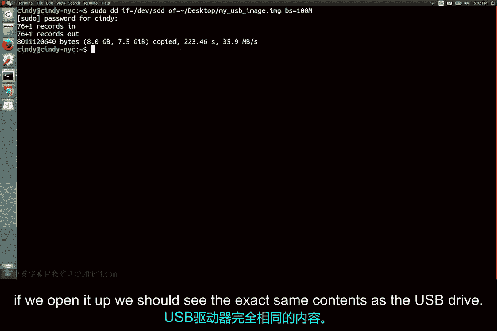
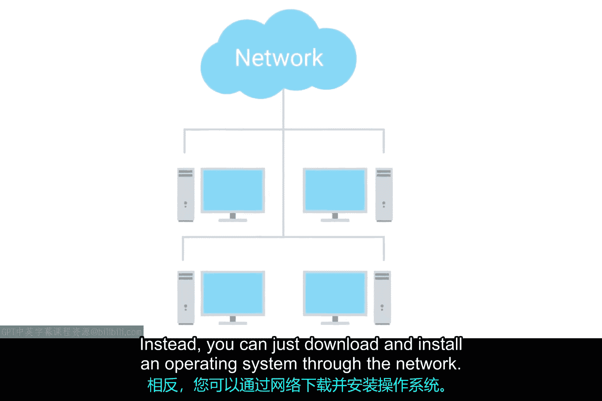
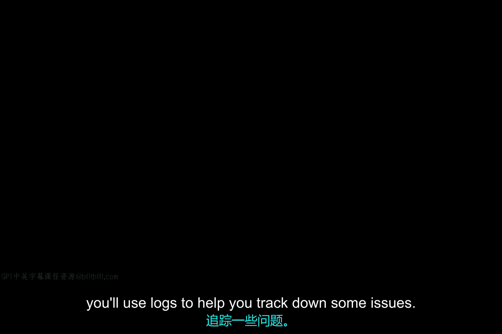

# 谷歌《IT支持（计算机网络⧸操作系统，第2、3课⧸共5课）｜Google IT Support》中英字幕deepseek p199 105_操作系统部署方法.zh_en -BV1uyqcYpExr_p199-

One tool we can use to image computer is a disk cloning tool。

It makes a copy of an entire disc and allows you to back up a current machine or set up a new one。

There are lots of disc cloning tools out there to help you complete this task。

The benefit of disc cloing over a standalone installation media is that you can also install settings and folders that you might need。

One of the many discing tools out there is the open source software at cloneonezililla。

It can be used to back up and restore a single machine or many machines simultaneously。

A popular commercial imaging tool is semantic ghost to read more about other disc cloning software。

 check out the supplemental reading right after this video with disk imaging。

 lots of tools offer different ways you can clone a disk。

 One option is disk to disk cloning where you connect an external hard drive to the machine you want to clone。

You can connect a hard drive like your HDDs and SSDs into something known as an external hard drive dock。

These devices are great IT tools that kind of look like toasters。

Once you connect your external hard drive， you can use any disk cloning tool of your choice。

 We're going to show you a really quick example of how disk cloning works。

 Let's use the Linux command line tool， D D， to copy files。

DD is a lightweight tool that's also used to clone a drive。Again。

 you can use any tools you want to clone your discs， but right now we're just going to use DD。

Let's make a copy of the USB drive I have connected in my laptop， then save it as an image file。

First， we want to make sure we have this drive unmounted。Then we want to run DD。

You don't have to know how D D works to use this command。 Actually。

 you should check out the final supplemental reading to learn more about this tool。

 This just says I'm going to copy the contents of slash dev slash S D D。

 which is the USB drive and save it to the desktop in an image file。

 once the image file is saved if we open it up， we should see the exact same contents as the USB drive。

😊。

You can use D D for larger disks like hard drives， and it'll function the same way。 Pretty cool。

 right？ Another method you can use to image a machine is to request the images directly from the network。

😊，Lots of operating system manufacturers today offer network initiated deployments。

 This means no more smety standalone installation media。Instead。

 you can just download and install an operating system through the network。

If you want to use your own images and not the built in network boot options for your computers。

 there are other options for that too。We don't discuss the specifics of them here。

 but they require a bit of automation to get going。It doesn't matter if it's a laptop， desktop。

 Windows OS， Linux OS， etc， if you're managing the operating system deployment for a company。

 you'll want to keep some aspects of hardware standardization in mind。

Imagine if your company has a different laptop with different drivers that need it to be installed。

 this can get tedious to maintain。It's usually a good idea to try and standardize what type of hardware you use in a company to make your job of deploying operating systems a little easier。

 Okay， you're so close to finishing this course。 We've got a final pair of assessments for you where you'll use logs to help you track down some issues。

😊。

