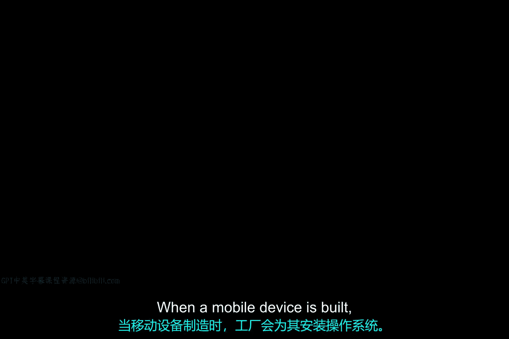
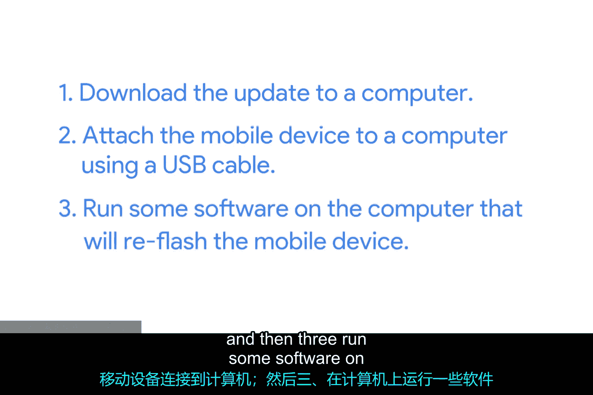
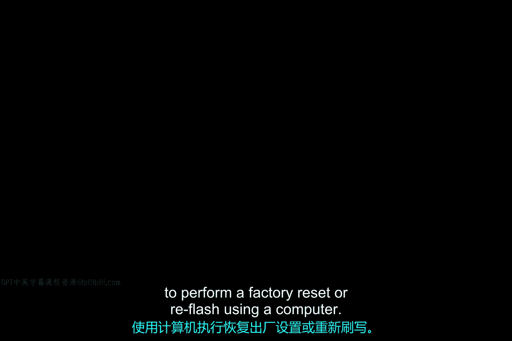

# 谷歌《IT支持（计算机网络⧸操作系统，第2、3课⧸共5课）｜Google IT Support》中英字幕deepseek p200 106_移动设备重置与映像.zh_en -BV1uyqcYpExr_p200-

When a mobile device is built， it's installed with an operating system at the factory。

 So a factory reset returns the device back to the state。

 It was in when the device will ship from the factory。

 You'll have to factory reset mobile device a lot as an I T support specialist。

 You might do this before reassigning a device to another end user。

 before sending a device out for repair or as a last resort when troubleshooting a misbehaving device。

 Don't forget a factory reset or remove all data， apps and customization from the device。

Make sure that anything you don't want to lose has been backed up or sync to the cloud。

 We'll cover mobile device synchronization in backup up in a future video。 Another heads up。

 Watch out for expansion storage。Additional storage devices like S D cards or USB drives can contain personal or proprietary data。

Doing a factory reset while expansion storage is attached might erase data that you intend to keep just as bad。

 The factory reset for lots of devices may leave the content of expansion storage intact。

 and you don't want to repurpose or decommission a device with personal or proprietary data still attached。

 One final thing， An Android and ios。 You'll need the primary account credentials in order to perform a factory reset。

This is so stolen devices cannot be easily factory， reset and then resold。 Over time。

 mobile device manufacturers will release updates to a device's operating system。

These updates will usually be delivered over the air or OTA。

An O T A update is one that's downloaded and installed by the mobile device itself。

 There are times when you might need to use a computer to install operating system updates。

 Some mobile devices like fitness trackers and medical devices might not have mobile or Wi Fi network interfaces to contact the Internet with。

Maybe the mobile device won't boot or doesn't have a good enough data connection to download the update itself。

In these cases， you can ref flashlash or overwrite the O S of the device from a computer。

 but be careful。 Pay close attention to the device's instructions for ref flashing for some devices。

 Ref flashing will preserve the end user data on the device。 But for others。

 the end results will be like a factory reset。 The details will be different from one device to another。

 The basic steps are one。 Down the update to a computer。2。

 attach the mobile device to a computer using a USB cable。 and then three。

 run some software on the computer that will re flash the mobile device。

In the supplemental reading， you'll find instructions on how to restore iOS and Android devices from a computer。

For other kinds of devices， refer to the device manufacturer's documentation on how to perform a factory reset or reflash using a computer。

