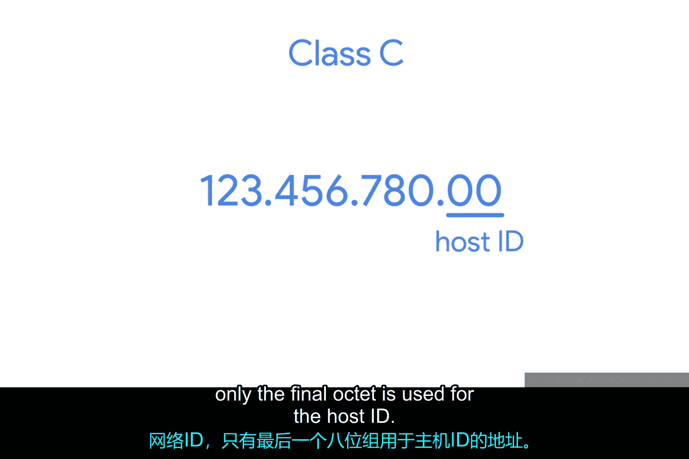
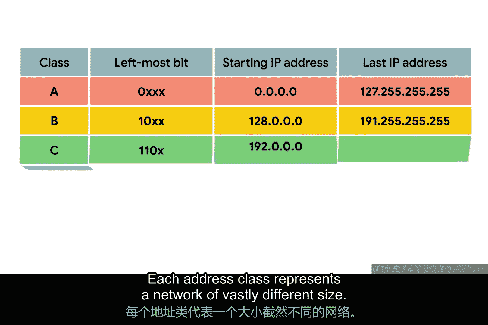
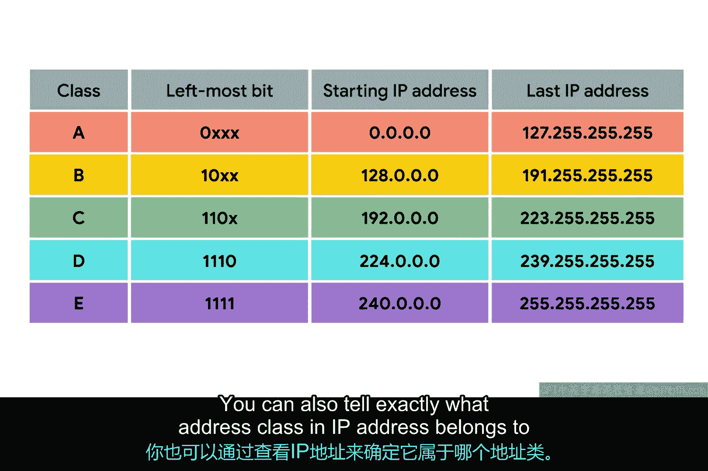
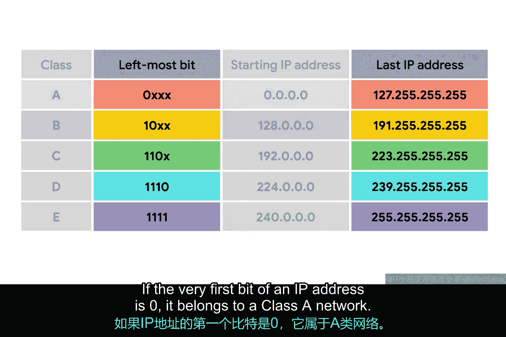
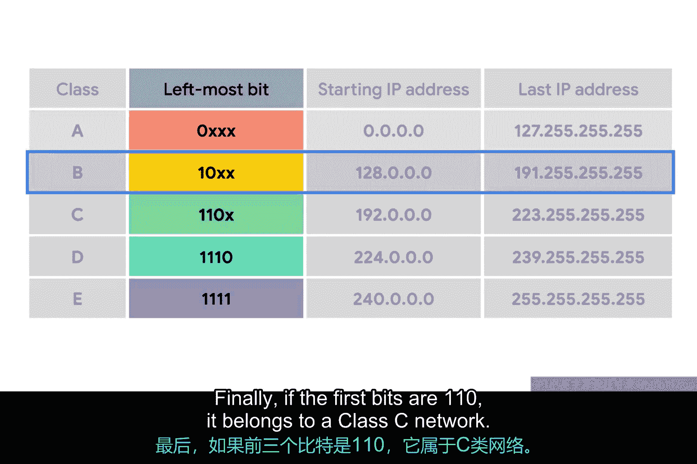
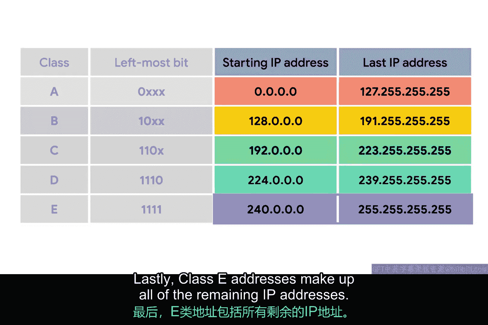

# 谷歌《IT支持（计算机网络⧸操作系统，第2、3课⧸共5课）｜Google IT Support》中英字幕deepseek p21 19_IP地址分类.zh_en -BV1uyqcYpExr_p21-

IP addresses can be split into two sections， the network ID and the host ID。Earlier。

 we mentioned that IBM owns all IP addresses that have a nine as the value of the first Dotet in an IP address。

If we take an example IP address of 9。100。100。100， the network ID would be the firstoct and the host ID would be the second。

 third， and fourthocTs。The address class system is a way of defining how the global IP address space is split up。

There are three primary types of address classes， class A， class B。And class C。

 Class A addresses are those where the firstoccte is used for the network ID。

 and the last three are used for the host ID。Class B addresses are where the first twoocTtets are used for the network ID and the second two are used for the host ID。

Class C addresses， as you might have guessed， are those where the first threeocTs are used for the network ID and only the finaloct is used for the host ID。

Each address class represents a network of vastly different size， for example。

 since a Class A network has a total of 24 bits of host ID space。

This comes out to 2 to the 24th or 16777216 individual addresses。

 compare this with a class C network， which only has 8 bits of host I space for a class C network。

 This comes out to 2 to the 8 or 256 addresses。 you can also tell exactly what address class in IP address belongs to just by looking at it。

If the very first bit of an IP address is zero， it belongs to a Class A network。

If the first bits are 10， it belongs to a Class B network。 Finally， if the first bits are 110。

 it belongs to a class C network。

Since humans aren't great at thinking in binary， it's good to know that this also translates nicely to how these addresses are represented in dotted decimal notation。

You might remember that eachoct in an IP address is 8 bits。

 which means eachoct can take a value between  zero and 255。If the first bit has to be a zero。

 as it is with the Class A address， the possible values for the firstoct are0 through 127。

This means that any IP address with a first Doedte with one of those values is a class A address。

Similarly， class B addresses are restricted to those that begin with the firstoct value of 128 through 191。

 and class C addresses begin with the firstoct value of 192 through 223。

 You might notice that this doesn't cover every possible IP address。

 That's because there are two other I address classes。

 but they're not quite as important to understand Class D addresses always begin with the bits 1110。

 and are used for multicasting， which is how a single IP datagram can be sent to an entire network at once。

 These addresses begin with decimal values between 224 and 239。 Lastly。

 Class C addresses make up all of the remaining IP addresses。

But they're unassigned and only used for testing purposes。 In practical terms。

 this class system has mostly been replaced by a system known as cider or classless inner domain routing。

But the address class system is still in place in many ways and is important to understand for anyone looking for a well rounded networking education。

And you know， we're all about that。 So don't worry， we'll be covering cider in a future lesson。

