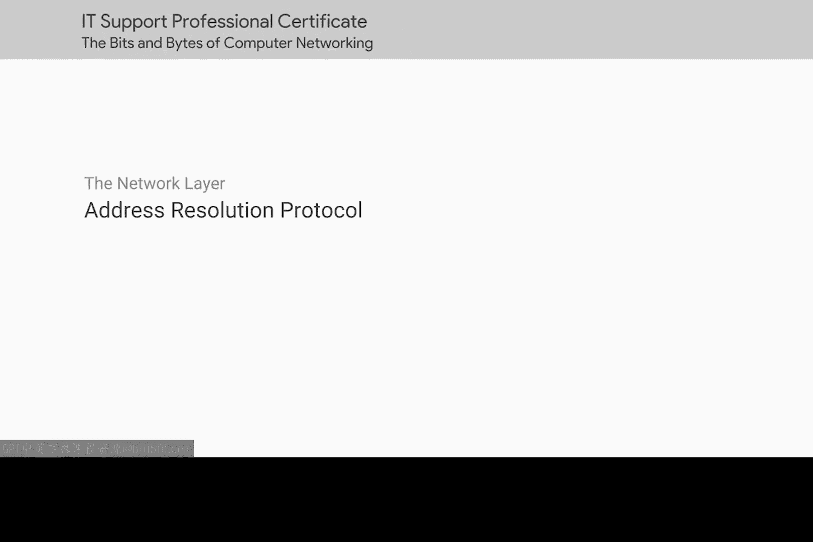
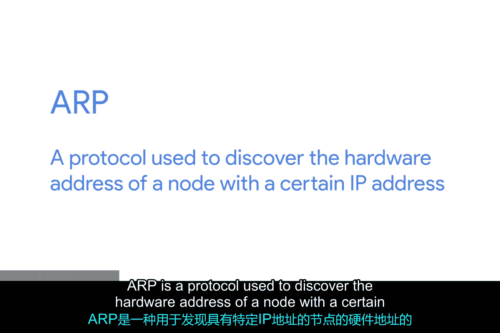
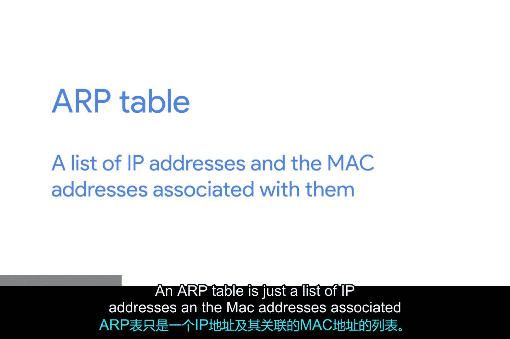
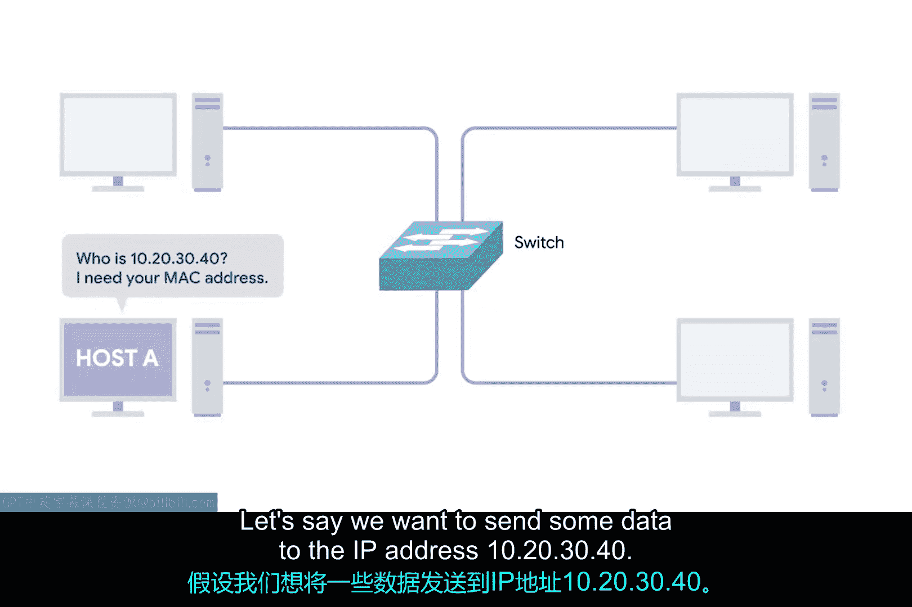
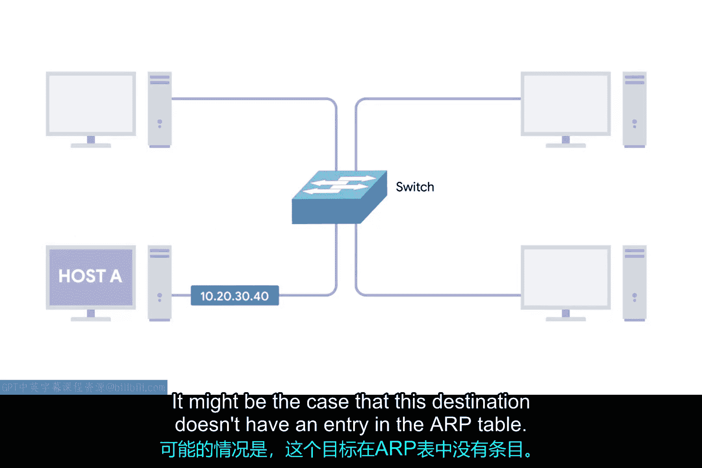
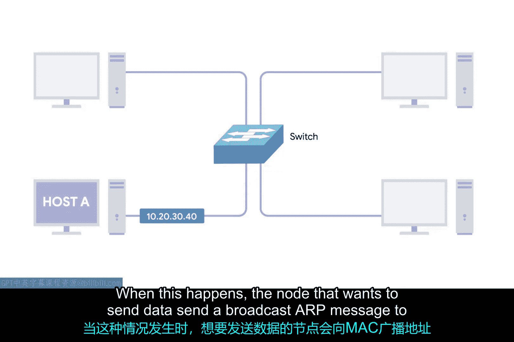
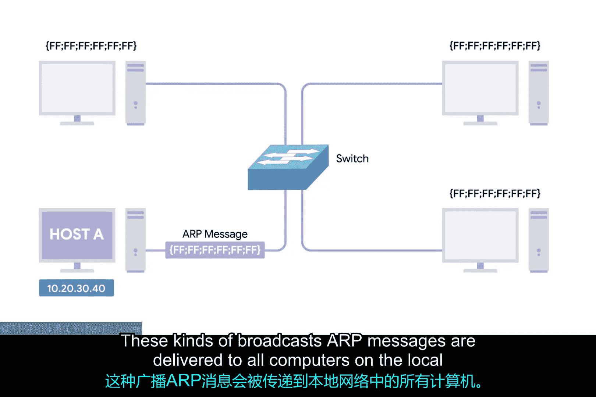
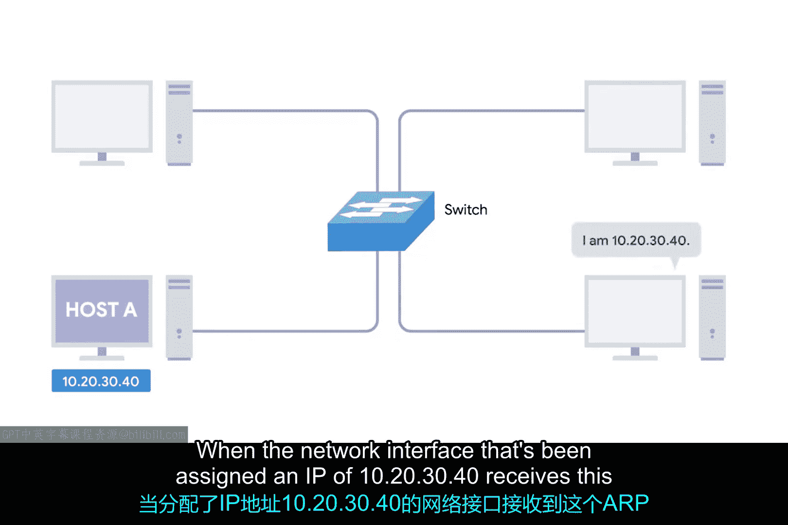
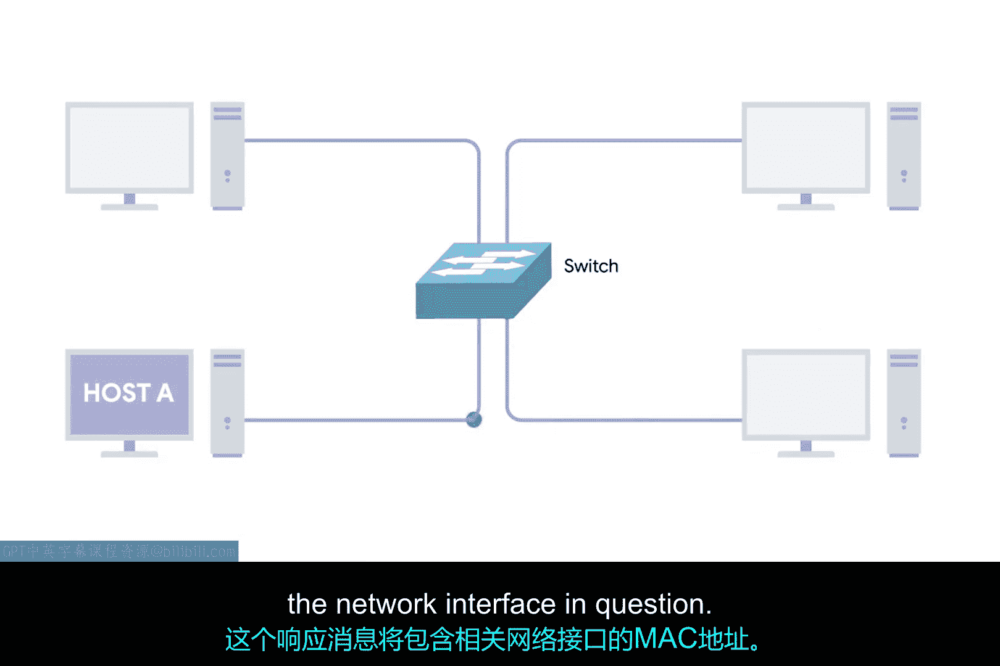
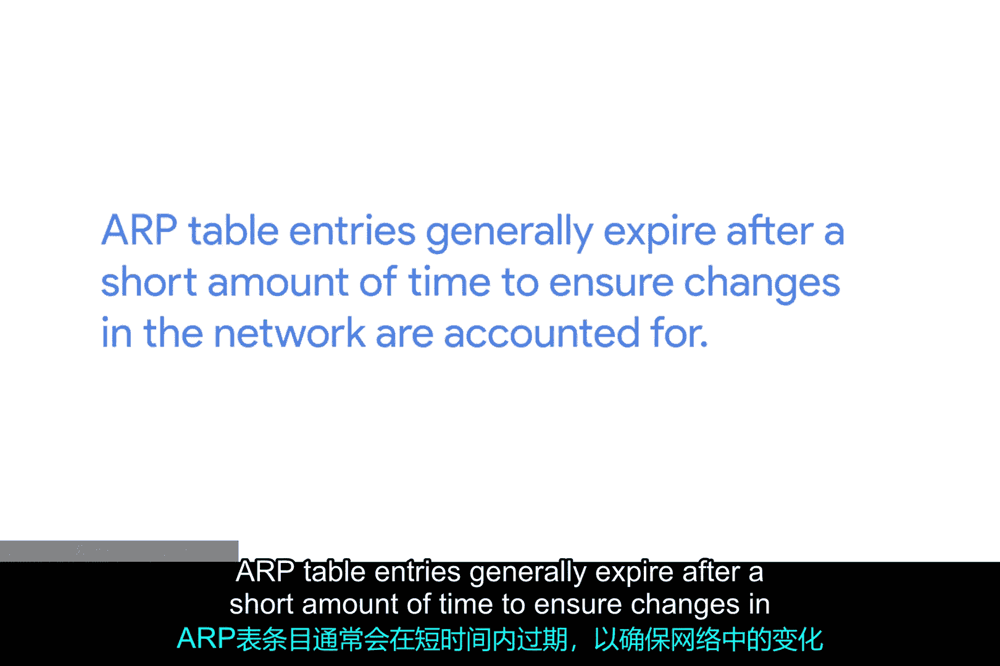

# 谷歌《IT支持（计算机网络⧸操作系统，第2、3课⧸共5课）｜Google IT Support》中英字幕deepseek p22 20_地址解析协议.zh_en -BV1uyqcYpExr_p22-

Congrats， you now understand how both Mac addresses are used at the data link layer and how IP addresses are used at the network layer。

Now we need to discuss how these two separate address types relate to each other。

This is where address resolution protocol or ARP comes into play ARP is a protocol used to discover the hardware address of a node with a certain IP address once an IP datagram has been fully formed。

 it needs to be encapsulated inside an ethernet frame。

This means that the transmitting device needs a destination Mac address to complete the Ethernet F header almost all network connected devices will retain a local ARP table an ARPT is just a list of IP addresses and the Mac addresses associated with them。

Let's say we want to send some data to the IP address， 10。20。30。40。

It might be the case that this destination doesn't have an entry in the arc table。

When this happens， the node that wants to send data sends a broadcast art message to the Mac broadcast address。

 which is all Fs。

These kinds of broadcast art messages are delivered to all computers on the local network。

When the network interface that's been assigned an IP of 10。20。30。40 receives this art broadcast。

 it sends back what's known as an AP response。

This response message will contain the Mac address for the network interface in question。

Now， the transmitting computer knows what Mac address to put in the destination hardware address field。

 and the ethernet frame is ready for delivery。 Itll also likely store this IP address in its local a table so that it won't have to send an art broadcast the next time it needs to communicate with this I。

 handy。Arp table entries generally expire after a short amount of time to ensure changes in the network are accounted for。

 so don't expect it to stick around the way I expect you to stick around for the next ungraded quiz。

