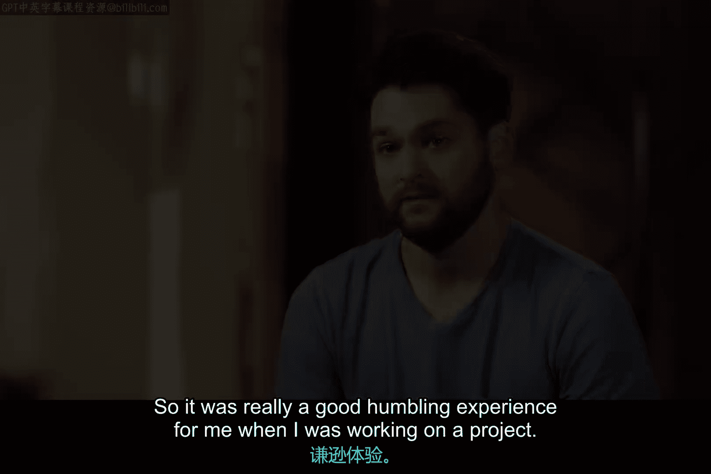

# 谷歌《IT支持（计算机网络⧸操作系统，第2、3课⧸共5课）｜Google IT Support》中英字幕deepseek p23 21_塞尔吉奥的路径.zh_en -BV1uyqcYpExr_p23-

🎼My name is Sergulaor and I'm a network engineer at Google when I was just like a young kid。

 I like analog tools like screwdrivers and drills and then I like taking things apart and then as I got older in my teenage years。

 they realized I could take computers and then that really interesting me because when you opened it up it was like fans like lights like the circuitry and I just didn't understand it it didn't make sense to me but if I knew if I put it together the right way I could actually interact with it and have fun and play my video games off of it and that's kind of how it really started and then by the time when I got a little older outside of high school。

 I realized I could make this like a passion and actually like really learn how this technology works。

 I think the favorite part is solving the problems。

 I really enjoy when we get to see data go from one device to another and how things communicate and how the customers get to enjoy it Ive gained so many different tools and skills and now I feel like a Swiss Army knife when I'm working and there's so many different experience that I can bring back to solve problems I face today early starting off as like an entry level of network technician。

 I had a project to upgrade。Fiwall for a police department and the firewall basically is the security appliance and the entry point to the network we thought it worked it went through successfully until I got a phone call very late at night that things were broken and we realized that emails and you know police calls were not going through and that the upgrade failed and at that point I realized you know the magnitude of the things that I am working on can affect people's lives and it can cause harm and it can cause good so it was really a good humbling experience for me when I was working on that project。

