# 谷歌《IT支持（计算机网络⧸操作系统，第2、3课⧸共5课）｜Google IT Support》中英字幕deepseek p24 22_子网划分.zh_en -BV1uyqcYpExr_p24-

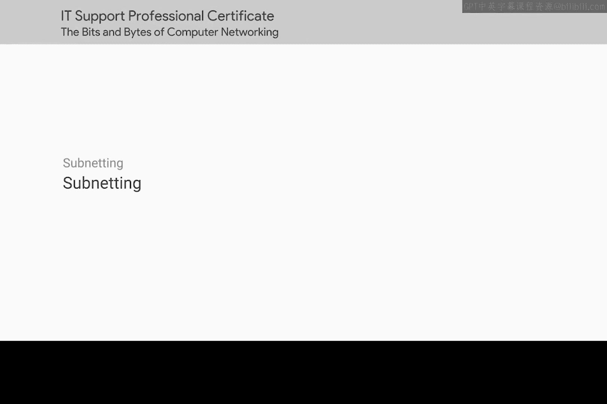

In the most basic of terms， subneting is the process of taking a large network and splitting it up into many individual smaller subnets or subnets。

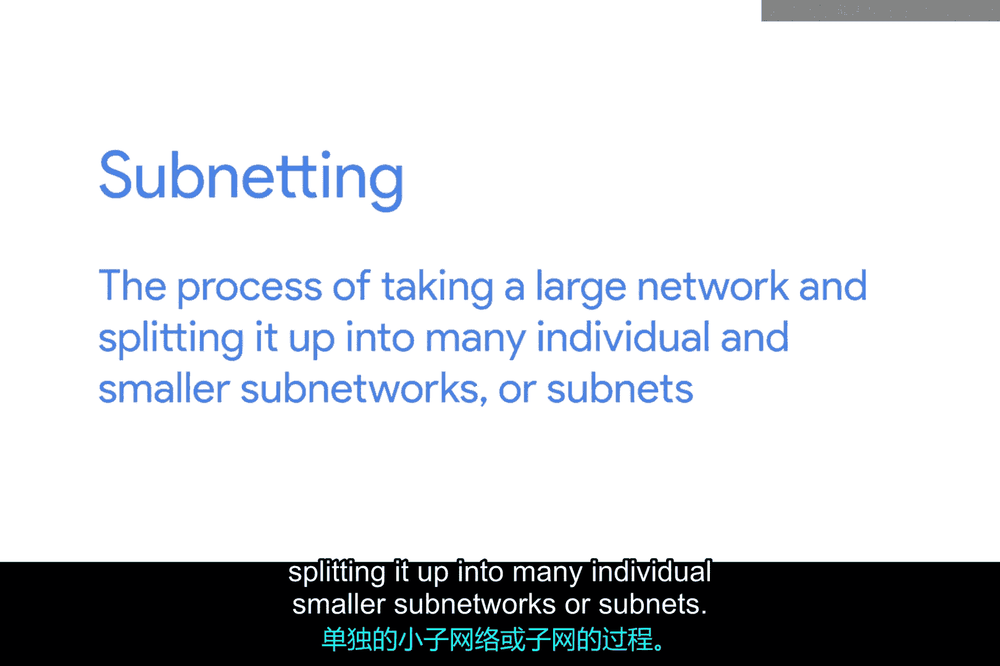

By the end of this lesson， you'll be able to explain why subnetting is necessary and describe how subnet masks extend what's possible with just network and host IDs。

You'll also be able to discuss how a technique known as cider allows for even more flexibility than plane subting。

Lastly， you'll be able to apply some basic binary math techniques to better understand how all of this works。

Incorrect subneting setups are a common problem you might run into as an IT support specialist。

 so it's important to have a strong understanding of how this works， that's a lot， so let's dive in。

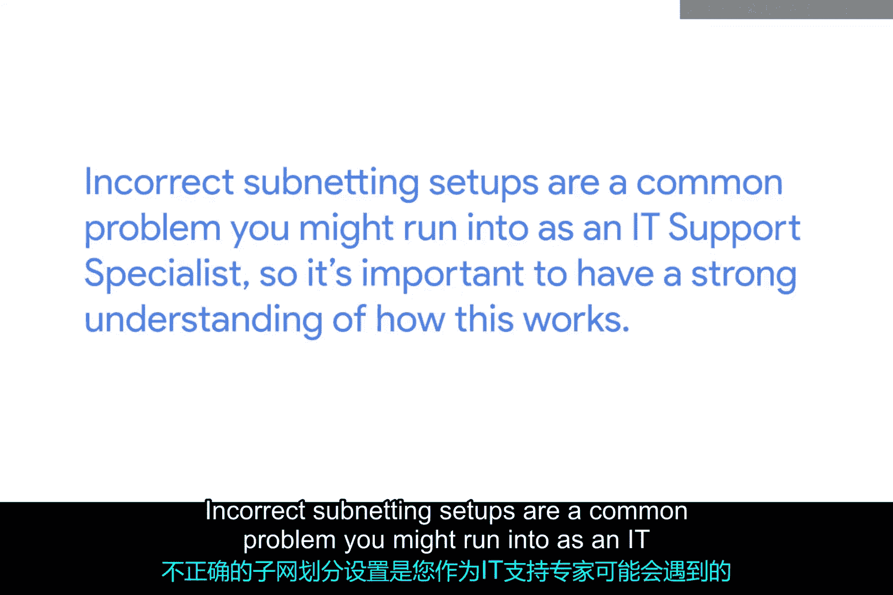

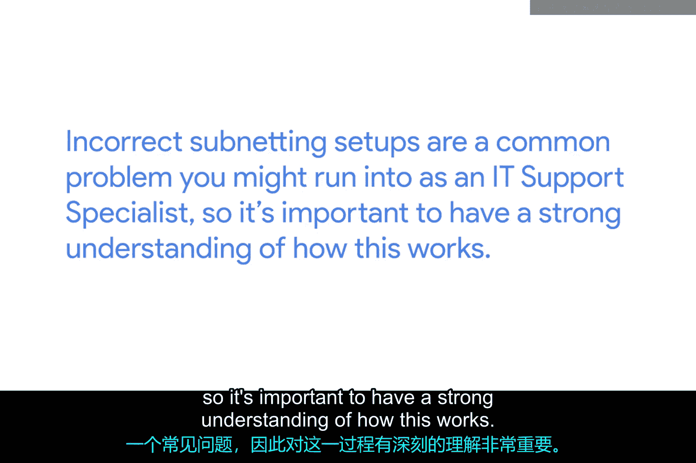

As you might remember from the last lesson， address classes give us a way to break the total global IP space into discrete networks。

If you want to communicate with the IP address 9。100。100。100。

 core routers on the internet know that this IP belongs to the 9。0。0。0 class A network。

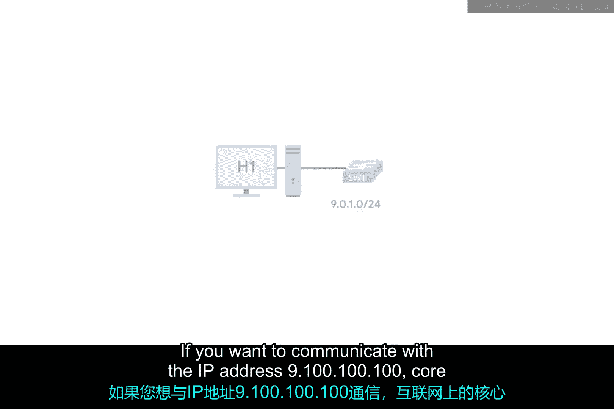

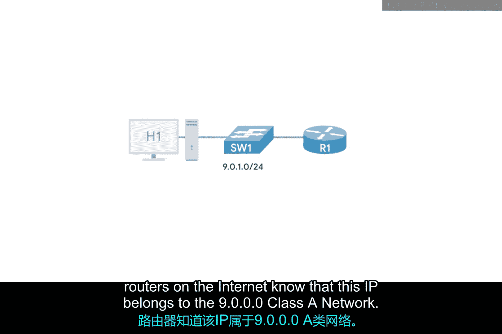

They then route the message to the gateway router responsible for the network by looking at the network ID。

 A gateway router specifically serves as the entry and exit path to a certain network。

 You can contrast this with core internet routers， which might only speak to other core routers。

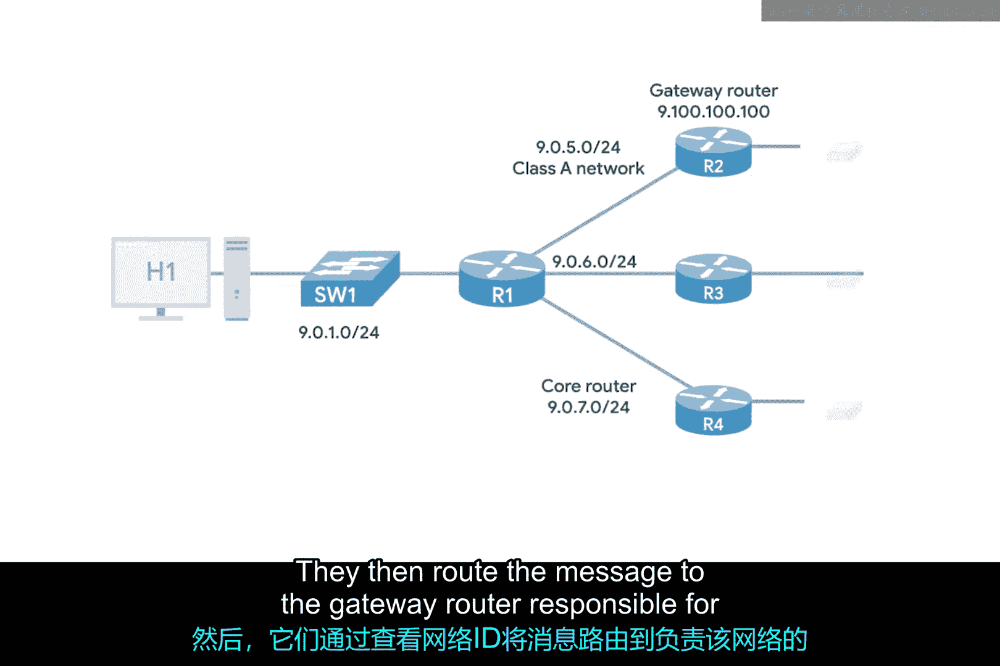

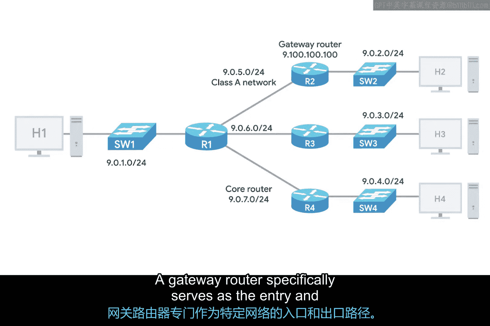

Once your packet gets to the gateway router for the 9。0。0。0 Class A network。

 that router is now responsible for getting that data to the proper system by looking at the host ID。

This all makes sense until you remember that a single class A network contains 16777216 individual Is。

 That's just way too many devices to connect to the same router。

 This is where subnetting comes in with subnets。 you can split your large network up into many smaller ones。

 These individual subnets will all have their own gateway routers。

 serving as the ingress and egress point for each subnet。😊。

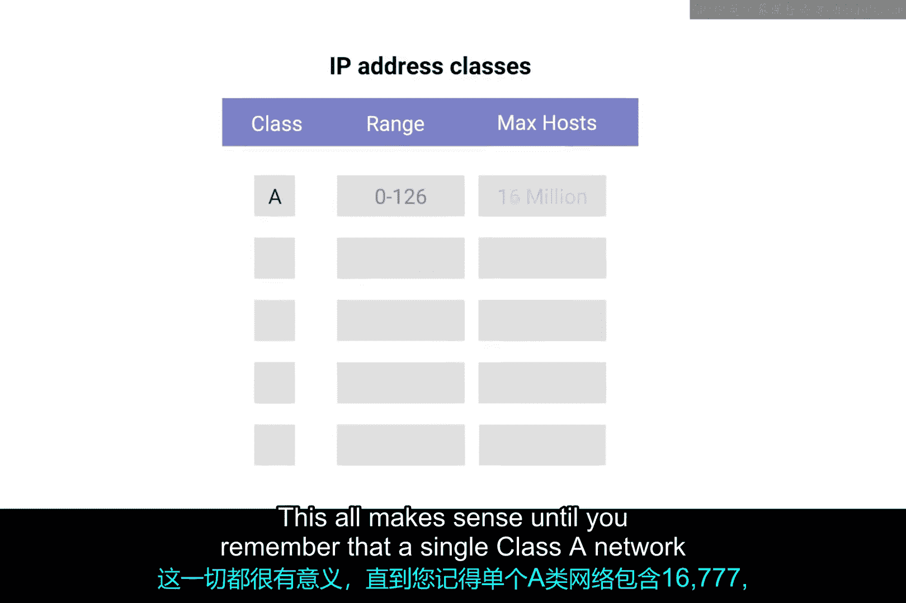

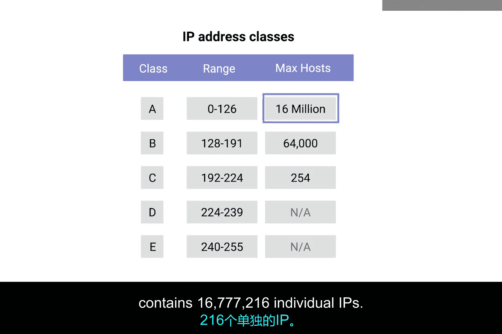

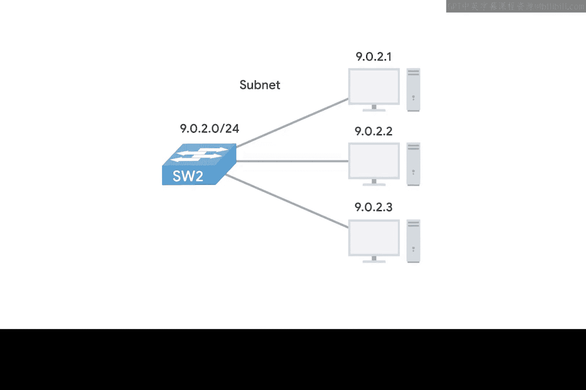