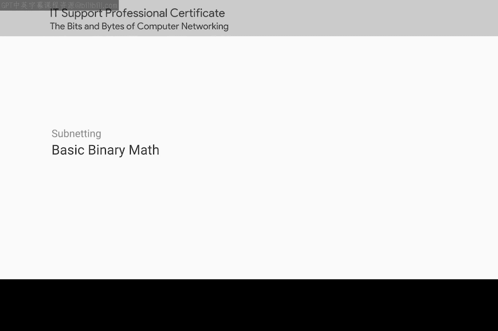
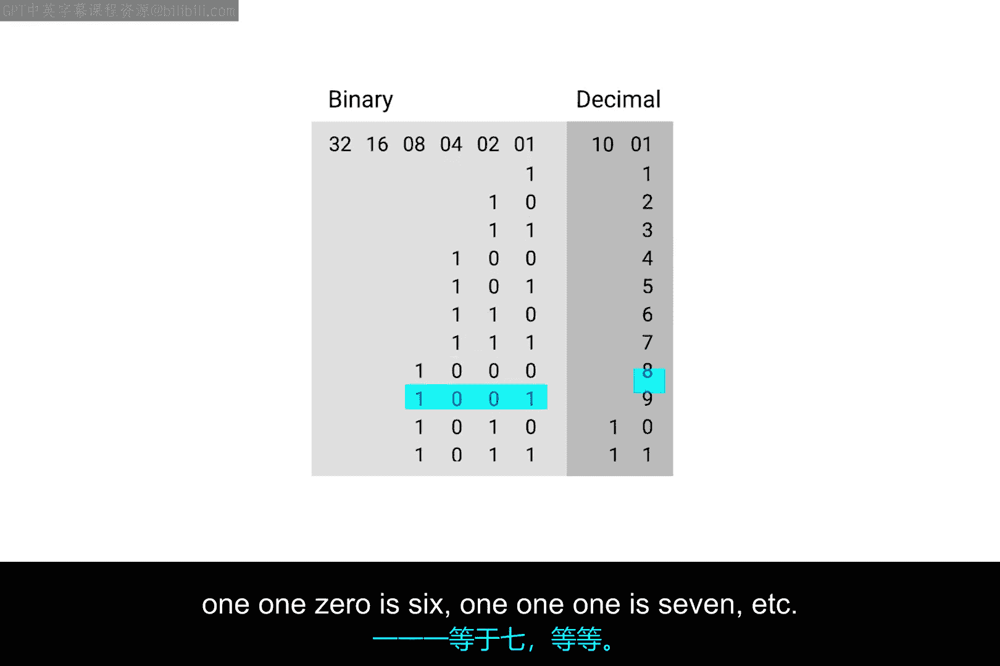
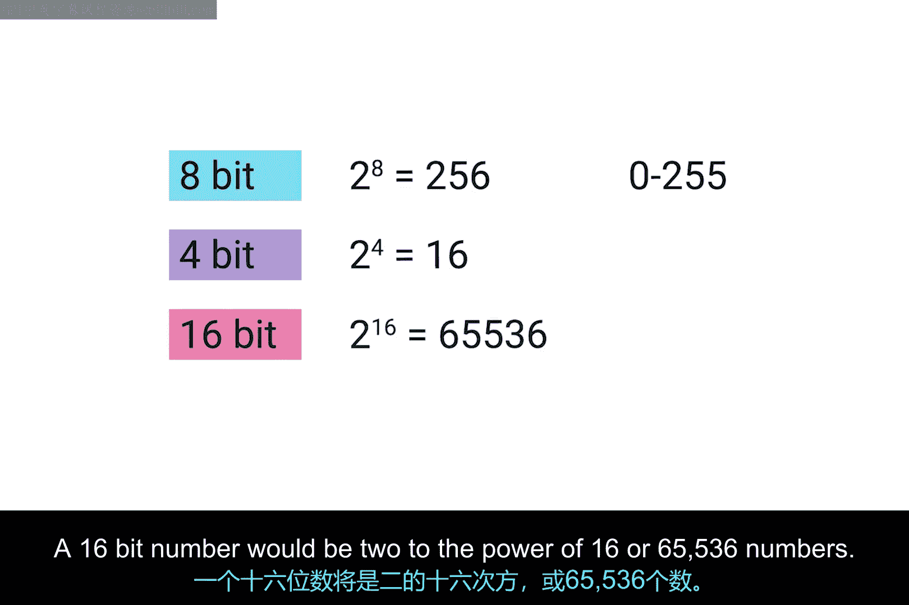
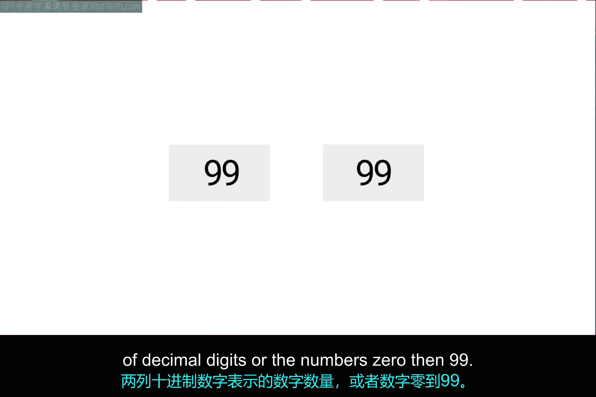
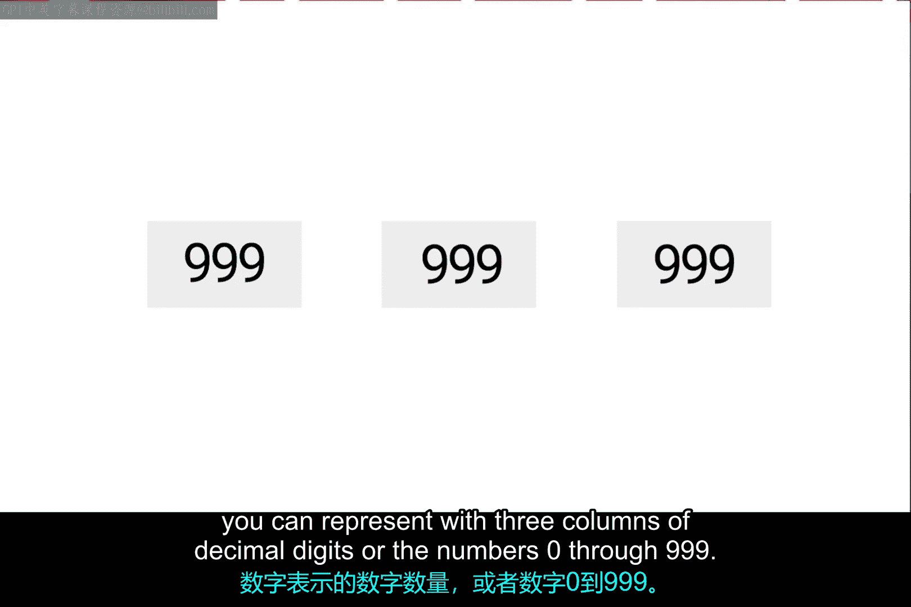
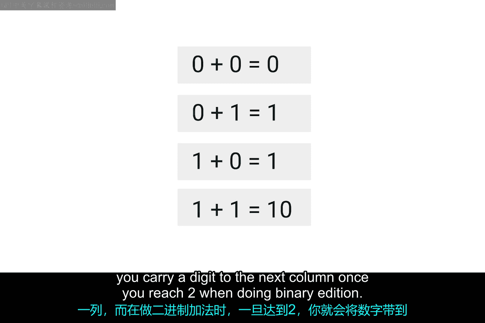
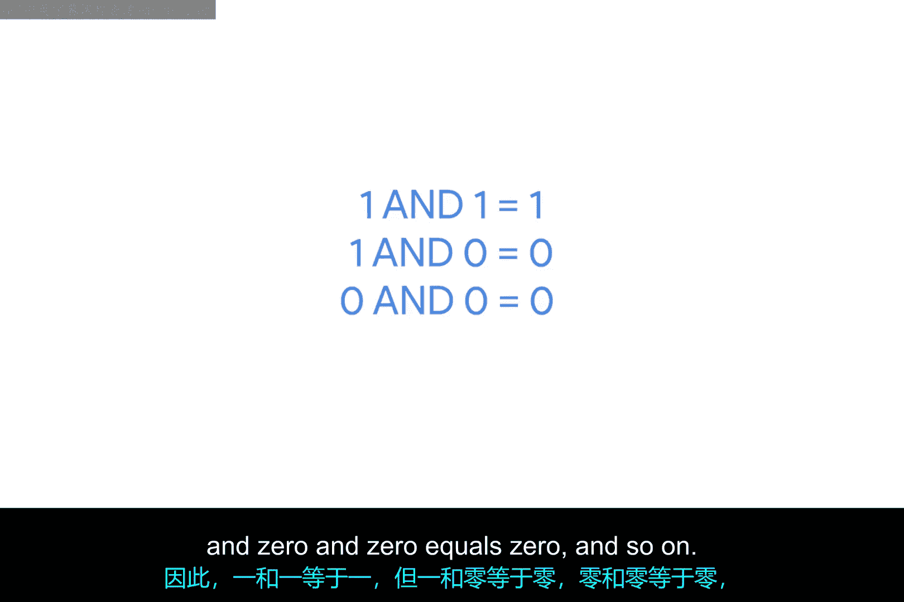
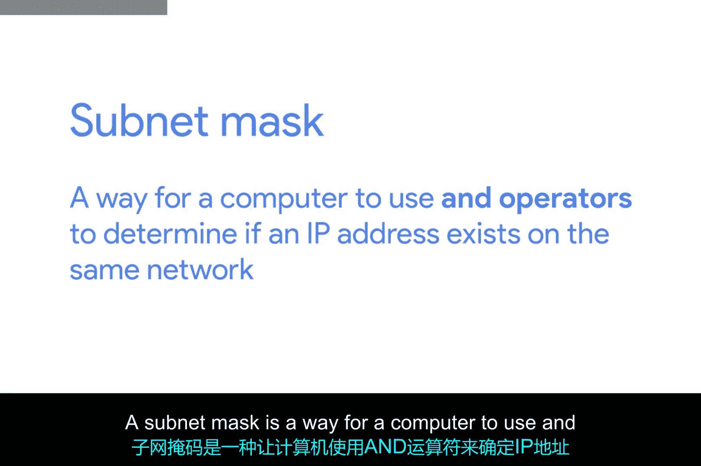
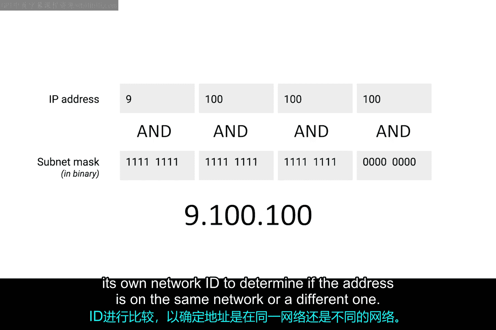

# 谷歌《IT支持（计算机网络⧸操作系统，第2、3课⧸共5课）｜Google IT Support》中英字幕deepseek p26 24_基本二进制数学.zh_en -BV1uyqcYpExr_p26-

Bineary numbers can seem intimidating at first since they look so different from decimal numbers。

 but as far as the basics go， the math behind counting。

 adding or subtracting binary numbers is exactly the same as with decimal numbers it's important to call out that there aren't different kinds of numbers Numbers are universal。

There are only different notations for how to reference them humans。

 most likely because most of us have1 fingers and 10 toes。

 decided on using a system with 10 individual numerals used to represent all numbers。The numerals 0。

1，2，3，4，5，6，7，8 and9 can be combined in ways to represent any whole number in existence。

Because there are 10 total numerals in use in a decimal system。

 another way of referring to this is as base 10。Because of the constraints of how logic gates work inside of a processor。

 it's way easier for computers to think of things only in terms of zero and1。

This is also known as binary or base 2。You can represent all whole numbers in binary in the same way you can in decimal it just looks a little different when you count in decimal。

 you move through all the numerals upward until you run out。

 then you add a second column with a higher significance。

Let's start counting at zero until we get to nine。Once we get to 9， we basically just start over。

 We add a one to a new column， then start over at 0 in the original column。

 We repeat this process over and over in order to count all whole numbers。

 counting in binary is exactly the same。 It's just that you only have two numerals available。

 You start with 0。 which is the same as 0 and decimal。 Then you increment once。 Now， you have one。

Which is the same as one in decimal。Since we've already run out of numerals to use。

 it's time to add a new column， so now we have the number 10， which is the same as two in decciimal。

1，1 is 3，1，0，0 is 4，1，0，1 is 5，1，1，0 is 6，1，1，1 is 7， et cetera。

It's the exact same thing we do with decimal just with fewer new world at our disposal when working with various computing technologies。

 you will often run into the concept of bits or ones and zeros。

 There's a pretty simple trick to figure out how many decimal numbers can be represented by a certain number of bits。

If you have an 8 bit number， you can just perform the math 2 to the power of 8。 This gives you 256。

 which lets you know that an 8 bit number can represent 256 decimal numbers or put another way the numbers 0 through 255。

A four bit number would be2 to the power of4 or 16 total numbers。

 a 16 bit number would be 2 to the power of 16 or 65，536 numbers。

In order to tie this back to what you might already know， this trick doesn't only work for binary。

 it works for any number system， it's just the base changes。

You might remember that we can also refer to binary as base 2 and decimal as base 10。

 All you need to do is swap out the base for what's being raised to the number of columns。

For example， let's take a base 10 number with two columns of digits。

This would translate to 10 to the power of two。T0 of the power of2 equals 100。

 which is exactly how many numbers you can represent with two columns of decimal digits。

Or the numbers 0 through 99， Similarlyly， 10 to the power of 3 is 1000。

 which is exactly how many numbers you can represent with three columns of decimal digits or the numbers0 through 999。

Not only is counting in different bases the same， so is simple arithmetic like addition。In fact。

 binary edition is even simpler than any other base， since you only have four possible scenarios。

0 plus 0 equals0， just like in decimal。0 plus 1 equals 1。

 and one plus0 equals 1 should also look familiar。1+ 1 equals 10， looks a little different。

 but should still make sense， you carry a digit to the next column once you reach 10 in doing decimal edition。

You carry a digit to the next column once you reach two when doing binary addition。

Addition is what's known as an operator， and there are many operators that computers use to make calculations。

 Two of the most important operators are or and and。In computer logic。

 a one represents true and a zero represents false。

The way the orR operator works is you look at each digit。And if either of them is true。

 the result is true。The basic equation is x or y equals z。

Which could be read as if either X or Y is true。Then Z is true， otherwise it's false。Therefore。

 one or0 equals1， but0 or0 equals 0。The operator and。Does what it sounds like it does。

 it returns true if both values are true。Therefore， one and1 equals  one， but one and0 equals 0。

 and0 and 0 equals 0 and so on。

Now， you might be wondering why we've covered all of this and no， it's not to confuse you。

It's all really to help explain subnetmas a bit more。

A subnet mask is a way for a computer to use and operators to determine if an IP address exists on the same network。

 This means that the host ID portion is also known since itll be anything left out let's use the binary representation of our favorite IP address9。

100。100。100 and our favorite subnet mask 255。255。255。0。

 Once you put one on top of the other and perform a binary and operator on each column you'll notice that the result is the network ID and subnet ID portion of our IP address or 9。

 100。100。

The computer that just performed this operation can now compare the results with its own network ID to determine if the address is on the same network or a different one。

I bet you never thought you'd have a favorite IP address or subnet。

 but that's what happens in the wonderful world of basic binary math。

