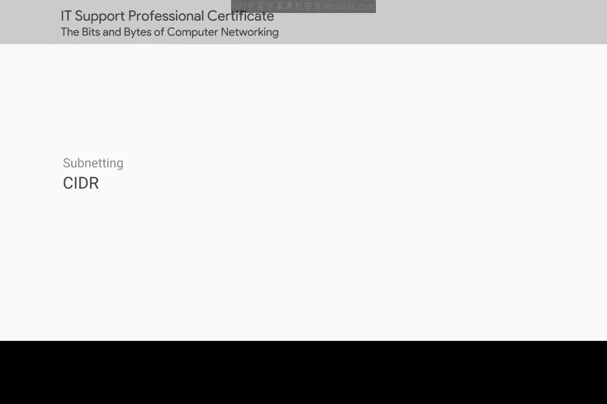
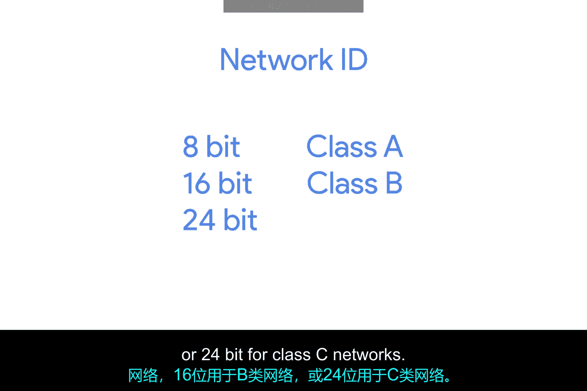
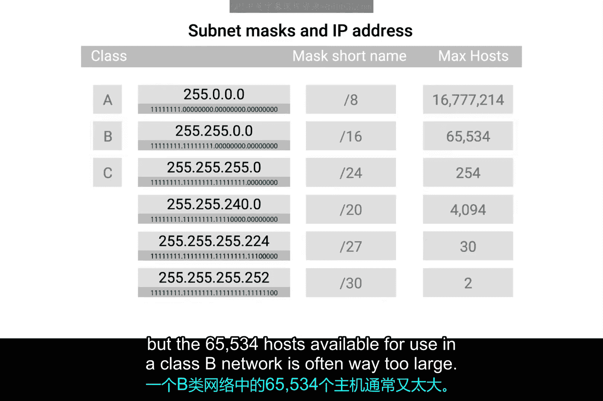
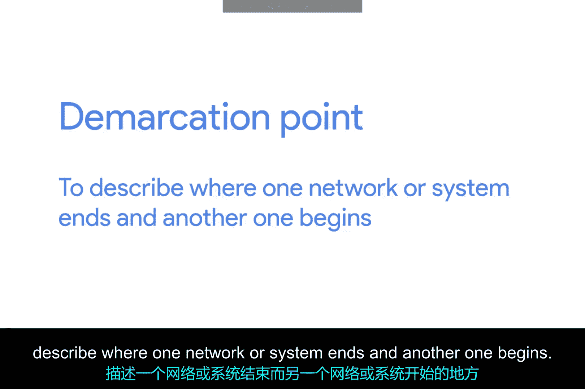
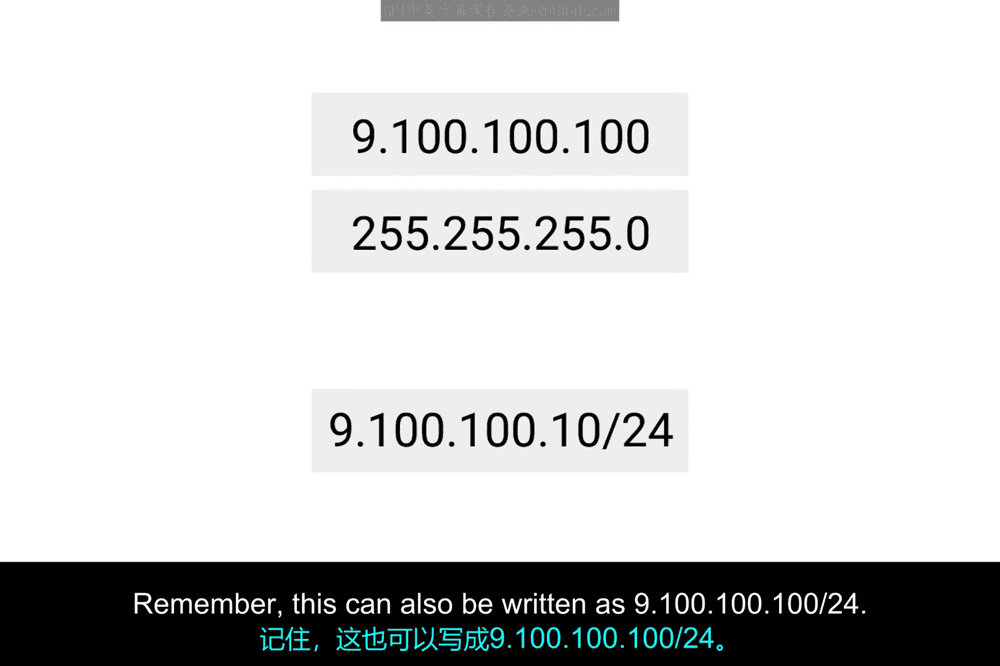
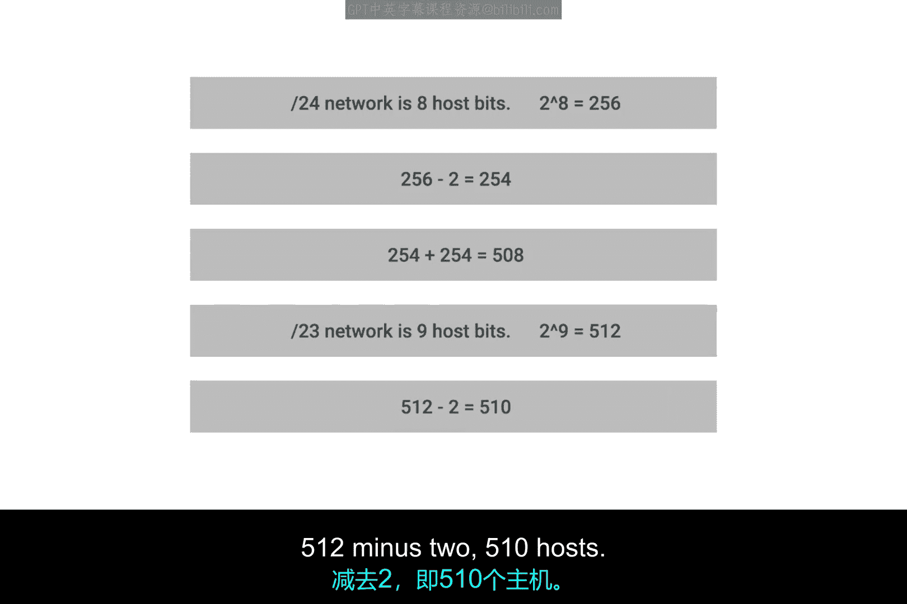

# 谷歌《IT支持（计算机网络⧸操作系统，第2、3课⧸共5课）｜Google IT Support》中英字幕deepseek p27 25_CIDR.zh_en -BV1uyqcYpExr_p27-

Adddress classes were the first attempt at splitting up the global internet IP space subneting was introduced when it became clear that address classes themselves weren't a sufficient way of keeping everything organized。

But as the internet continued to grow， traditional subnetting just couldn't keep up。

With traditional subneting and the address classes。

 the network ID is always either8 bit for Class A networks。

 16 bit for class B networks or 24 bits for class C networks。

This means that there might only be 254 class A networks in existence。

 but it also means there are 297，152 potential Class C networks that's a lot of entries in a routing table。

To top it all off， the sizing of these networks aren't always appropriate for the needs of most businesses。

254 hosts in a Class C network is too small for many use cases， but the 65。

534 hosts available for use in a Class B network is often way too large。

Many companies ended up with various adjoining Class C networks to meet their needs。

 that meant that routing tables ended up with a bunch of entries for a bunch of class C networks that were all actually being routed to the same place。

This is where cider or classless inner domain routing comes into play。

Citder is an even more flexible approach to describing blocks of IP addresses。

It expands on the concept of subneting by using subnet masks to demarcate networks to demarcate something means to set something off when discussing computer networking。

 you'll often hear the term demarcation point to describe where one network or system ends and another one begins in our previous model we rely it on a network ID subnet ID and host ID to deliver an IP Datagram to the correct location with ciR。

 the network ID and subnet ID are combined into one。

Citder is where we get the shorthand slash notation that we discussed in the earlier video on subnettting。

This slash notation is also known as cider notation。

CitR basically just abandons the concept of address classes entirely。

 allowing an address to be defined by only two individual IDs。Let's take 9。100。100。

100 with a net mask of 255。255。255。0 remember， this can also be written as 9。100。100。

100/24 in a world where we no longer care about the address class of this IP all we need is what the network mask tells us to determine the network ID。

In this case， that would be 9。100。 100。 The host ID remains the same。

 This practice not only simplifies how routers and other network devices need to think about parts of an IP address。

 but it also allows for more arbitrary network sizes before network sizes were static。

 think only class A， class B or class C， and only subnets could be of different sizes。

 cider allows for networks themselves to be differing sizes。Before this。

 if a company needed more addresses than a single class C could provide。

 theyd need an entire second Class C。With cider， they could combine that address space into one contiguous chunk with a net mask of s23 or 255。

255。254。0。This means that routers now only need to know one entry in their routing table to deliver traffic to these addresses instead of two。

It's also important to call out that you get additional available host IDs out of this practice。

Remember that you always lose two host IDs per network。

 so if a/lash 24 network has 2 to the 8 or 256 potential hosts。

 you really only have 256 minus2 or 254 available Is to assign。If you need two networks of this size。

 you have a total of 254 plus 254 or 508 hosts。A single slash 23 network， on the other hand。

 is two to the nine or 512。512 minus2。510 hosts。

Take a second and lock that into your memory。Then when you're ready。

 we have a short ungraded quiz for you before we move on to routing in the next lesson。

