# 谷歌《IT支持（计算机网络⧸操作系统，第2、3课⧸共5课）｜Google IT Support》中英字幕deepseek p29 27_基本路由概念.zh_en -BV1uyqcYpExr_p29-

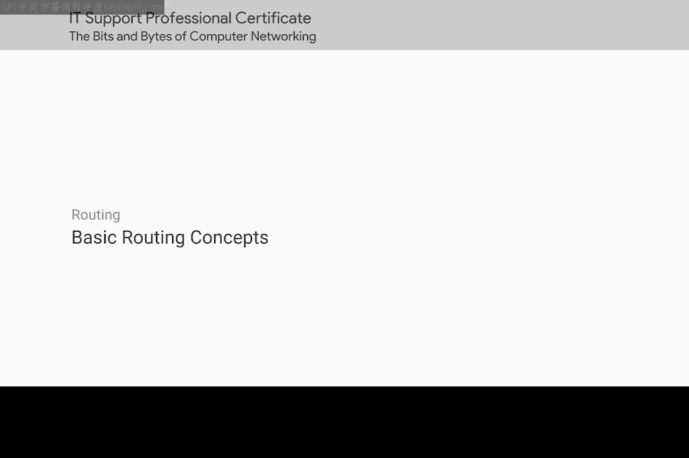

The internet is an incredibly impressive technological achievement。

 It meshes together millions of individual networks and allows communications to flow between them from almost anywhere in the world。

 you can now access data from almost anywhere else。

 often in just fractions of a second the way communications happen across all these networks。

 allowing you to access data from the other side of the planet is through routing。

By the end of this lesson， you'll be able to describe the basics of routing and how routing tables work。

 you'll be able to define some of the major routing protocols and what they do and identify nonroutable address space and how it's used。

You'll also gain an understanding of the RFC system and how it made the internet what it is today。

All of these are very important skills in order to troubleshoot the networking issues you might run into as an IT support specialist。

Routing is one of those things that is both very simple and very complex at a very high level。

 what routing is and how routers work is actually pretty simple， but underneath the hood。

 routing is a very complex and technologically advanced topic。

 entirere books have been written about the topic。 Today。

 most intensive routing issues are almost exclusively handled by ISP and only the largest of companies。

😊，We'll arm you with the basic overview of routing to give you a wellrounded networking education since it's an important topic to understand no matter what。

 but by no means will our coverage be exhaustive from a very basic standpoint。

 a router is a network device that forwards traffic depending on the destination address of that traffic。

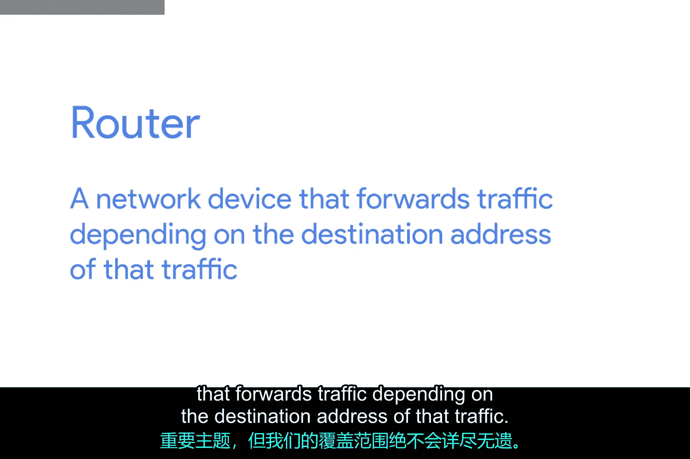

A router is a device that has at least two network interfaces。

 since it has to be connected to two networks to do its job。Basic routing has just a few steps。1。

A router receives a packet of data on one of its interfaces，2。

 the router examines the destination IP of this packet。Three。

The router then looks up the destination network of this IP in its routing table。4our。

 the router forwards that out through the interface that's closest to the remote network。

 as determined by additional info within the routing table。

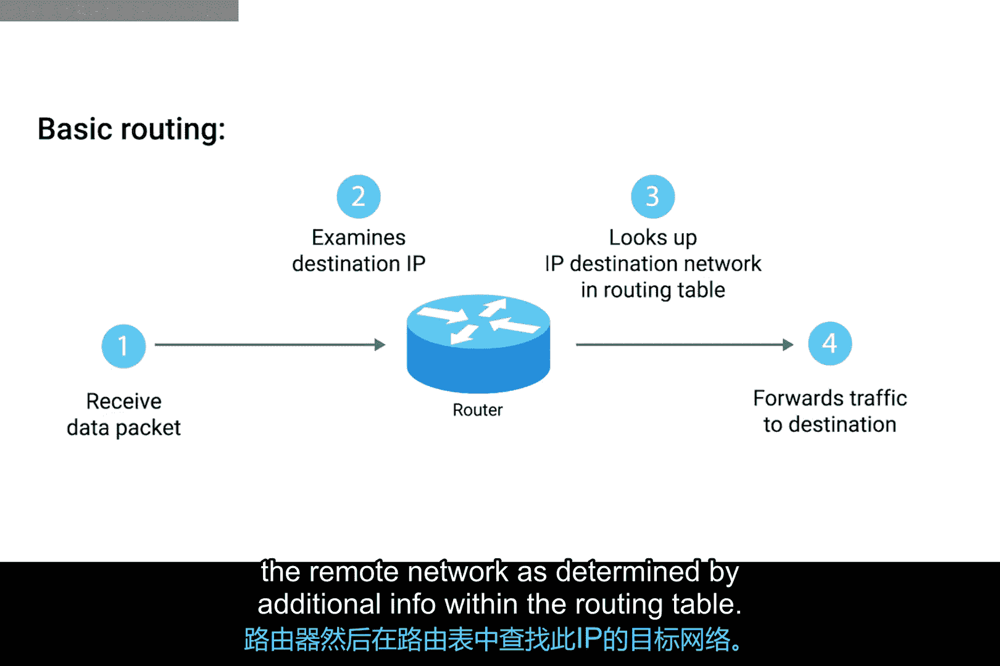

These steps are repeated as often as needed until the traffic reaches its destination Let's imagine a router connected to two networks。

We'll call the first network network A and give it an address space of 192。168。1。0/24。

We'll call the second network network B and give it an address space of 10。0。0。0/24。

The router has an interface on each network。On network A， it has an IP of 192。168。1。1。

 and on network B， it has an IP of 10。0。0。254。Remember， IP addresses belong to networks。

 not individual nodes on a network。A computer on network A with an IP address of 192。168。1。

100 sends a packet to the address 10。0。0。10。This computer knows that 10。0。0。

10 isn't on its local subnet， so it sends this packet to the Mac address of its gateway， the router。

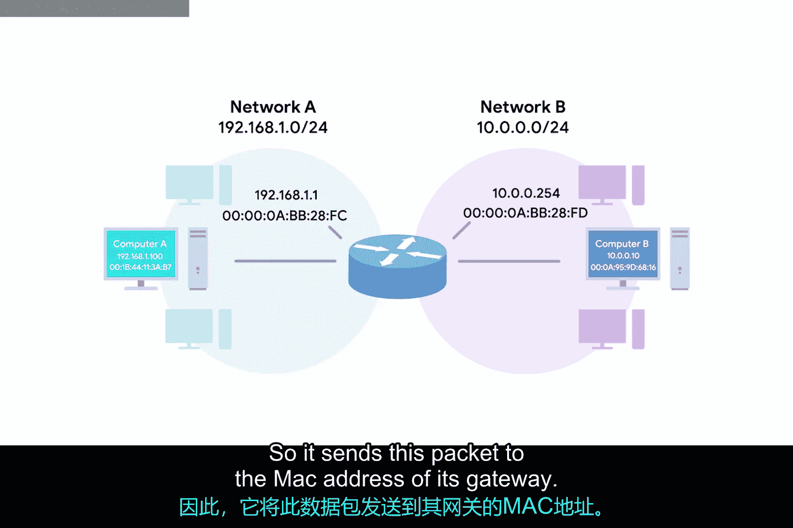

The router's interface on network A receives the packet because it sees that destination Mac address belongs to it。

The router then strips away the data link layer encapsulation， leaving the network layer contents。

 the IP Datagram。

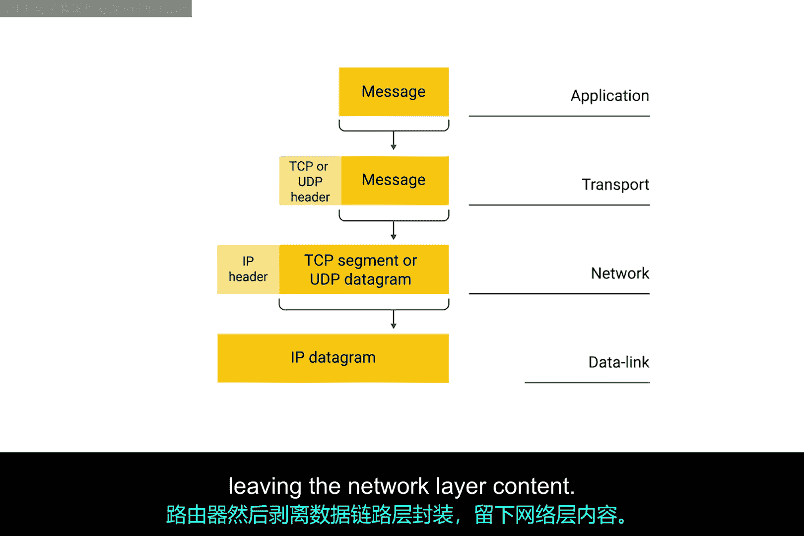

Now， the router can directly inspect the IP Datagram header for the destination IP field。

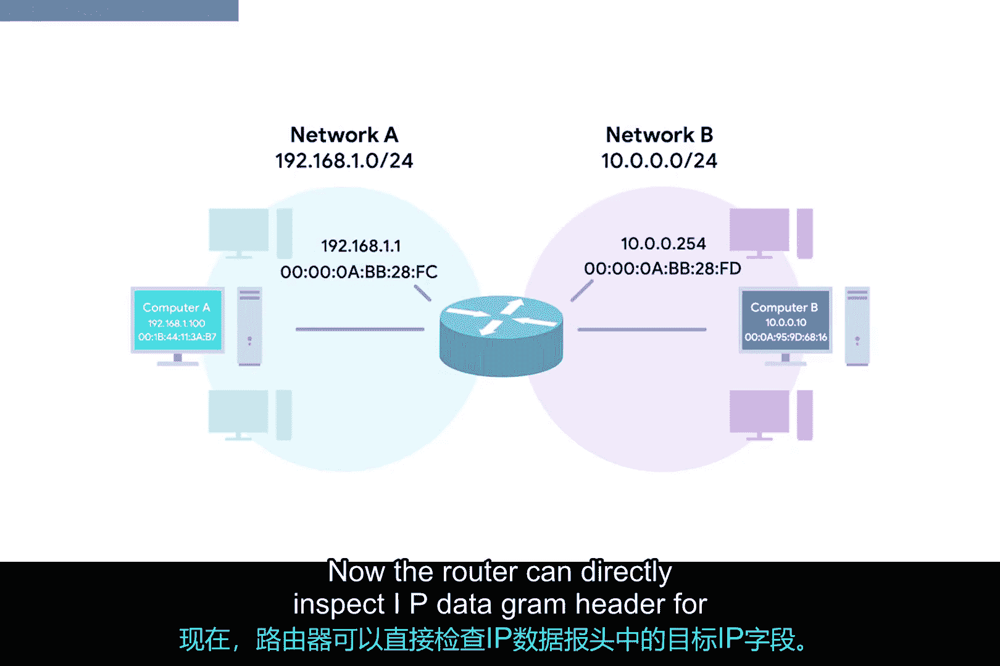

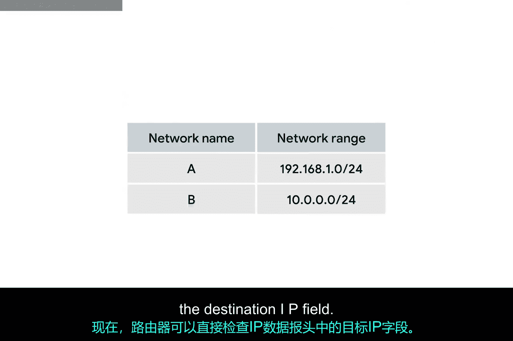

It finds the destination IP of 10。0。0。10， the router looks at its routing table and sees that network B or the 10。

0。0。0/24 network is the correct network for the destination IP it also sees that this network is only one hop away。

 in fact， since it's directly connected， the router even has the Mac address for this IP in its Ap table。

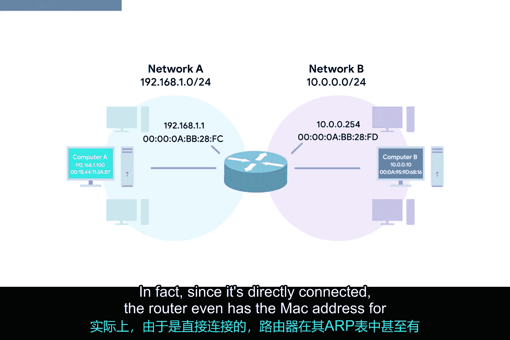

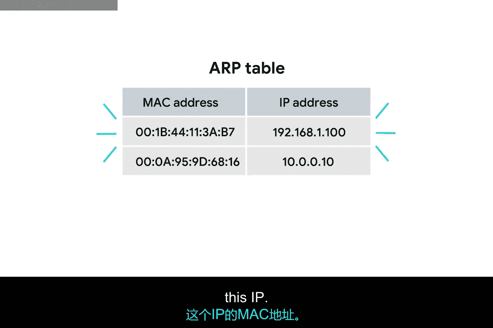

Next， the router needs to form a new packet to forward along to network B。

 It takes all of the data from the first IP datagram and duplicates it。

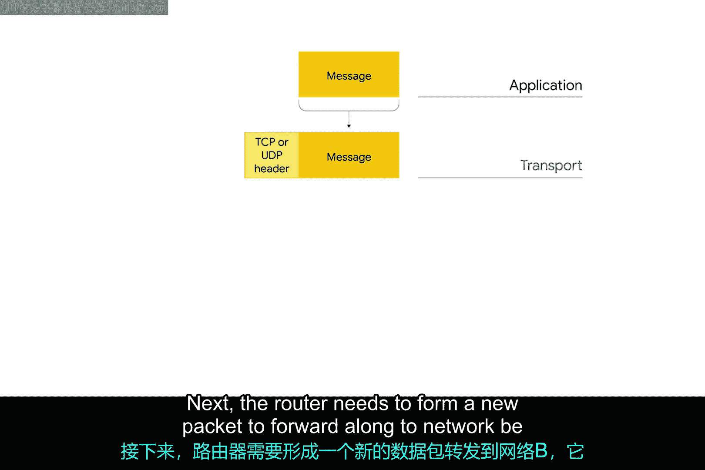

But it decrements the TTL field by one and calculates a new checkum。

Then it encapsulates this new IP datagram inside of a new ethernet frame。

This time it sets its own Mac address of the interface on network B。As the source Mac address。

 since it has the Mac address of 10。0。0。10 in its a table。

 it sets that as the destination Mac address。

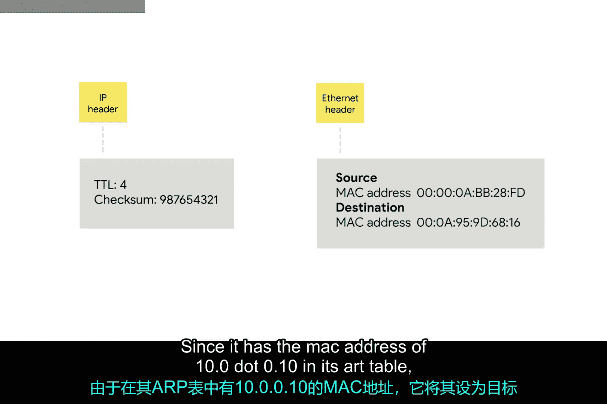

Lastly， the packet is sent out of its interface on network B。

 and the data finally gets delivered to the node living at 10。0。0。10。

That's a pretty basic example of how routing works。

 but let's make it a little more complicated and introduce a third network。

Everything else is still the same We have network A whose address space is 192。168。1。0/24。

 we have network B， whose address space is 10。0。0。0/24。

The router that bridges these two networks still has the Is of 192。168。1。1 on network A and 10。0。0。

254 on network B。

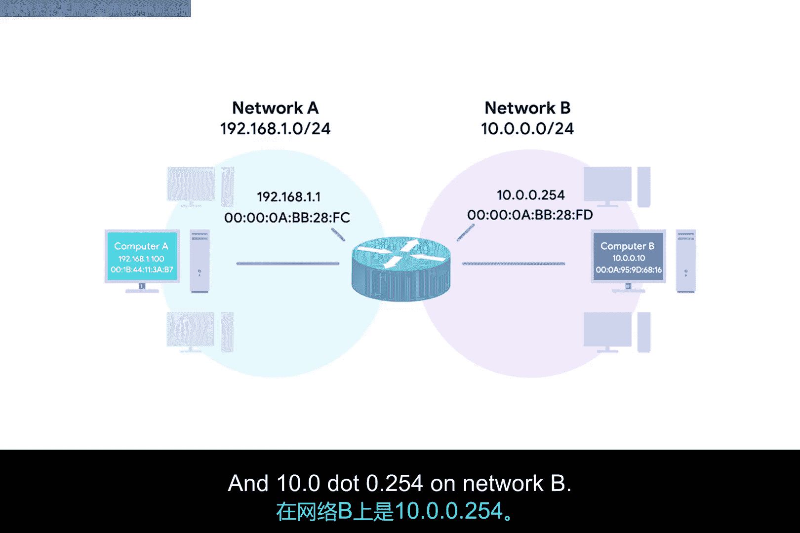

But let's introduce a third network， network C， it has an address space of 172。16。1。0/23。

There's a second router connecting network B and network C。

Its interface on network B has an IP of 10。0。0。1， and its interface on network C has an IP of 172。16。

1。1。This time around， our computer at 192。168。1。100 wants to send some data to the computer that has an IP of 172。

16。1。100 we'll skip the data link layer stuff， but remember that it's still happening of course。

The computer at 192。168。1。100 knows that 172。16。1。100 is not on its local network。

 so it sends the packet to its gateway， the router between network A and network B。Again。

 the router inspects the content of this packet， it sees a destination address of 172。16。1。100。

 and through a lookup of its routing table， it knows that the quickest way to get to the 172。16。1。

0/23 network is via another router with an IP of 10。0。0。1。

The router decrements the TTL field and sends it along to the router of 10。0。0。1。

This router then goes through the motions， knows that the destination IP of 172。16。1。

100 is directly connected and forwards the packet to its final destination。

 that's the basics of routing。

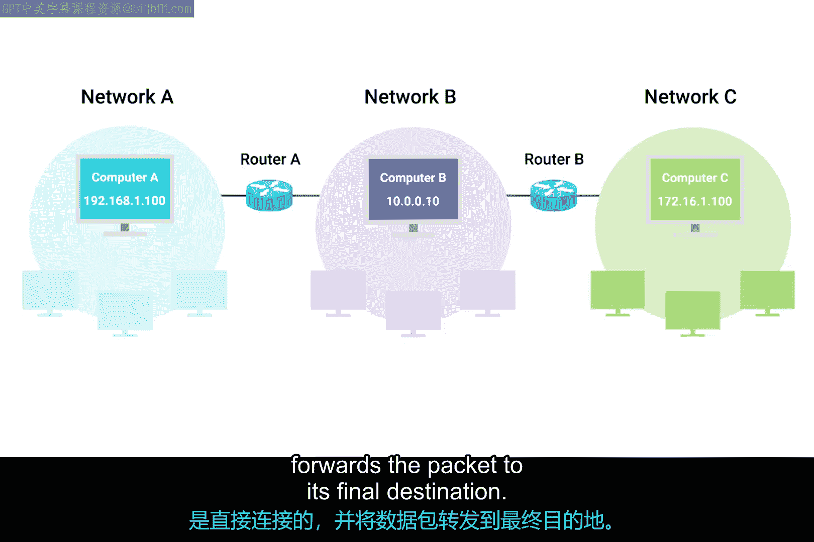

The only difference between our examples and how things work on the internet is scale routers are usually connected to many more than just two networks。

 very often your traffic may have to cross a dozen routers before it reaches its its final destination。

And finally， in order to protect against breakages。

 core internet routers are typically connected in a mesh。

 meaning that there might be many different paths for a packet to take。Still。

 the concepts are all the same， routers inspect the destination IP。

 look at their routing table to determine which path is the quickest。

 and forward the packet along the path。This happens over and over every single packet。

 making up every single bit of traffic all over the internet at all times， pretty cool stuff huh。

