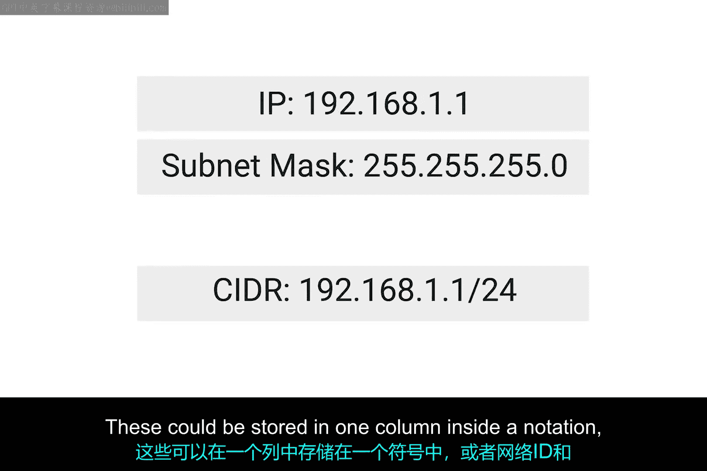
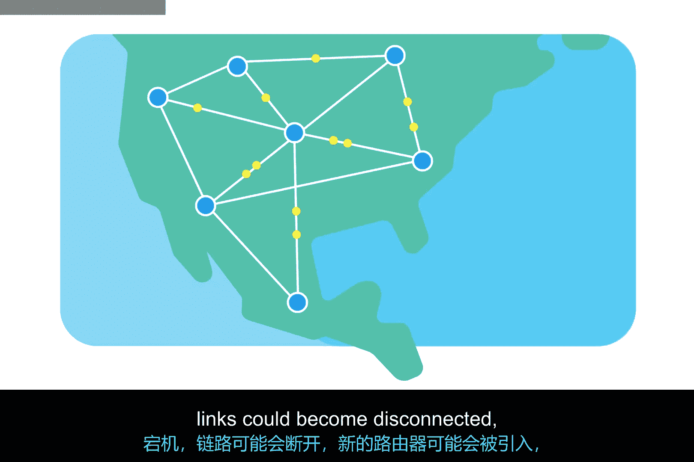

# 谷歌《IT支持（计算机网络⧸操作系统，第2、3课⧸共5课）｜Google IT Support》中英字幕deepseek p30 28_路由表.zh_en -BV1uyqcYpExr_p30-

During our earlier video on the basics of routing， you might have noticed a bunch of references to something known as a routing table。

 routing itself is a pretty simple concept and you'll find that routing tables aren't that much more complicated。

The earliest routers were just regular computers of the era。 They had two network interfaces。

 bridge two networks and had a routing table that was manually updated。 In fact。

 all major operating systems today still have a routing table that they consult before transmitting data。

 you could still build your own router today if you had a computer with two network interfaces and a manually updated routing table。

Roouting tables can vary a ton depending on the make and class of the router。

 but they all share a few things in common。The most basic routing table will have four columns。

Destination network。This column would contain a row for each network that the router knows about。

 This is just the definition of the remote network， a network ID and a net mask。

These could be stored in one column insider notation。

 or the network ID and net maskask might be in a separate column， either way， it's the same concept。

 the router has a definition for a network and therefore knows what IP addresses might live on that network。

When the router receives an incoming packet， it examines the destination IP address and determines which network it belongs to。

A routing table will generally have a catch all entry that matches any IP address that it doesn't have an explicit network listing for。

Next top。This is the IP address of the next router that should receive data intended for the destination networking question。

Or this could just state the network is directly connected and that there aren't any additional hops needed。

Total hops。This is the crucial part to understand routing and how routing tables work on any complex network like the internet。

 there will be lots of different paths to get from point A to point B。

 routers try to pick the shortest possible path at all times to ensure timely delivery of data。

 but the shortest possible path to a destination network is something that could change over time。

 sometimes rapidly intermediary routers could go down。 Links could become disconnected。

 new routers could be introduced。 traffic congestion could cause certain routes to become too slow to use。

 will'll get to know how routers know the shortest path in an upcoming video For now。

 it's just important to know that for each next hop and each destination network。

 the router will have to keep track of how far away that destination currently is。

That way， when it receives updated information from neighboring routers。

 it'll know if it currently knows about the best path or if a new better path is available interface。

The router also has to know which of its interfaces it should forward traffic。

 matching the destination network out of。 In most cases， routing tables are pretty simple。

 The really impressive part is that many core internet routers have millions of rows in the routing tables。

These must be consulted for every single packet that flows through a router on its way to its final destination。

 What's also impressive is how much you've learned about routers， routing and routing tables。

 Nice work。I'll see you in the next video on interior gateway Pros。

