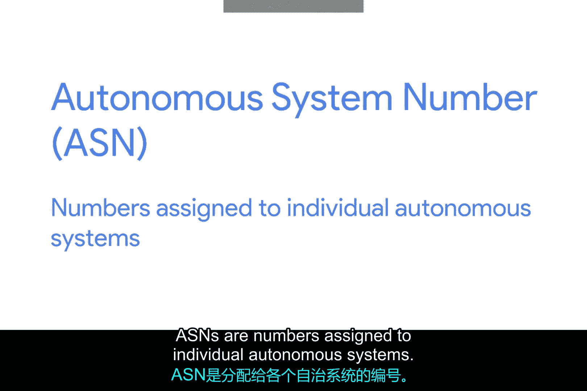

# 谷歌《IT支持（计算机网络⧸操作系统，第2、3课⧸共5课）｜Google IT Support》中英字幕deepseek p32 30_外部网关协议.zh_en -BV1uyqcYpExr_p32-

Exterior gateway protocols are used to communicate data between routers representing the edges of an autonomous system。

Since routers sharing data using interior gateway protocols are all under control of the same organization。

 routers use exterior gateway protocols when they need to share information across different organizations。

Exterior gateway protocols are really key to the internet operating how it does today。

 so thanks exterior gateway protocols。The internet is an enormous mesh of autonomous systems at the highest levels。

 core internet routers need to know about autonomous systems in order to properly forward traffic。

Since autonomous systems are known and defined collections of networks。

 getting data to the edge router of an autonomous system is the number one goal of core internet routers。

The IANA or the Internet Ass Ners Authority is a nonprofit organization that helps manage things like IP address allocation。

The internet couldn't function without a single authority for these sorts of issues。

 otherwise anyone could try and use any IP space they wanted， which would cost total chaos online。

Along with managing IP address allocation， the IANA is also responsible for ASN or autonomous system number allocation ASNs are numbers assigned to individual autonomous systems。

Just like IP addresses， ASNs are 32 bit numbers， but unlike IP addresses。

 they're normally referred to as just a single decimal number instead of being split out into readable bits。

 there are two reasons for this First IP addresses need to be able to represent a network ID portion and a host ID portion for each number。

This is more easily accomplished by splitting the number in four sections of eight bits。

 especially back in the day when address classes rule the world。

In ASN never needs to change in order for it to represent more networks or hosts。

 It's just the core internet routing tables that need to be updated to know what the ASSN represents。

 Second， ASNs are looked at by humans far less often than I addresses are so because it can be useful to be able to look at the I9。

100。100。100 and know that 9。0。0。0/8 address space is owned by IBM ASNs represent entire autonomous systems just being able to look up the fact that ASS 19604 belongs to IBM is enough。

Unless you one day end up working at an Internet service provider。

 understanding more details about how exterior gateway protocols work is out of scope for most people in IT。

 but grasping the basics of autonomous systems， ASNs。

 and how core internet routers route traffic between them is important to understand some of the basic building blocks of the internet。

