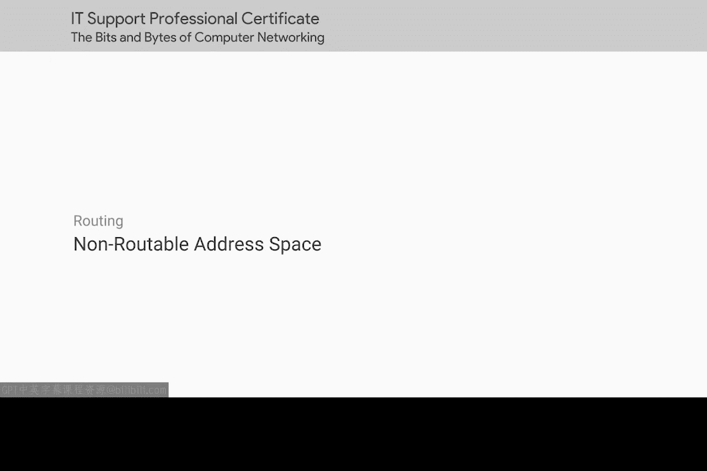
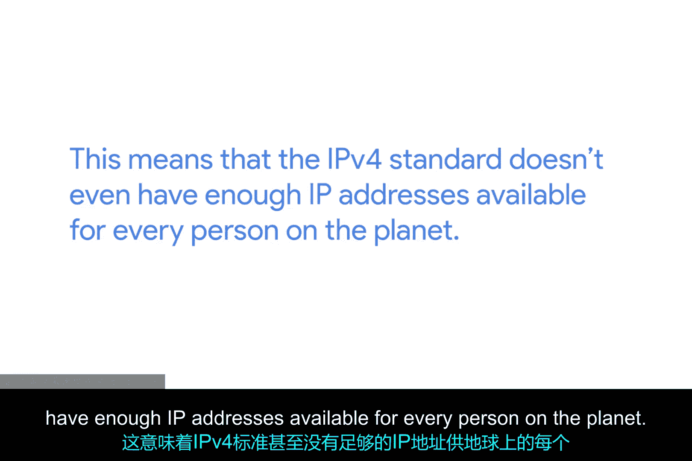

# 谷歌《IT支持（计算机网络⧸操作系统，第2、3课⧸共5课）｜Google IT Support》中英字幕deepseek p33 31_不可路由的地址空间.zh_en -BV1uyqcYpExr_p33-

And now a brief history lesson， even as far back as 1996。

 it was obvious that the internet was growing at a rate that couldn't be sustained。

When IP was first defined， it defined an IP address as a single 32 bit number。

A single 32 bit number can represent 4294967295 unique numbers， which definitely sounds like a lot。

 but as of 2017。There are an estimated 7。5 billion humans on earth。

 This means that the IPV4 standard doesn't even have enough I P addresses available for every person on the planet。

 It also can account for entire data centers filled with thousands and thousands of computers required for large scale technology companies to operate。

So in 1996， RFC 1918 was published， RFC stands for requestquest for Com。

And is a longstanding way for those responsible for keeping the internet running to agree upon the standard requirements to do so。

Rf 1918 outlined a number of networks that would be defined as non routeutable address space。

Non routeable address space is basically exactly what it sounds like。

 they are ranges of Is set aside for use by anyone that cannot be routed to。

Not every computer connected to the internet needs to be able to communicate with every other computer connected to the internet。

Non routeutable address space allows for nodes on such a network to communicate with each other。

 but no gateway router will attempt to forward traffic to this type of network。

This might sound super limiting， and in some ways it is， in a future module。

 will'll cover a technology known as Nat or a network address translation。

It allows for computers on non routeutable address space to communicate with other devices on the internet。

 but for now， let's just discuss non routeutable address space in a vacuum。

RfC 1918 defined three ranges of IP addresses that will never be routed anywhere by core routers。

That means that they belong to no one and that anyone can use them。 In fact。

 since they're separated from the way traffic moves across the internet。

 there's no limiting to how many people might use these addresses for their internal networks。

The primary three ranges of non routeutable address space are。10。0。0。0 slash 8。172。16。0。0/12。And 192。

168。0。0/16。These ranges are free for anyone to use for their internal networks。

 It should be called out that interior gateway protocols will route these address spaces。

 so they're appropriate for use within an autonomous system， but exterior gateway protocols will not。

 We've covered a lot in this module and congratulations to you for sticking with it。Next up。

 we'll cover the transport and application layers， but first up， another quiz。

You can do it and remember， you can always go back and review the material as much as you need to。

