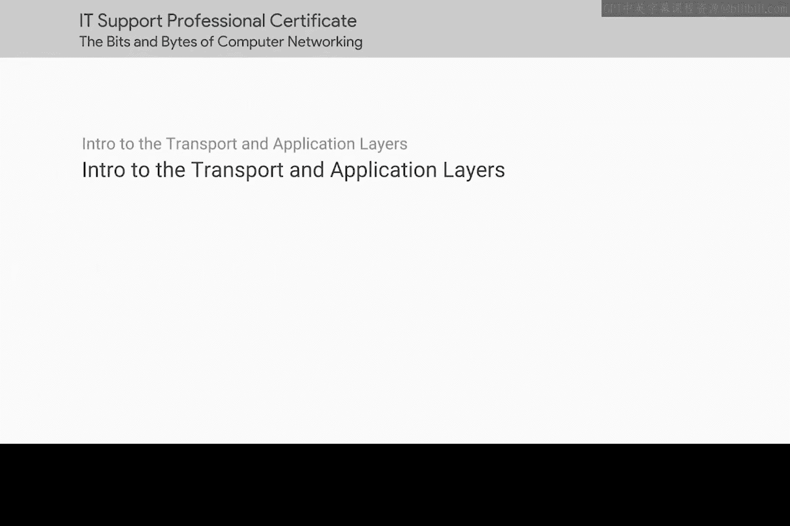
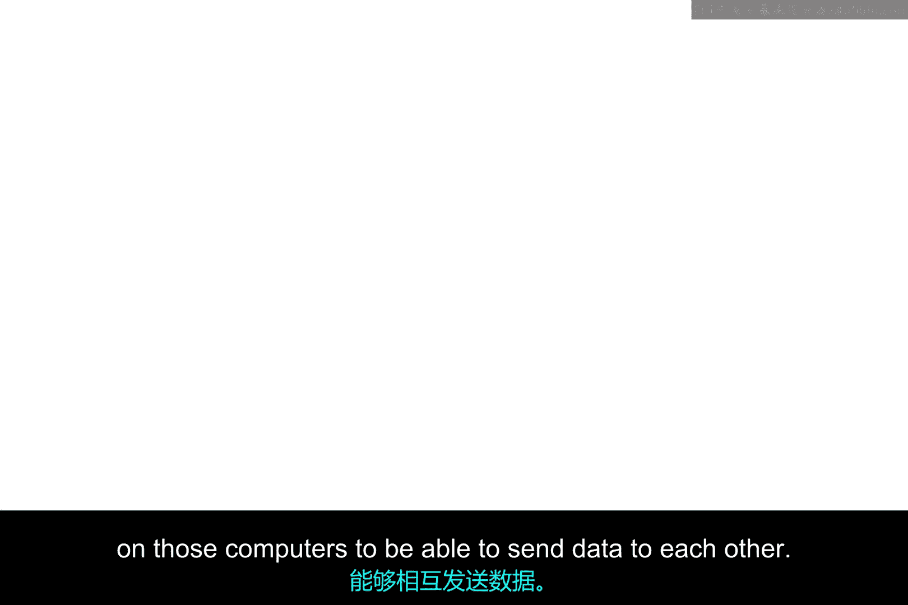
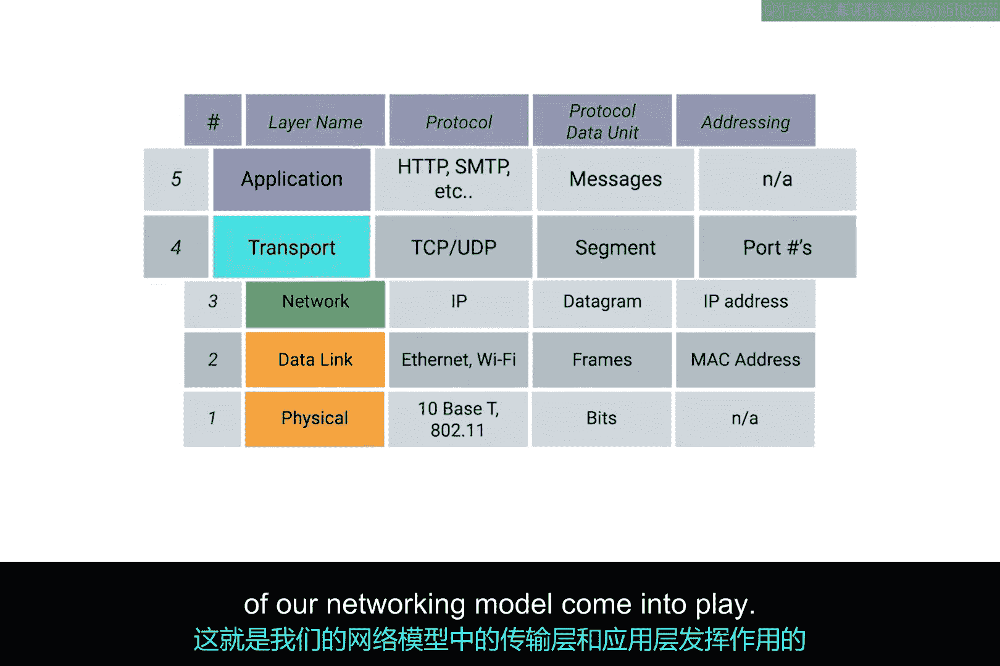
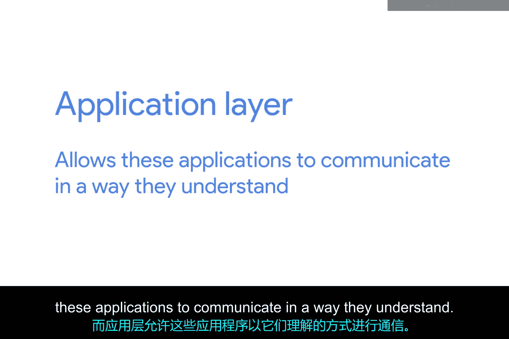

# 谷歌《IT支持（计算机网络⧸操作系统，第2、3课⧸共5课）｜Google IT Support》中英字幕deepseek p35 33_传输层与应用层介绍.zh_en -BV1uyqcYpExr_p35-

The first three layers of our network model have helped us describe how individual nodes on a network can communicate with other nodes on either their own network or mobile。

But we haven't discussed how individual computer programs can communicate with each other。

 it's time to dive into this because that's really the aim of computer networking。

 we network computers together， not just so they can send data to each other。

 but because we want programs running on those computers to be able to send data to each other。

This is where the transport and application layers of our networking model come into play。

In short， the transport layer allows traffic to be directed to specific network applications。

 and the application layer allows these applications to communicate in a way they understand。

By the end of this module， you'll be able to describe TCP ports and sockets and identify the different components of a TCP header。

You'll also be able to show the difference between connection oriented and connection lists protocols and explain how TCP is used to ensure data integrity。

Are you ready to be transported to the next lesson， I hope so。

 because the transport layer is up next， see you there。

