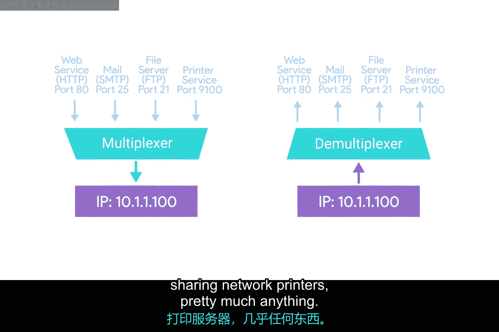
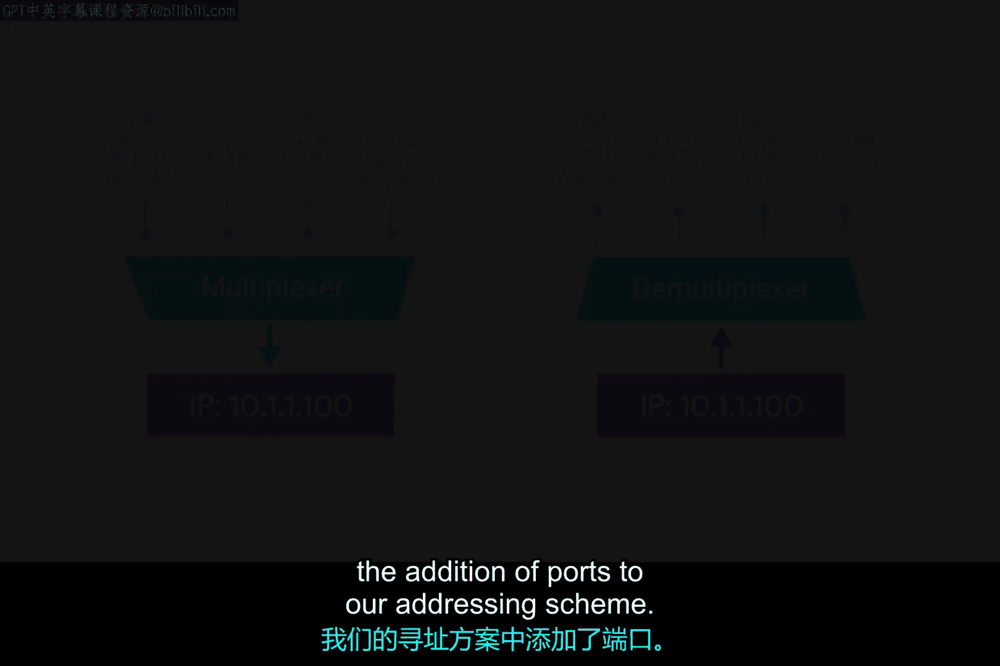

# 谷歌《IT支持（计算机网络⧸操作系统，第2、3课⧸共5课）｜Google IT Support》中英字幕deepseek p36 34_传输层.zh_en -BV1uyqcYpExr_p36-

The transport layer is responsible for lots of important functions of reliable computer networking。

These include multiplexing and demplexxing traffic。

Establishing long running connections and ensuring data integrity through error checking and data verification。

By the end of this lesson， you should be able to describe what multiplexing and de multixing are and how they work。

 you'll be able to identify the differences between TCP and UDP。

 explain the threeway handshake and understand how TCP flags are used in this process。Finally。

 you'll be able to describe the basics of how firewalls keep networks safe。

The transport layer has the ability to multiplex and demx。

 which sets this layer apart from all others。Multiplexing in the transport layer means that nodes on a network have the ability to direct traffic toward many different receiving services。

D multixing is the same concept just at the receiving end。

It's taking traffic that's all aimed at the same node and delivering it to the proper receiving service。

The transport layer handles multiplexing and demxing through ports。

A port is a 16 bit number that's used to direct traffic to specific services running on a networked computer。

Remember the concept of server and clients？A server or service is a program running on a computer waiting to be asked for data。

A client is another program that is requesting this data。

 different network services run while listening on specific ports for incoming requests。For example。

 the traditional port for HTTP or unencrypted web traffic is port 80。

If we want to request a web page from a web server running on a computer listening on IP 10。1。1。100。

 the traffic would be directed to port 80 on that computer。

Ports are normally denoted with a colon after the IP address。

 so the full IP and port in this scenario could be described as 10。1。1。100 colon 80。

When written this way， it's known as a socket address or socket number。

This same device might also be running an FTP or file transfer protocolto server。

FTP is an older method used for transferring files from one computer to another。

 but you still see it in use today。FTP traditionally listens on port 21。

 so if you wanted to establish a connection to an FTP server running on the same IP that our example web server was running on。

 you direct traffic to 10。1。1。100， port 21。You might find yourself working in IT support at a small business in these environments。

 a single server could host almost all of the applications needed to run a business。

 The same computer might host an internal website， the mail server for the company。

 a file server for sharing files， a print server for sharing network printers， pretty much anything。

 This is all possible because of multiplexing and demxing。

And the addition of ports to our addressing scheme。

