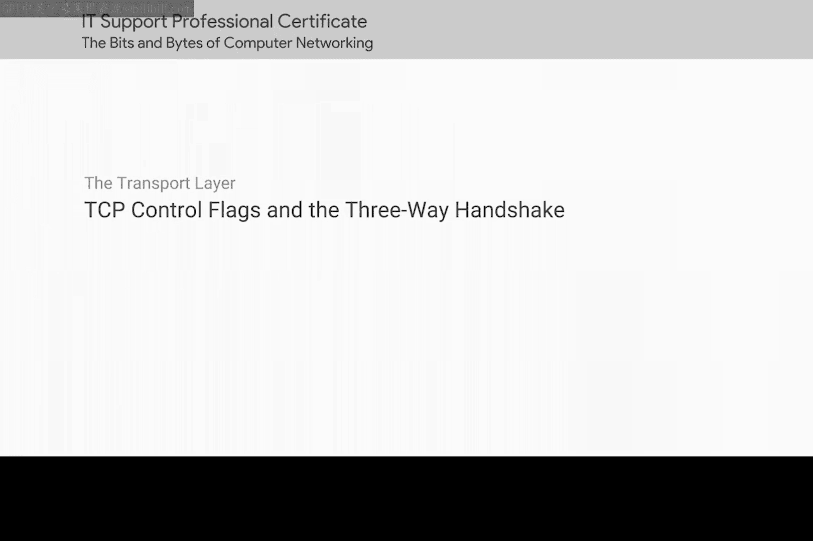
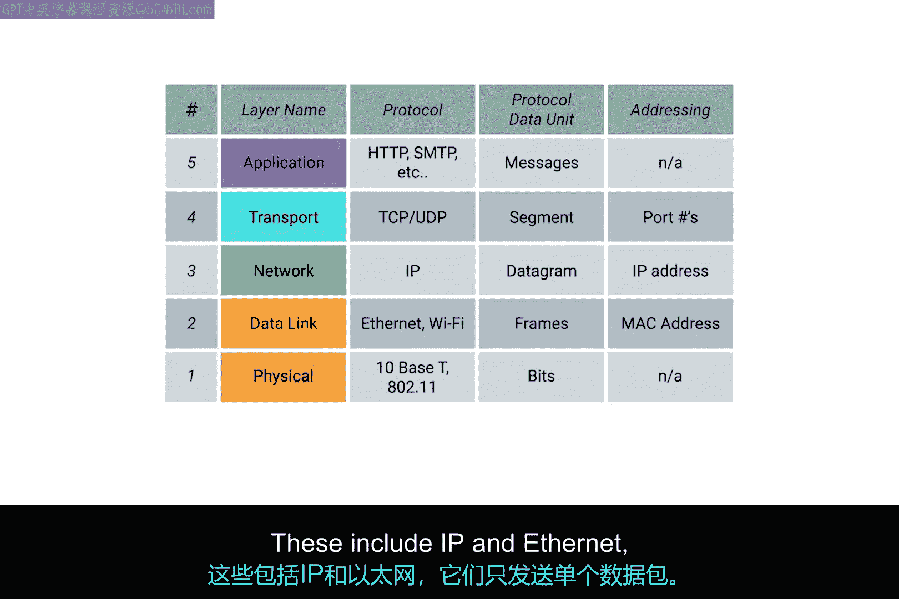
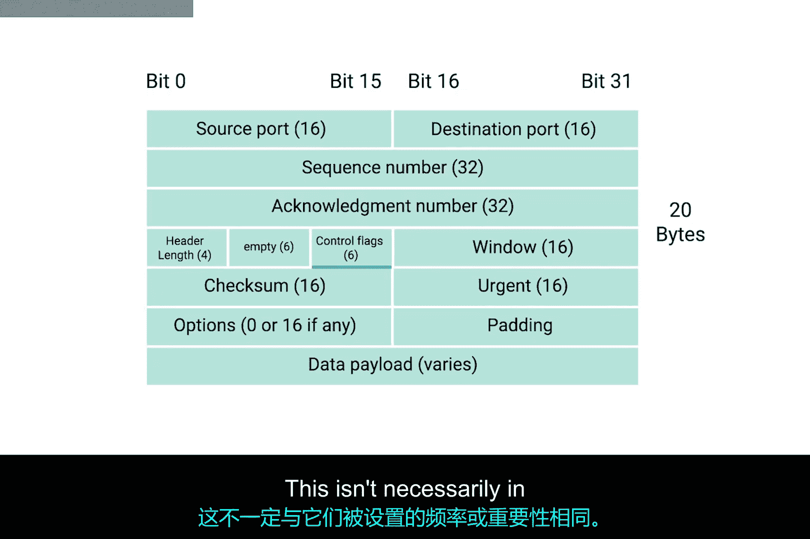
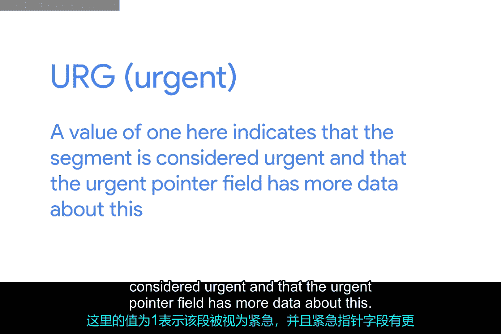
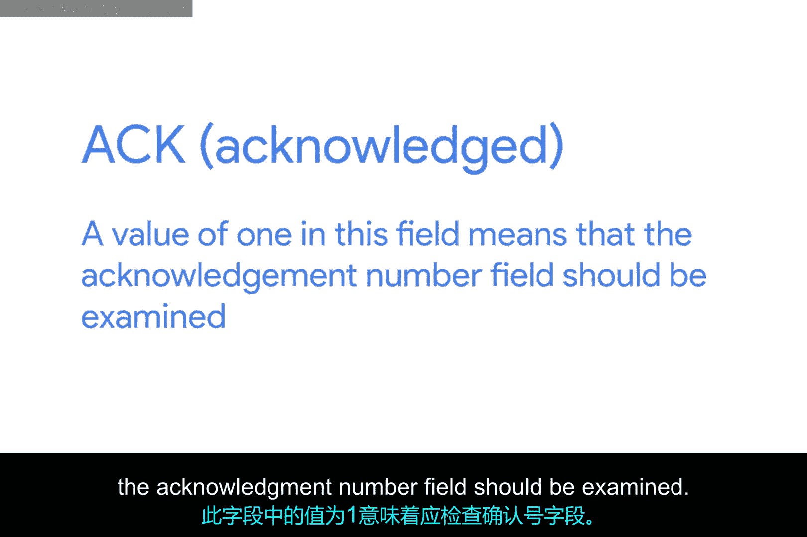
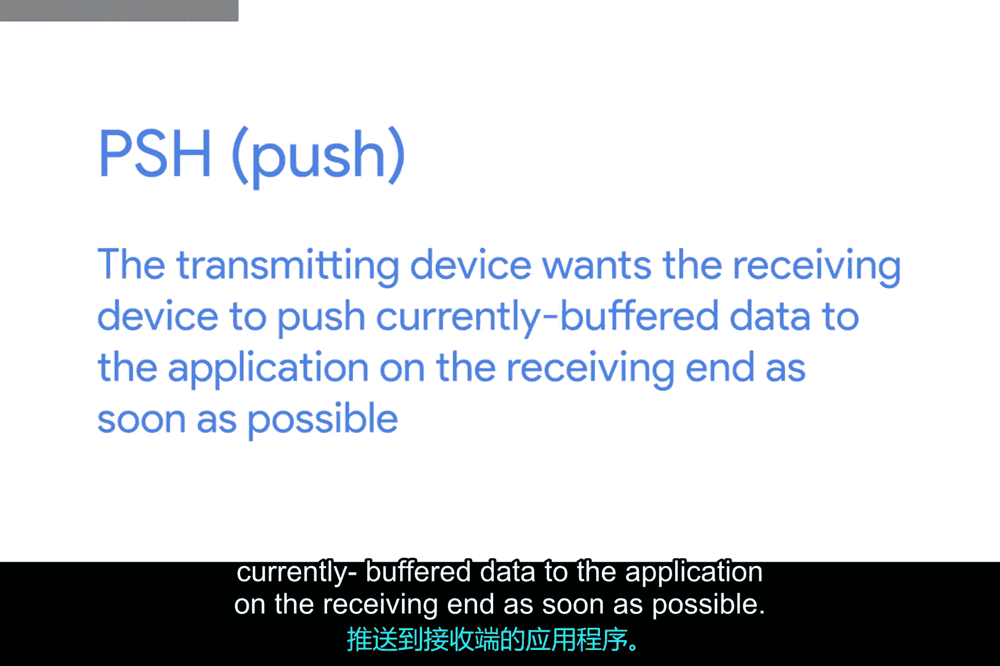
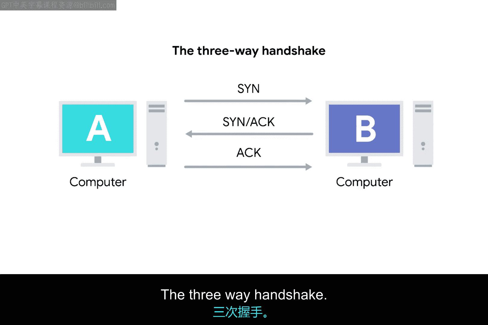
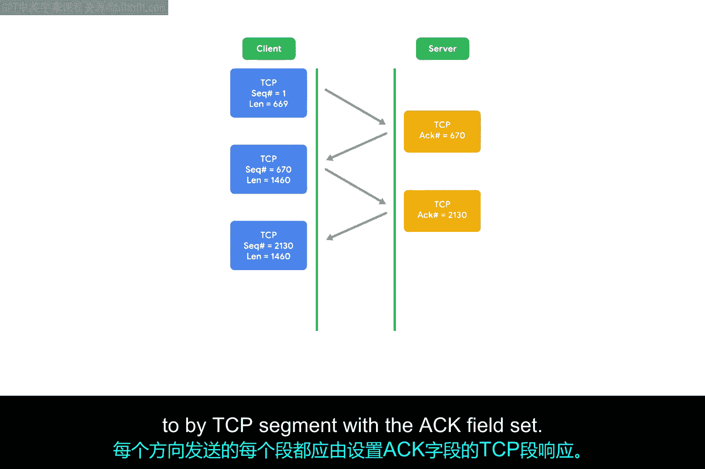
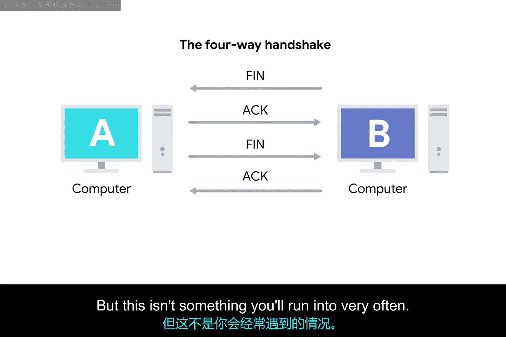

# 谷歌《IT支持（计算机网络⧸操作系统，第2、3课⧸共5课）｜Google IT Support》中英字幕deepseek p38 36_TCP控制标志与三次握手.zh_en -BV1uyqcYpExr_p38-

As a protocol， TCP establishes connections used to send long chains of segments of data。

You can contrast this with the protocols that are lower in the networking model。

These include IP and Ethernet， which just send individual packets of data。

As an IT support specialist， you need to understand exactly how that works so you can troubleshoot issues where network traffic may not be behaving in the expected manner。

 the way TCP establishes a connection is through the use of different TCP control flags used in a very specific order。

Before we cover how connections are established and closed。

 let's first define the six TCP control flags。We'll look at them in the order that they appear in a TCP header。

Heads up， This isn't necessarily in the same order of how frequently they're set or how important they are。

 The first flag is known as U RG。 This is short for urgent。

A value of one here indicates that the segment is considered urgent and that the urgent pointer field has more data about this。

Like we mentioned in the last video， this feature of TCP has never really had widespread adoption and isn't normally seen。

The second flag is a， short for acknowledge。A value of one in this field means that the acknowledgeknowment number field should be examined。

The third flag is PSH， which is short for push。This means that the transmitting device wants the receiving device to push currently buffer data to the application on the receiving end as soon as possible。

A buffer is a computing technique where a certain amount of data is held somewhere before being sent somewhere else。

This has lots of practical applications。In terms of TCP。

 it's used to send large chunks of data more efficiently by keeping some amount of data in a buffer。

 TCP can deliver more meaningful chunks of data to the program waiting for it。But in some cases。

 you might be sending a very small amount of information that you need the listening program to respond to immediately。

 This is what the push flag does。 The fourth flag is RST short for reset。

 This means that one of the sides in a TCP connection hasn't been able to properly recover from a series of missing or malformed segments。

It's a way for one of the partners in a TCP connection to basically say， wait。

 I can't put together what you mean， let's start over from scratch。 The fifth flag is SN。

 which stands for synchronize。It's used when first establishing a TCP connection and make sure the receiving end knows to examine the sequence number field。

And finally， our sixth flag is F， which is short for finishish。When this flag is set to one。

 it means the transmitting computer doesn't have any more data to send and the connection can be closed。

For a good example of how TCP control flags are used。

 let's check out how a TCP connection is established。Computer A will be our transmitting computer。

 and Comp B will be our receiving computer。To start the process off。

 computer A sends a TCP segment to Comp B with a Sinfl sent。This is Comp A's way of saying。

 let's establish a connection and look at my sequence number field so we know where this conversation starts。

Computer B then responds with a TCP segment where both the sin and act flags are set。

This is computer B's way of saying， sure， let's establish a connection and I acknowledge your sequence number。

Then computer A responds again with just the AC flag set。

 which is just saying I acknowledge your acknowledgement， let's start sending data。

 I love how polite they are to each other。This exchange， involving segments that have S， Sinac。

 and a set， happens every single time a TCP connection is established anywhere and is so famous that it has a nickname。

 the three way Handshake。

A handshake is a way for two devices to ensure that they're speaking the same protocol and will be able to understand each other。

Once the three way handshake is complete， the TCB connection is established Now。

 computer A is free to send whatever data it wants to computer B and vice versa。

Since both sides have now sent SinAC， Paris to each other。

 a TCP connection in this state is operating in full duplex。

Each segment sent in either direction should be responded to by a TCP segment with the AC field set。

This way， the other side always knows what has been received。

Once one of the devices involved with the TCP connection is ready to close the connection。

 something known as a four way handshake happens。The computer ready to close the connection sends a fin flag。

 which the other computer acknowledges with an a flag。

Then if this computer is also ready to close the connection which will almost always be the case。

 it will send a fin flag this is again responded to by an act flag hypothetically a TCP connection can stay open in simplex mode with only one side closing the connection but this isn't something you'll run into very often up next I'll sock it to you with information on TCP socket states so many networking puns okay see you there。

