# 谷歌《IT支持（计算机网络⧸操作系统，第2、3课⧸共5课）｜Google IT Support》中英字幕deepseek p39 37_TCP套接字状态.zh_en -BV1uyqcYpExr_p39-

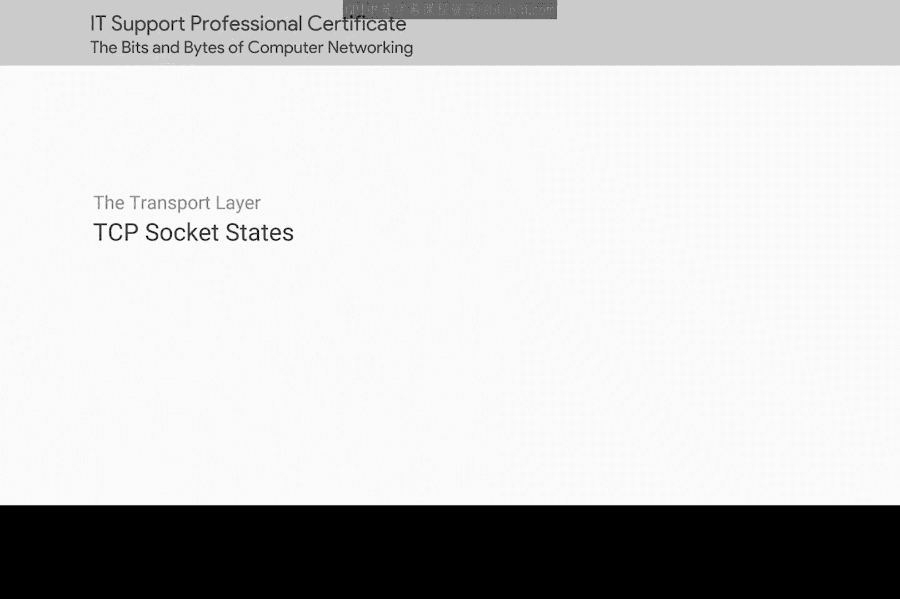

A socket is the instantiation of an endpoint in a potential TCP connection an instantiation is the actual implementation of something defined elsewhere TCP sockets require actual programs to instantiate them。

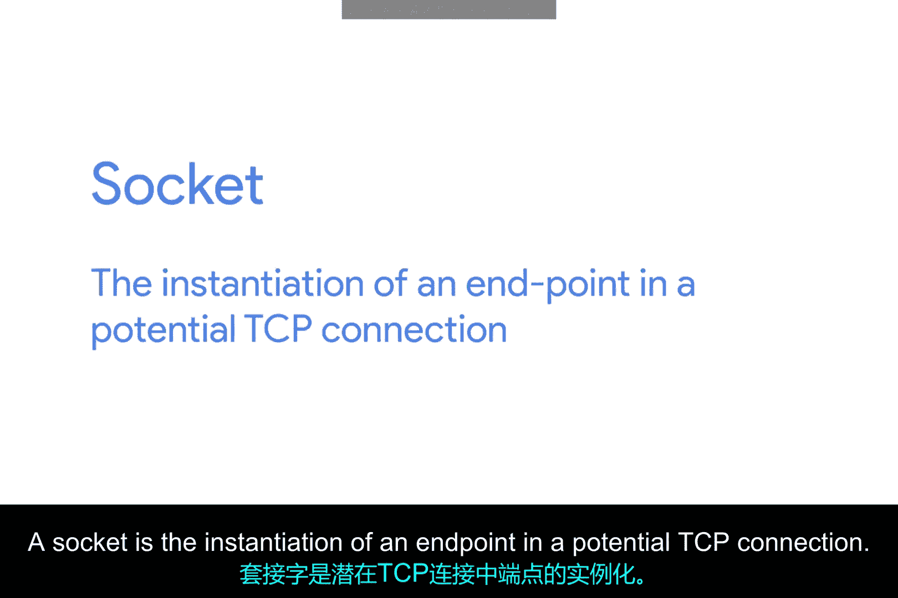

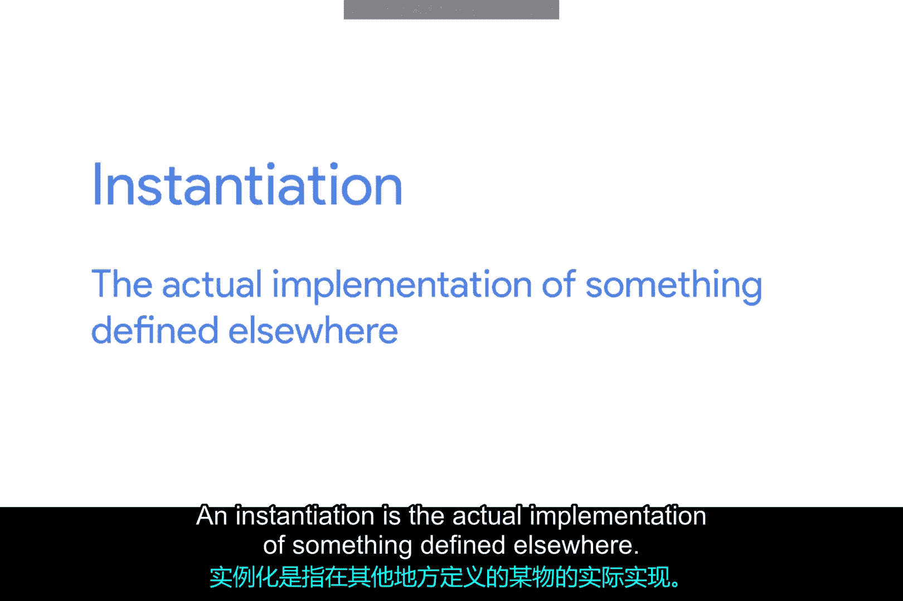

You can contrast this with a port， which is more of a virtual descriptive thing。In other words。

 you can send traffic to any port you want， but you're only going to get a response if a program has opened a socket on that port。

TCP sockets can exist in lots of states and being able to understand what those mean will help you troubleshoot network connectivity issues as an IT support specialist we'll cover the most common ones here。

Listen。Listen means that a TCP socket is ready and listening for incoming connections。

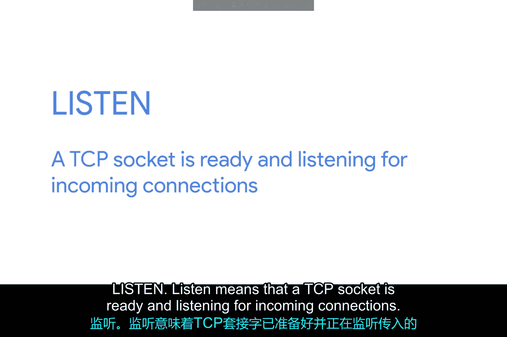

You'd see this on the server side only。Sincent。This means that a synchronization request has been sent。

 but the connection hasn't been established yet， you'd see this on the client side only。

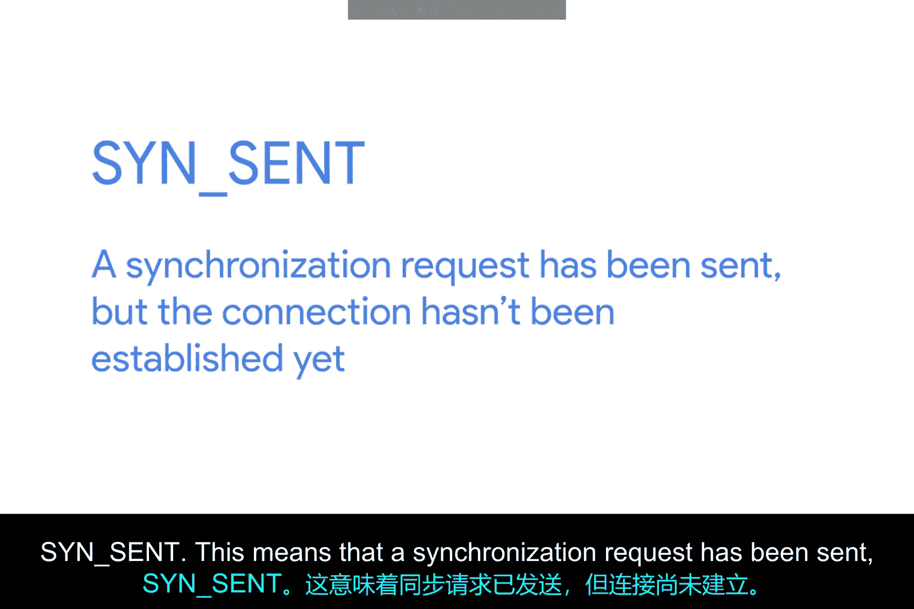

Sin received。This means that a socket previously in a listen state has received a synchronization request and sent a Sin act back。

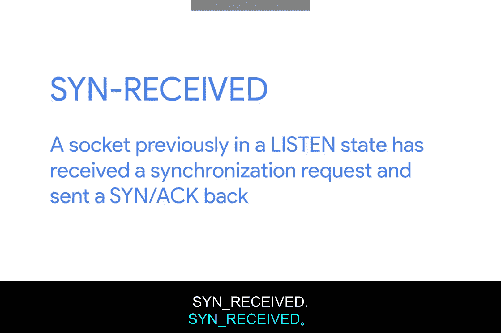

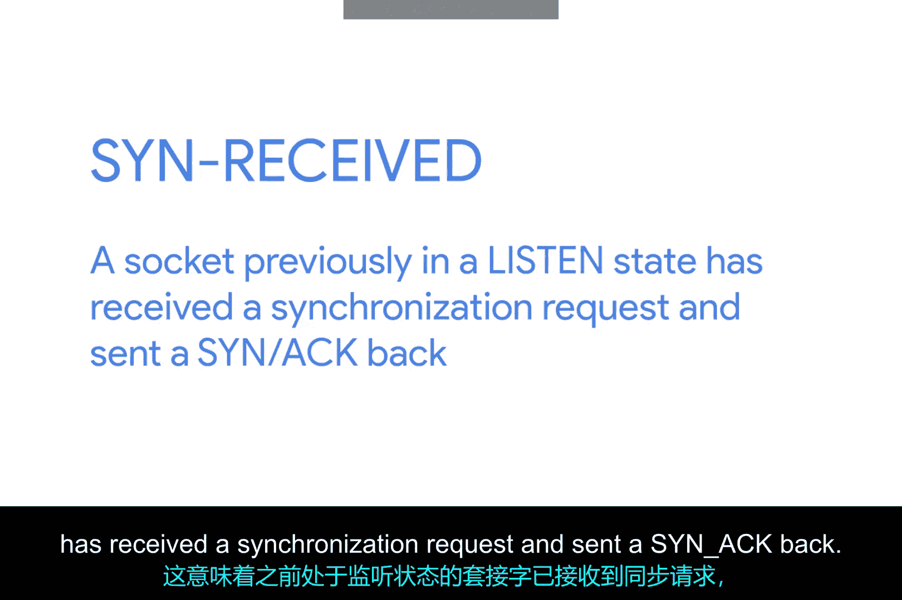

But it hasn't received the final act from the client yet， you'd see this on the server side only。

Established。This means that the TCP connection is in working order and both sides are free to send each other data。

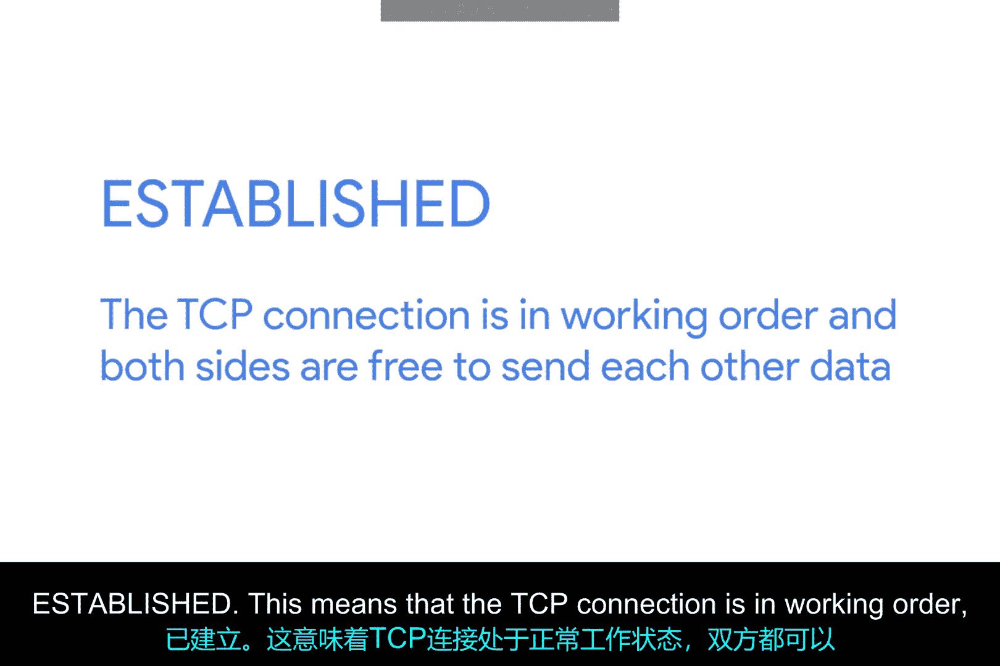

You'd see this state on both the client and server sides of a connection。

 this will be true of all the following socket states too， so keep that in mind。Fhin weight。

This means that a Fin has been sent， but the corresponding act from the other end hasn't been received yet。

 close weight。

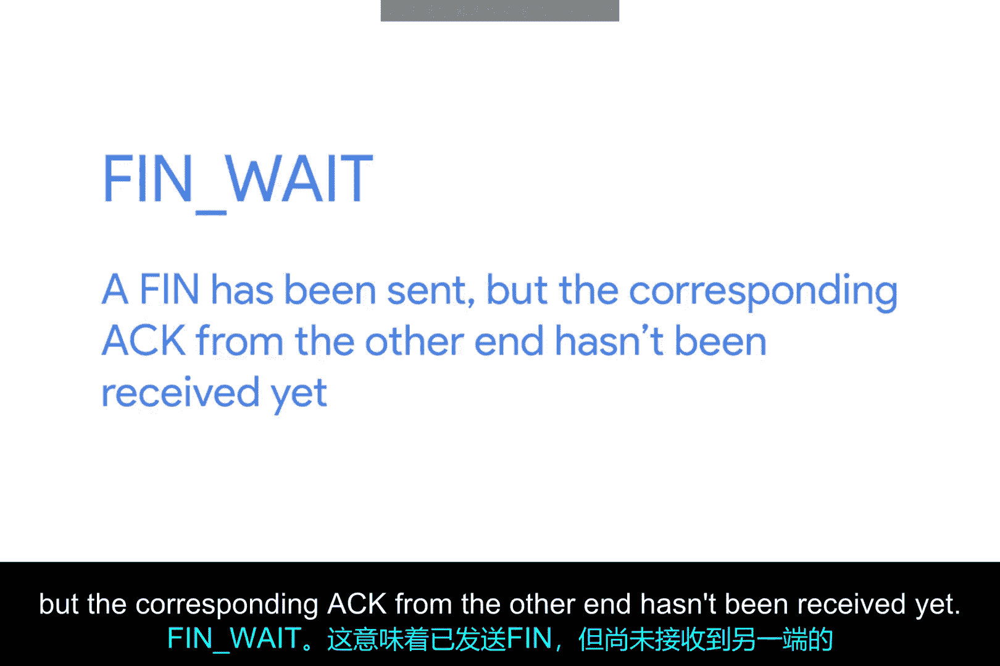

This means that the connection has been closed at the TCP layer。

 but that the application that opened the socket hasn't released its hold on the socket yet。

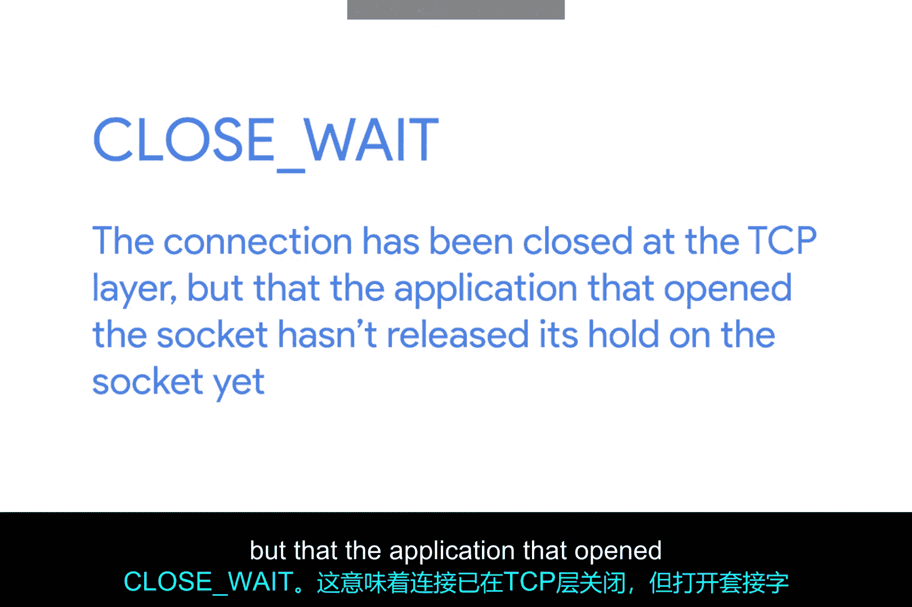

Closed。This means that the connection has been fully terminated and that no further communication is possible。

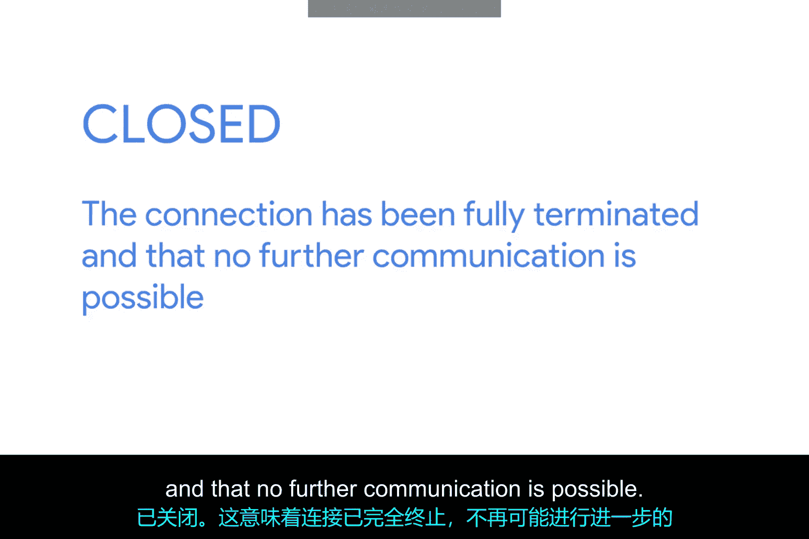

There are other TCP socket states that exist。Additionally。

 socket states and their names can vary from operating system to operating system。

 that's because they exist outside of the scope of the definition of TCP itself。TCP as a protocol。

 is universal in how it's used since every device speaking the TCP protocol has to do this in the exact same way for communications to be successful。

Choosing how to describe the state of a socket at the operating system level isn't quite as universal。

When troubleshooting issues at the TCP layer， make sure you check out the exact socket state definitions for the systems you're working with。

