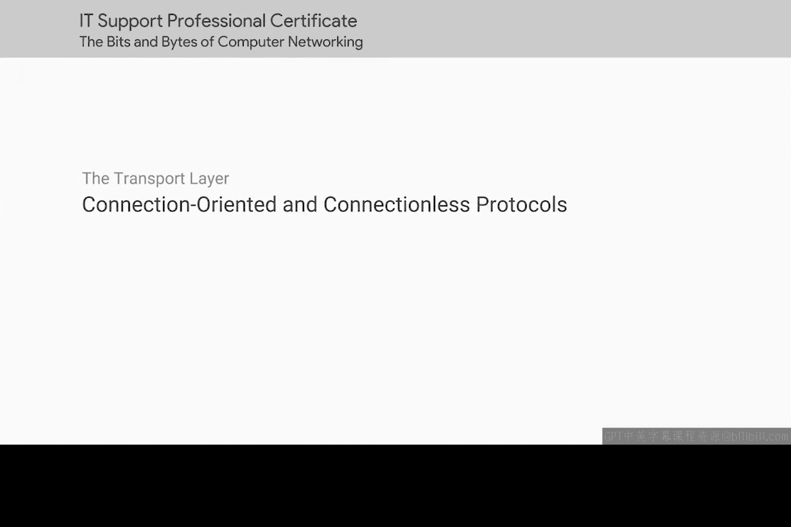
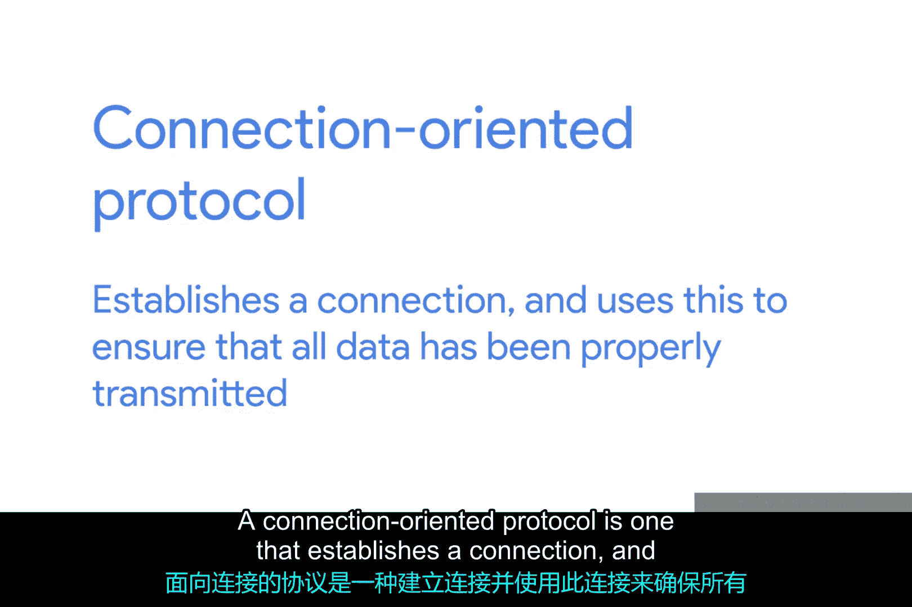
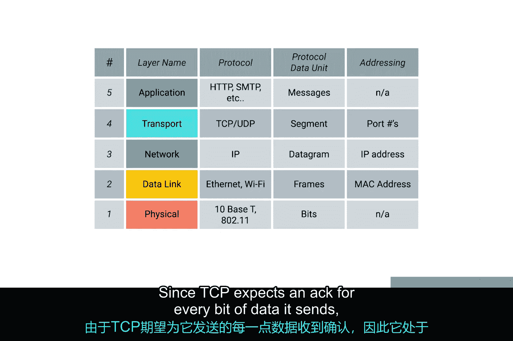
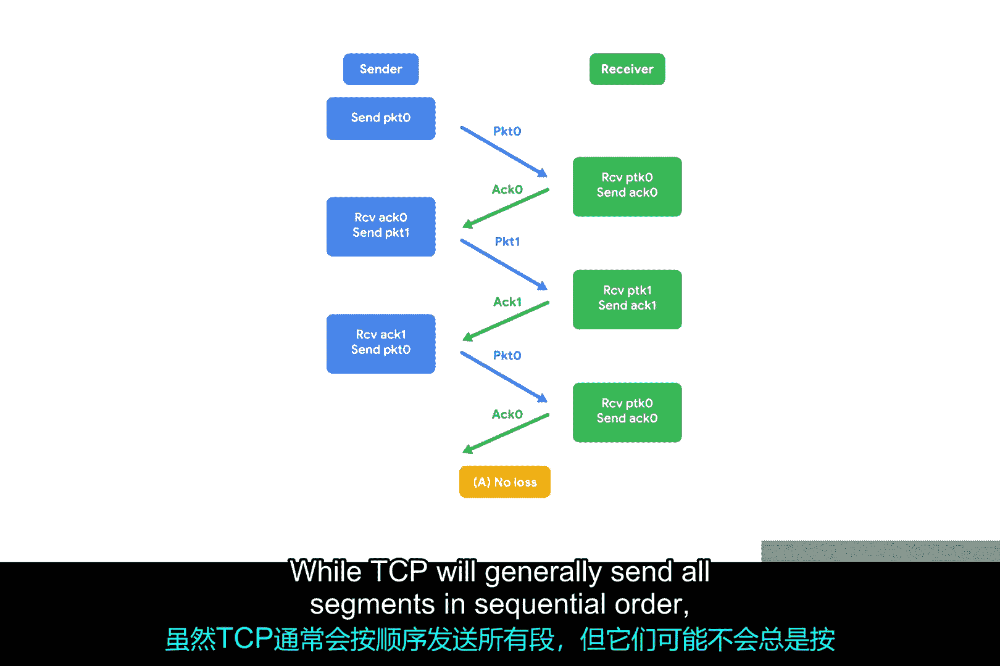
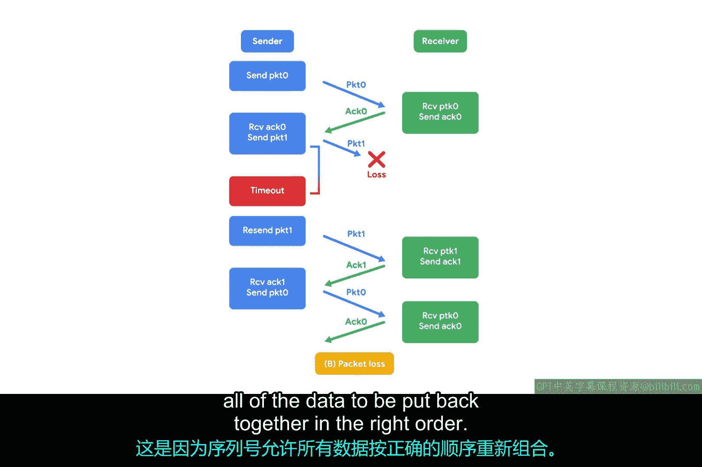

# 谷歌《IT支持（计算机网络⧸操作系统，第2、3课⧸共5课）｜Google IT Support》中英字幕deepseek p40 38_面向连接与无连接协议.zh_en -BV1uyqcYpExr_p40-

So far， we've mostly focused on TCP， which is a connection oriented protocol。

 a connection oriented protocol is one that establishes a connection and uses this to ensure that all data has been properly transmitted。

A connection at the transport layer implies that every segment of data sent is acknowledged this way。

 both ends of the connection always know which bits of data have definitely been delivered to the other side and which habit。

Connection oriented protocols are important because the internet is a vast and busy place。

 and lots of things could go wrong while trying to get data from point A to point B。

You might remember from our lesson about the physical layer that even some minor crosstalk from a neighboring twisted pair in the same cable can be enough to make a cyclical redundancy check fail。

This could cause the entire frame to be discarded， yikes。

If even a single bit doesn't get transmitted properly。

 the resulting data is often incomprehensible by the receiving end。

And remember that at the lowest level， a bit is just an electrical signal within a certain voltage range。

But there are plenty of other reasons why traffic might not reach its destination beyond line errors。

It could be anything， pure congestion might cause a router to drop your traffic in favor of forwarding more important traffic。

 or a construction company could cut a fiber cable connecting two ISPs， anything's possible。

Connection oriented protocols like TCP protect against this by forming connections and through the constant stream of acknowledgeknowledgments。

Our protocols at lower levels of our network model like IP and EtherNe。

 do use checkums to ensure that all the data they received was correct。

 but did you notice that we never discussed any attempts at resending data that doesn't pass this check？

That's because that's entirely up to the transport layer protocol。At the IP or ethernet level。

 if a checkup doesn't compute， all of that data is just discarded。

 it's up to TCP to determine when to resend this data。

Since TCP expects an AC for every bit of data it sends。

 it's in the best position to know what data successfully got delivered and can make the decision to resend a segment if needed。

This is another reason why sequence numbers are so important。

 while TCP will generally send all segments in sequential order。

 they may not always arrive in that order。

If some of the segments had to be resent due to errors at lower layers。

 it doesn't matter if they arrive slightly out of order。

 this is because sequence numbers allow for all of the data to be put back together in the right order。

 it's pretty handy。

Now， as you might have picked up on， there's a lot of overhead with connection oriented protocols like TCP。

 you have to establish the connection， you have to send a stream of constant streams of acledgments。

 you have to tear the connection down at the end that all accounts for a lot of extra traffic。

While this is important traffic， it's really only useful if you absolutely positively have to be sure your data reaches its destination。

You can contrast this with connectionless protocols the most common of these is known as UDP or user Datacrme protocol Unlike TCP。

 UDP doesn't rely on connections and it doesn't even support the concept of an acknowledgement。

With UDP， you just set a destination port and send the packet。

This is useful for messages that aren't super important。 a great example of UDP is streaming video。

Let's imagine that each UDP datagram is a single frame of a video for the best viewing experience。

 you might hope that every single frame makes it to the viewer。

 but it doesn't really matter if a few get lost along the way a video will still be pretty watchable unless it's missing a lot of its frames。

By getting rid of all the overhead of TCP， you might actually be able to send higher quality video with UDP。

That's because you'll be saving more of the available bandwidth for actual data transfer instead of the overhead of establishing connections and acknowledging delivered data segments。

