# 谷歌《IT支持（计算机网络⧸操作系统，第2、3课⧸共5课）｜Google IT Support》中英字幕deepseek p41 39_防火墙.zh_en -BV1uyqcYpExr_p41-

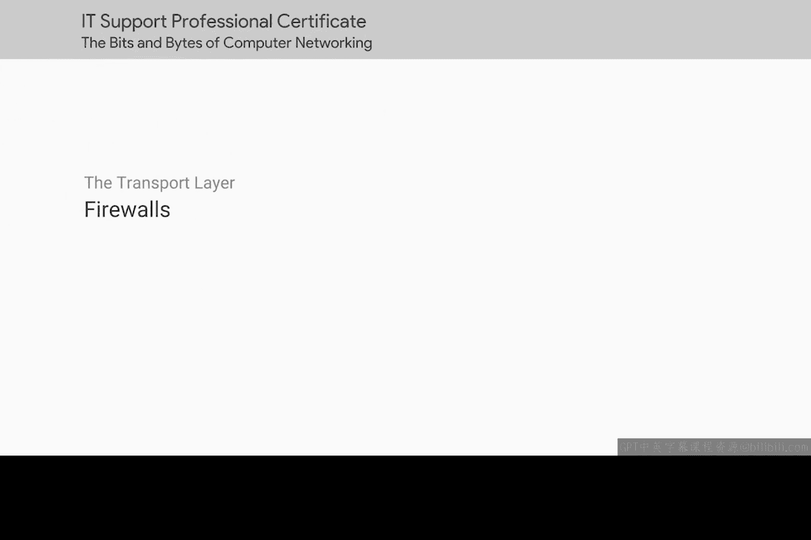

You know what network device we haven't mentioned that you're probably super familiar with？

A firewall， a firewall is just a device that blocks traffic that meets certain criteria。

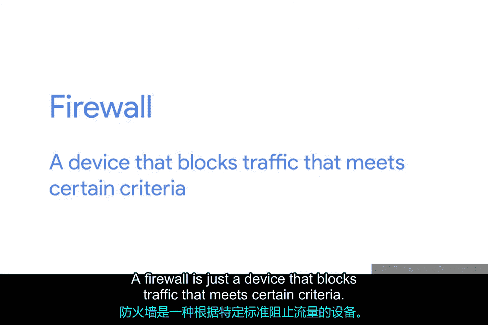

Firewalls are a critical concept to keeping a network secure since they're the primary way you can stop traffic you don't want from entering a network。

Firewalls can actually operate at lots of different layers of the network。

There are firewalls that can perform inspection of application layer traffic and firewalls that primarily deal with blocking ranges of IP addresses。

The reason we cover firewalls here is that they're most commonly used at the transportation layer。

Firewalls that operate at the transportation layer will generally have a configuration that enables them to block traffic to certain ports while allowing traffic to other ports。

Let's imagine a simple， small business network。This small business might have one server which hosts multiple network services。

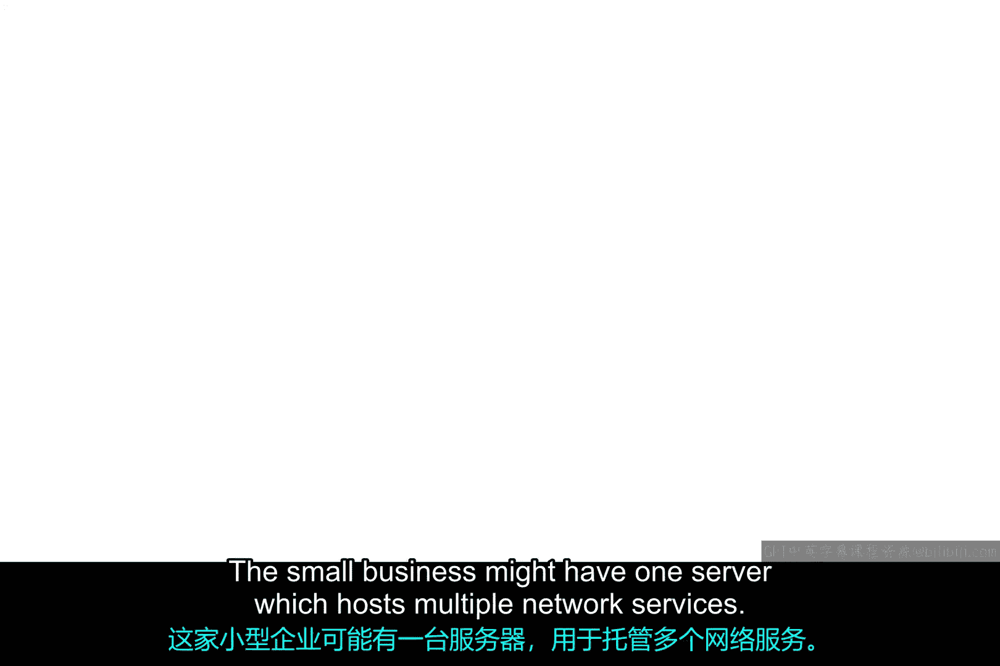

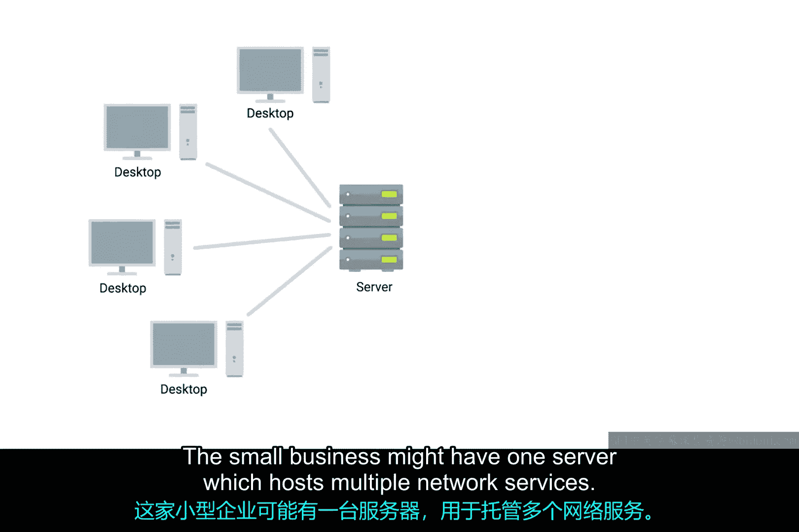

This server might have a web server that hosts the company's website while also serving as the file server for a confidential internal document。

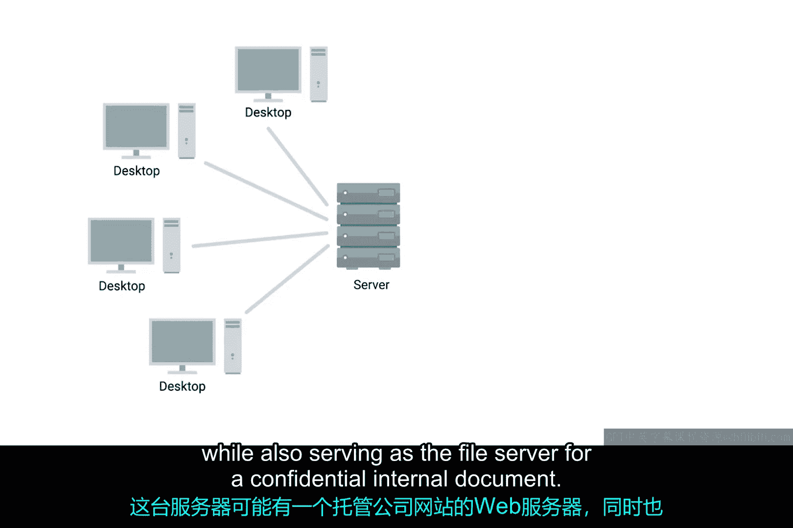

A firewall placed at the perimeter of the network could be configured to allow anyone to send traffic to port 80 in order to view the webage。

At the same time， it could block all access for external IPs to any other port so that no one outside of the local area network could access the file server。

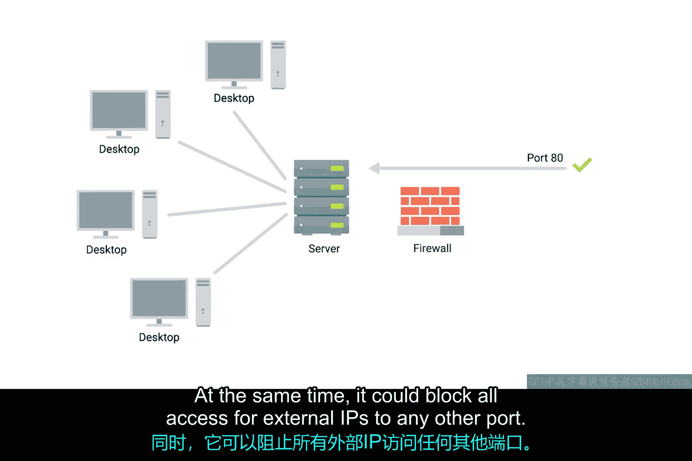

Firewalls are sometimes independent network devices。

 but it's really better to think of them as a program that can run anywhere。

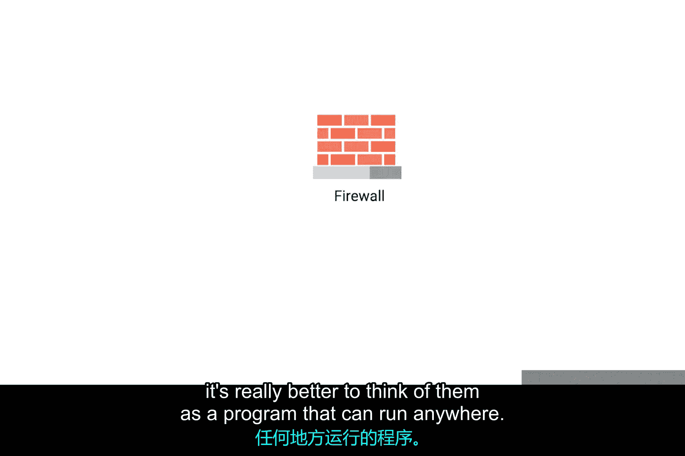

For many companies and almost all home users， the functionality of a router and a firewall is performed by the same device。

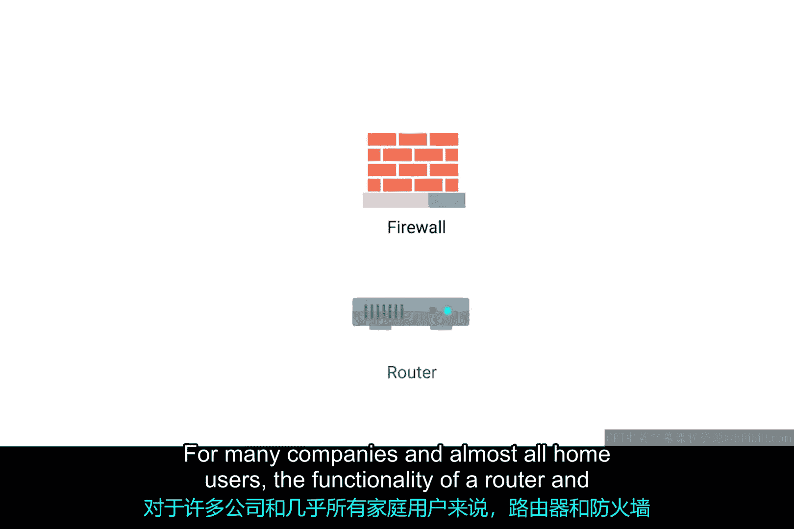

And firewalls can run on individual hosts instead of being a network device。

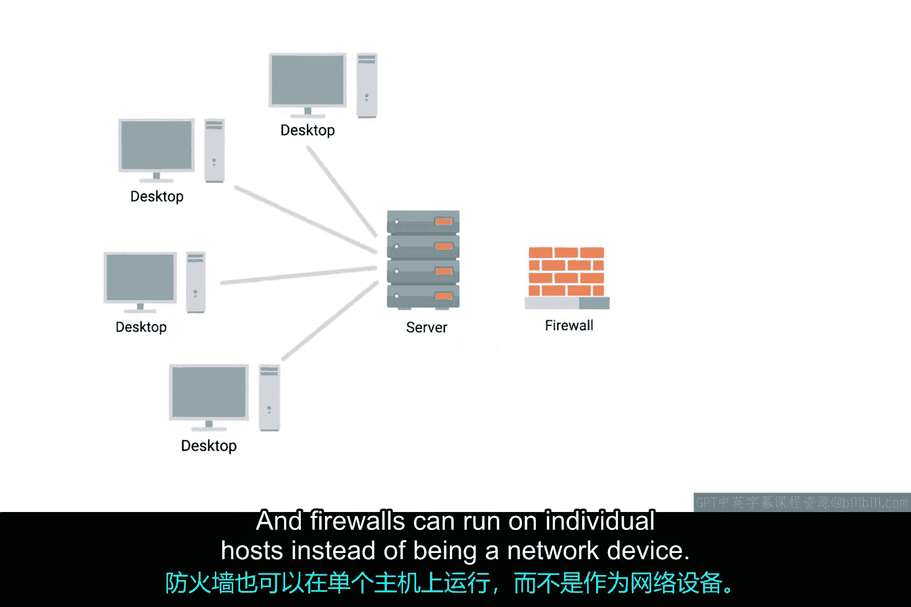

All major modern operating systems have firewall functionality built in。

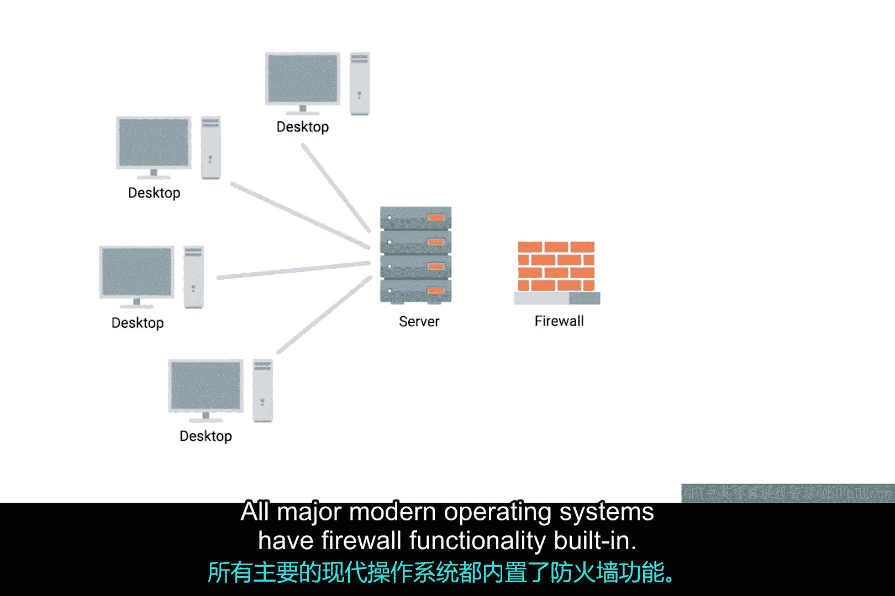

That way， blocking or allowing traffic to various ports and therefore to specific services can be performed at the host level as well。

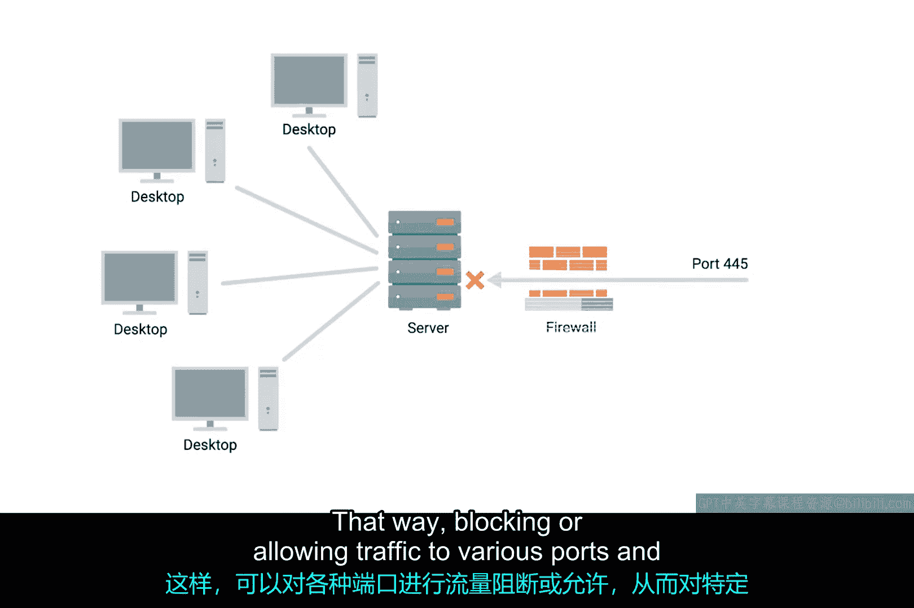

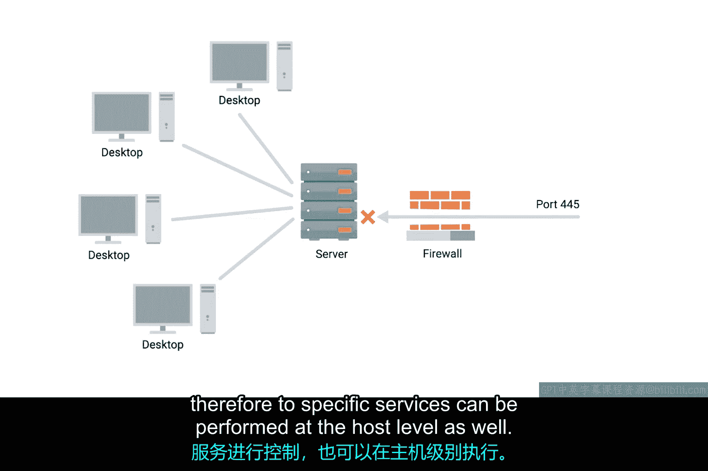

Up next， firing up your brain for a short quiz。