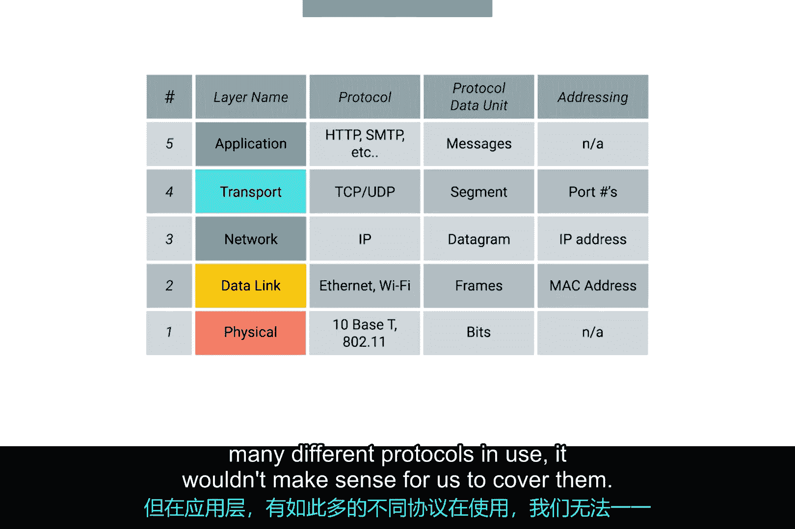

# 谷歌《IT支持（计算机网络⧸操作系统，第2、3课⧸共5课）｜Google IT Support》中英字幕deepseek p42 40_应用层.zh_en -BV1uyqcYpExr_p42-

Welcome to our lesson about the application layer。We're almost done covering all aspects of our networking model。

 which means you've already learned how computers process electrical or optical signals to send communication across a cable at the physical layer。

 we've also covered how individual computers can address each other and send each other data using Ethernett at the datalink layer We've discussed how the network layer is used by computers and routers to communicate between different networks using IP and in our last lesson we covered how the transportation layer ensures that data is received and sent by the proper applications。

You're chock full of layers of new information。Now we can finally talk about how those actual applications send and receive data using the application letter。

Just like with every other layer， TCP segments have a generic data section to them。

As you might have guessed， this payload section is actually the entire content of whatever data applications want to send to each other。

It could be contents of a web page if a web browser is connecting to a web server。

This could be the streaming video content of your Netflix app on your PlayStian connecting to the Netflix servers。

It could be the contents of a document your word processor is sending to a printer and many more things。

There are a lot of protocols used at the application layer， and they are numerous and diverse。

At the data link layer， the most common protocol is Ethernet。

 I should call out that wireless technologies do use other protocols at this layer。

 which willll cover in a future module at the network layer， use of IP is everywhere you look。

At the transport layer， TCP and UDP cover most of the use cases。But at the application layer。

 there are just so many different protocols in use， it wouldn't make sense for us to cover them。

Even so， one concept you can take away about application layer protocols is that they're still standardized across application types。

 let's dive a little deeper into web servers and web browsers for an example。

 there are lots of different web browsers， you could be using Chrome， Internet Explorer， Safari。

 you name it。They'll need to speak the protocol。 The same thing is true for web servers。

 In this case， the web browser would be the client and the web server would be the server。

The most popular web servers are Microsoft IIS， Apache， and En X。

 but they also need to all speak the same protocol this way you ensure that no matter which browser you're using。

 you'd still be able to speak to any server。For web traffic。

 the application layer protocol is known as HTTP， all of these different web browsers and web servers have to communicate using the same HTTP protocol specifications in order to ensure interoperability。

The same is true for most other classes of application。

 you might have dozens of choices for an FTP client。

 but they all need to speak the FTP protocol in the same way。

