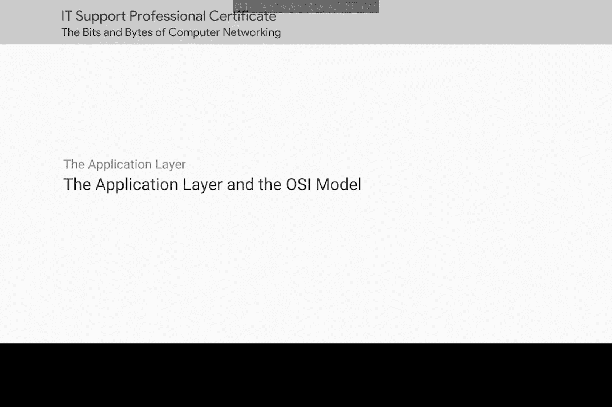
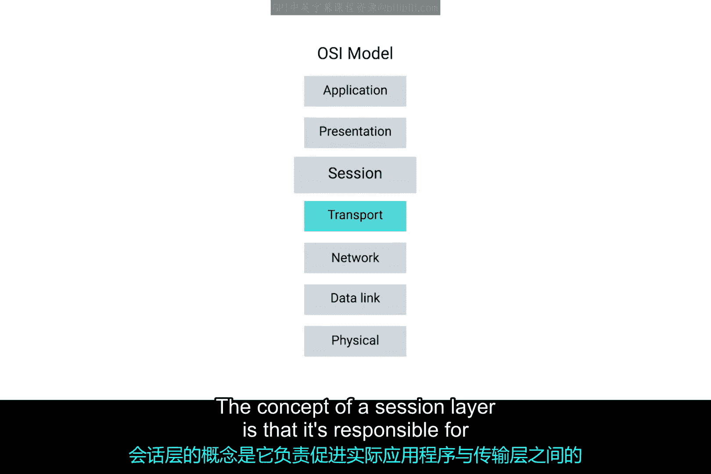
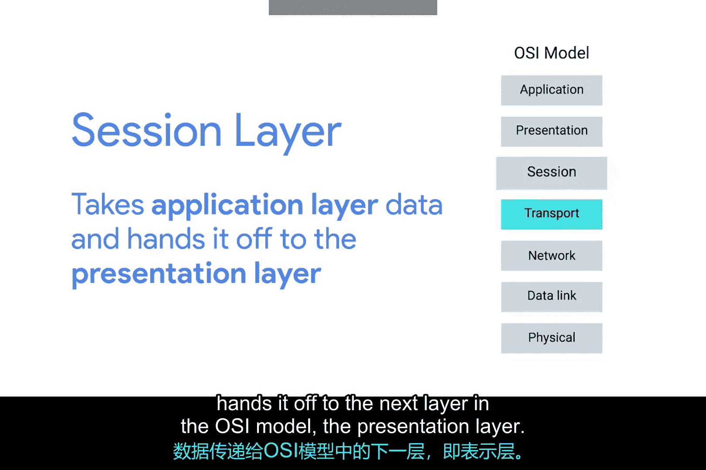
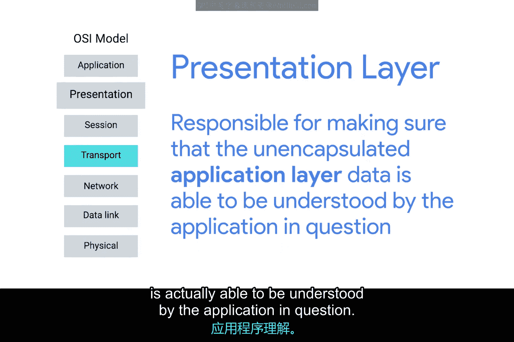
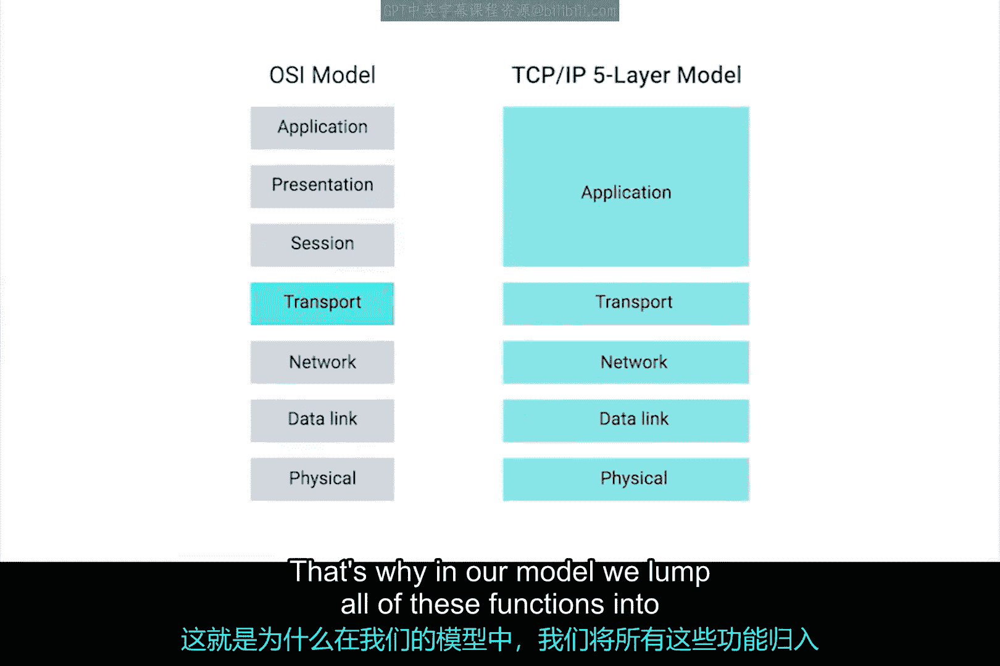
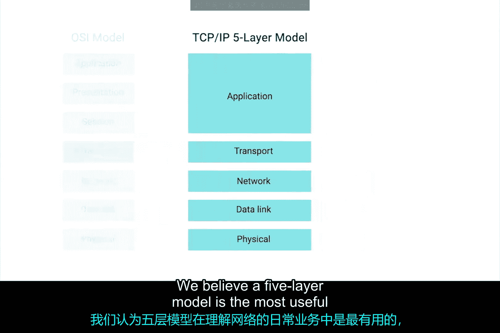
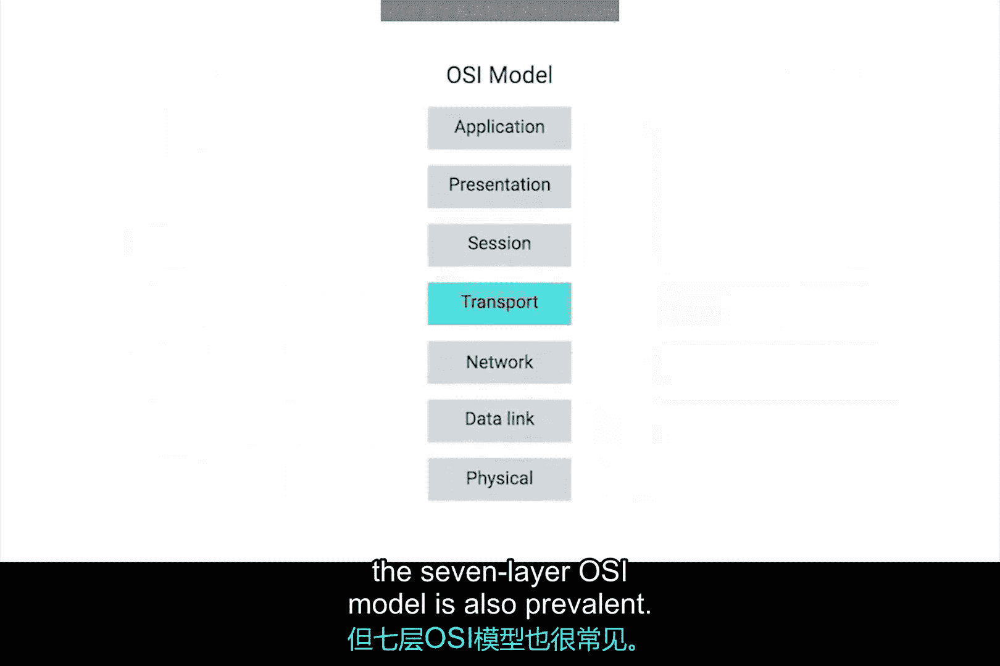

# 谷歌《IT支持（计算机网络⧸操作系统，第2、3课⧸共5课）｜Google IT Support》中英字幕deepseek p43 41_应用层与OSI模型.zh_en -BV1uyqcYpExr_p43-

In our opening module， we talked about how there are lots of competing network layer models。

We've been working from a five layer model， but you'll probably run into various other models during your career as an IT support specialist。

Some models might combine the physical and data link layers into one and only talk about four layers。

But you might remember a certain model we called out specifically in a reading section back in the first module。

This is the OSI or Open Systems Interconnection model。

This model is important to understand with our five layer model because it's the most rigorously defined that means it's often used in academic settings or by various network certification organizations。

The OSI model has seven layers and introduces two additional layers between our transport layer and our application layer。

The fifth layer in the OSI model is the session layer。

The concept of the session layer is that it's responsible for things like facilitating the communication between actual applications and the transport layer。

It's the part of the operating system that takes the application layer data that's been unencapsulated from all the layers below it and hands it off to the next layer in the OSI model。

 the presentation layer。

The presentation layer is responsible for making sure that the unencapsulated application layer data is actually able to be understood by the application in question。

This is the part of an operating system that might handle encryption or compression of data。

While these are important concepts to keep in mind。

 you'll notice that there isn't any encapsulation going on。 That's why in our model。

 we lump all of these functions into the application layer。

We believe a five layer model is the most useful when it comes to the day to day business of understanding networking。

 but the seven layer OSI model is also prevalent。

No networking education would be complete without understanding its basics。

