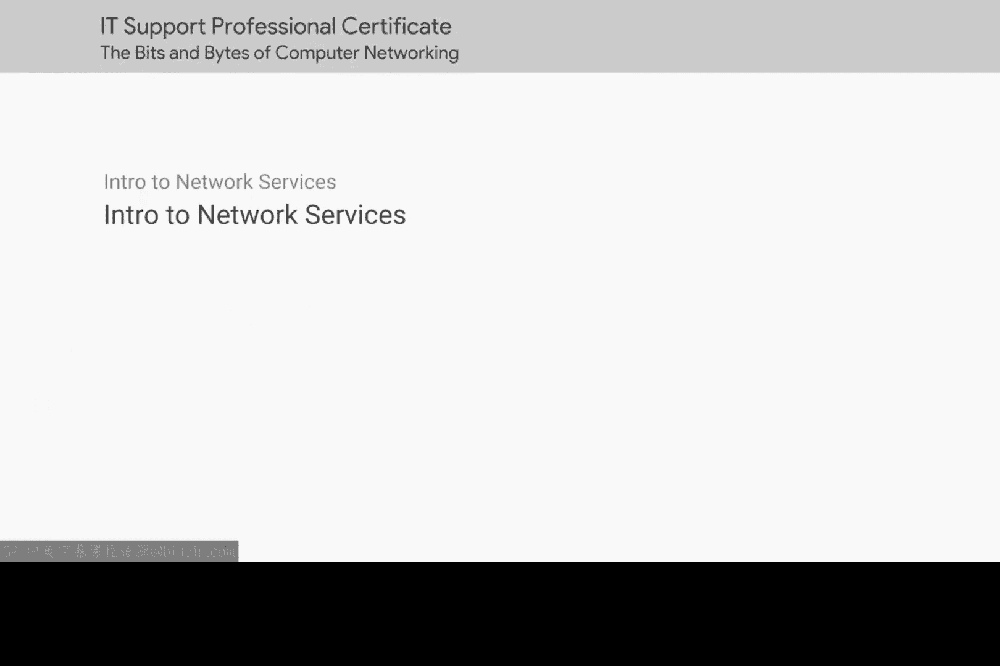

# 谷歌《IT支持（计算机网络⧸操作系统，第2、3课⧸共5课）｜Google IT Support》中英字幕deepseek p46 44_网络服务介绍.zh_en -BV1uyqcYpExr_p46-

There is no denying it。 Computer networking is a complicated business that involves many technologies。

 layers and protocols。 At the end of the day， the main purpose of computer networking is so network services can be available to answer requests for the data from clients。

 The sheer number and variety of things that might comprise a network service makes it impossible to cover all of them。

 but there are a lot of network services and technologies that are used to help make computer networking。

 more user friendly and secure。These network services and technologies are ones that directly relate to the business of networking itself。

 and it's important to understand how those work。If something on the network isn't working as expected。

 the first place you should look at are the services we'll be covering here。

And being asked to fix things that aren't working as expected will be a major part of being an IT support specialist。

By the end of this module， you'll be able to describe why name resolution is important。

 identify the many steps involved with DNS lookup and understand the most common DNS record types you'll also be able to explain how DHCP makes network administration a simpler task you'll be able to demonstrate how NA technologies help keep network secure and help preserve precious IP address space Finally。

 you'll be able to describe how VPNs and proxies help users get connected and stay secure As you can see。

 we've got a lot to tackle so let's get started。