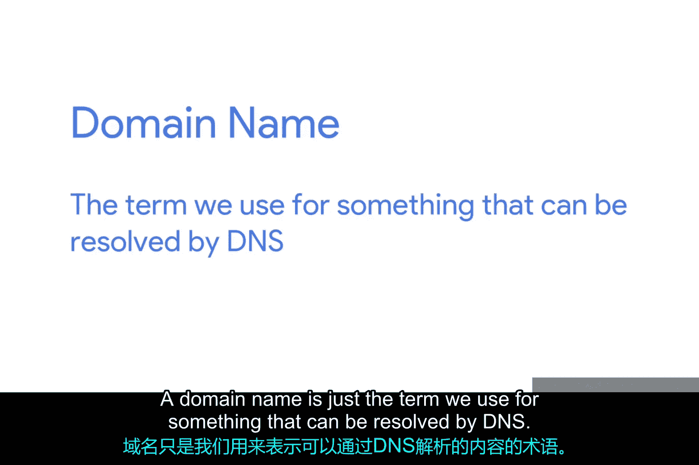
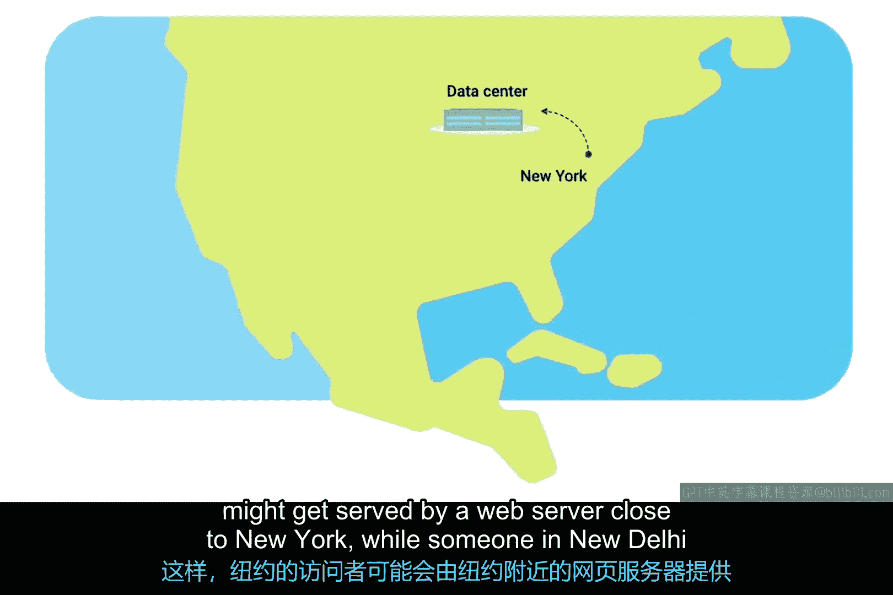
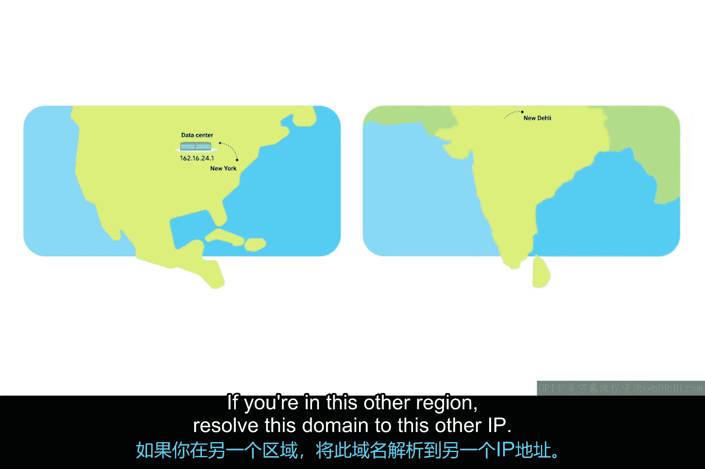

# 谷歌《IT支持（计算机网络⧸操作系统，第2、3课⧸共5课）｜Google IT Support》中英字幕deepseek p47 45_为何需要DNS.zh_en -BV1uyqcYpExr_p47-

Computers speak to each other in numbers At the very lowest levels。

 all computers really understand are 1 and0。 Reading binary numbers isn't the easiest for humans。

 so most binary numbers are represented in lots of different forms。

This is especially true in the realm of networking。

Remember that an IP address is really just a 32 bit binary number。

But it's normally written out as fourocts in decimal form， since that's easier for humans to read。

 you might also remember that Mac addresses are just 48 bit binary numbers that are normally written out in six groupings of two hexadecimal digits each。

While remembering 192。168。1。100 might be easier than remembering a long string of ones and zeros。

 it still doesn't do a very good job when you have to remember more than just a few addresses。

Imagine having to remember the fouroc Tets of an IP address for every website you visit。

It's just not a thing that the human brain is normally good at。

Humans are much better at remembering words。That's where DNS or domain name system comes into play。

DNS is a global and highly distributed network service that resolves strings of letters into IP addresses for you。

Let's say you wanted to check a weather website to see what the temperature is going to be like。

 it's much easier to type。Www。weather。com into a web browser then it is to remember that one of the IP addresses for this site is 184。

29。131。121 The IP address for a domain name can also change all the time for a lot of different reasons。

A domain name is just the term we use for something that can be resolved by DNS。

In the example we just used， www。weather。com would be the domain name。

 and the IP it resolves to could change depending on a variety of factors。

Let's say that weatherather do co was moving their web server to a new data center。

Maybe they've signed a new contract or the old data center was shutting down。By using DNS。

 an organization can just change what IP a domain name resolves to。

 and the end user would never even know， so not only does DNS make it easier for humans to remember how to get to a website。

 it also lets administrative changes happen behind the scenes without an end user having to change their behavior。

Try to imagine a world where you'd have to remember every IP for every website you visit while also having to memorize new ones if something changed。

 we'd spend our whole day memorizing numbers。The importance of DNS for how the internet operates today can't be overstated。

IP addresses might resolve to different things depending on where in the world you are。

While most internet communications travel at the speed of light， the further you have to route data。

 the slower things will become in almost all situations。

 it's going to be quicker to transmit a certain amount of data between places that are geographically close to each other。

If you're a global web company， you'd want people from all over the world to have a great experience accessing your website。

 So instead of keeping all of your web servers in one place。

 you could distribute them across data centers across the globe。 This way。

 someone in New York visiting a website might get served by a web server close to New York。

 while someone in New Delhi might get served by a web server close to New Delhi。 Again。

 DNS helps provide this functionality。 because of its global structure。

 DNS lets organizations decide if you're in the region， resolve the domain name to this I。

 if you're in this other region， resolveve this domain to this other I。😊。

DNS serves lots of purposes and might be one of the most important technologies to understand as an IT support specialist so you can effectively troubleshoot networking issues。

