# 谷歌《IT支持（计算机网络⧸操作系统，第2、3课⧸共5课）｜Google IT Support》中英字幕deepseek p48 46_域名解析的多个步骤.zh_en -BV1uyqcYpExr_p48-

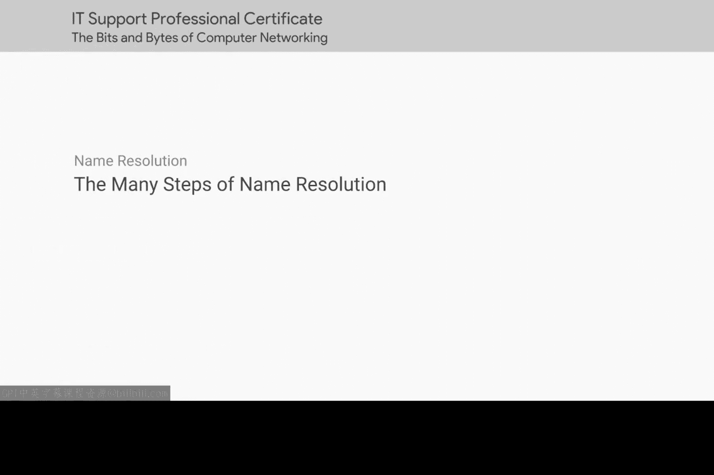

At its most basic， DNS is a system that converts domain names into IP addresses。

It's the way humans are likely to remember and categorize things resolved into the way computers prefer to think of things。

This process of using DNS to turn a domain name into an IP address is known as name resolutionol。

Let's take a closer look at exactly how this works。

 The first thing that's important to know is that DNS servers are one of the things that need to be specifically configured at a node on a network。

For a computer to operate on a modern network， they need to have certain number of things configured。

Remember that Mac addresses are hard coded and tied to specific pieces of hardware。

 but we've also covered that the IP address， Snet mask and gateway for a host must be specifically configured。

 A DNS server is the fourth and final part of the standard modern network configuration。

These are almost always the four things that must be configured for a host to operate on a network in an expected way。

I should call out that a computer can operate just fine without DNS or without a DNS server being configured。

 but as we covered in the last video， this makes things difficult for any human that might be using that computer。

There are five primary types of DNS servers。

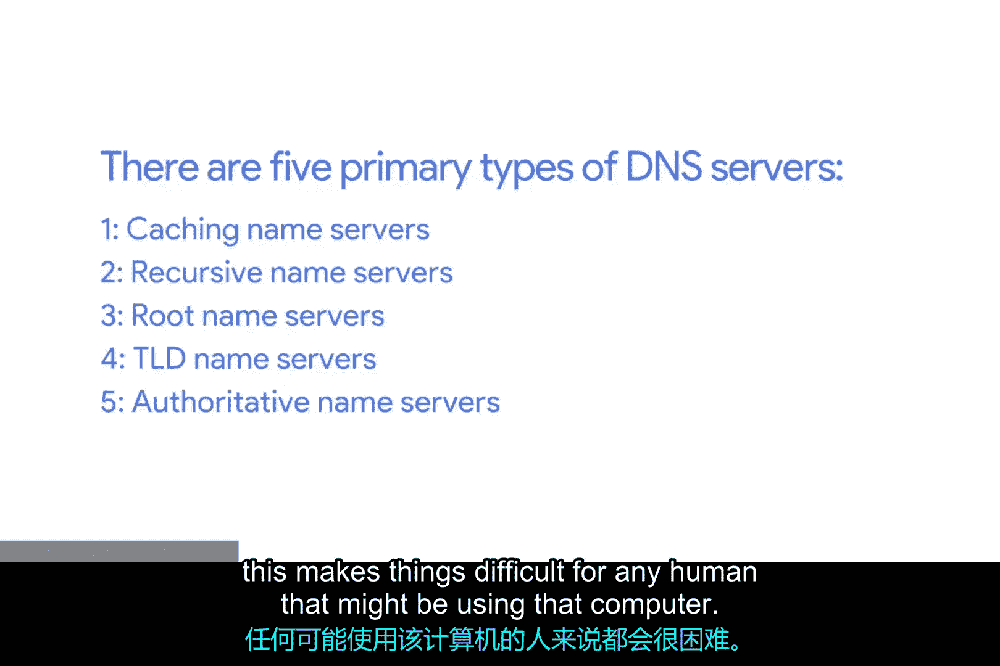

Cashching name servers， recursive name servers， root name servers， TLD name servers。

 and Authoritative name servers。

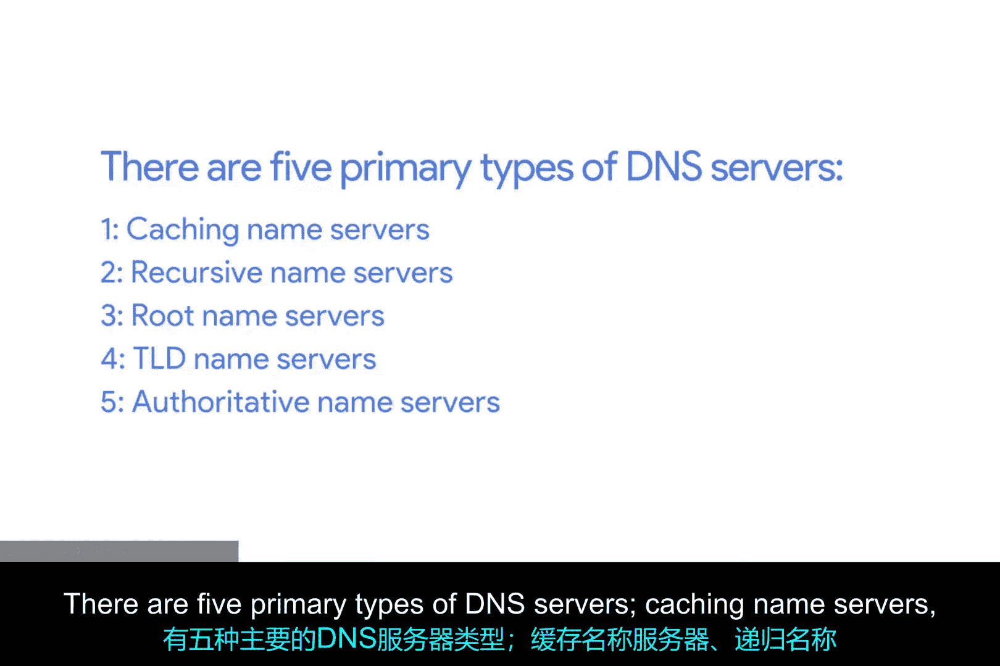

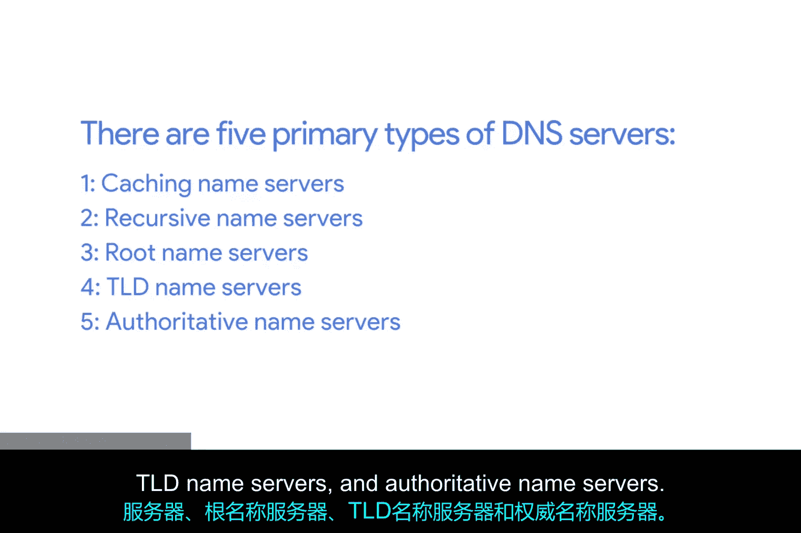

As we dive deeper into these， it's important to note that any given DNS server can fulfill many of these roles at once。

Cashching and recursive name servers are generally provided by an ISP or your local network。

Their purpose to store domain name lookups for a certain amount of time。

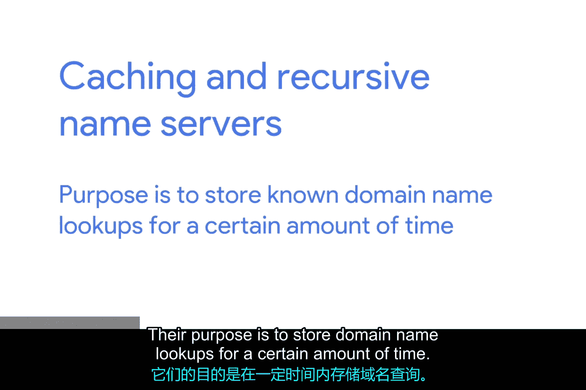

As you'll see in a moment， there are lots of steps in order to perform a fully qualified resolution of a domain name in order to prevent this from happening every single time a new TCP connection is established。

 your ISP or local network will generally have a caching name server available。

Most caching name servers are also recursive name servers。

Recursive name servers are ones that perform full DNS resolution requests。

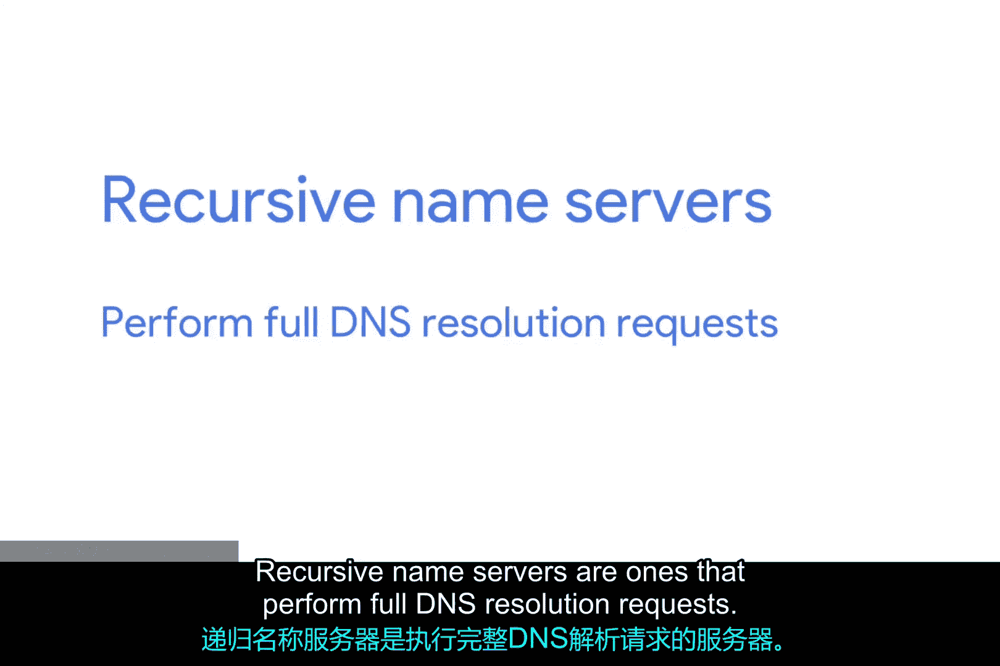

In most cases， your local name server will perform the duties of both。

 but it's definitely possible for a name server to be either just caching or just recursive。

Let's introduce an example to better explain how this works。

You and your friend are both connected to the same network。

 and you both want to check out Facebook dot com。 Your friend enters www do Facebook do com into a web browser。

 which means that their computer now needs to know the I of www。

 Facebook do com in order to establish a connection。Both of your computers are on the same network。

 which usually means that they've both been configured with the same name server。

 So your friend's computer asks the name server for the I P of W W W dot Facebook dot com。

 which it doesn't know This name server now performs a fully recursive resolution to discover the correct I P for W W W dot Facebook dot com。

 This involves a bunch of steps we'll cover in just a moment。

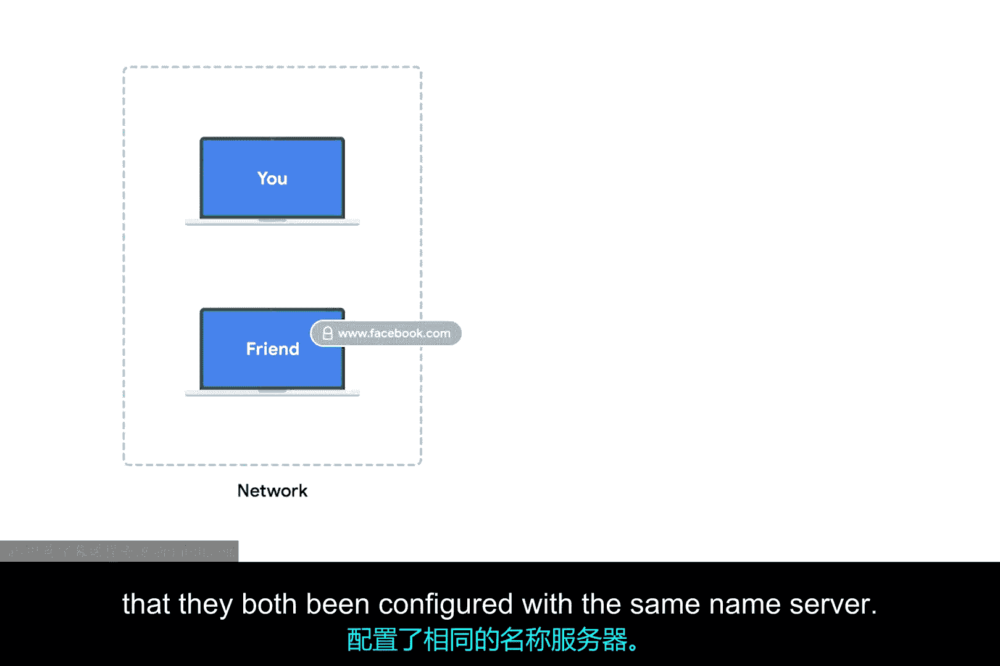

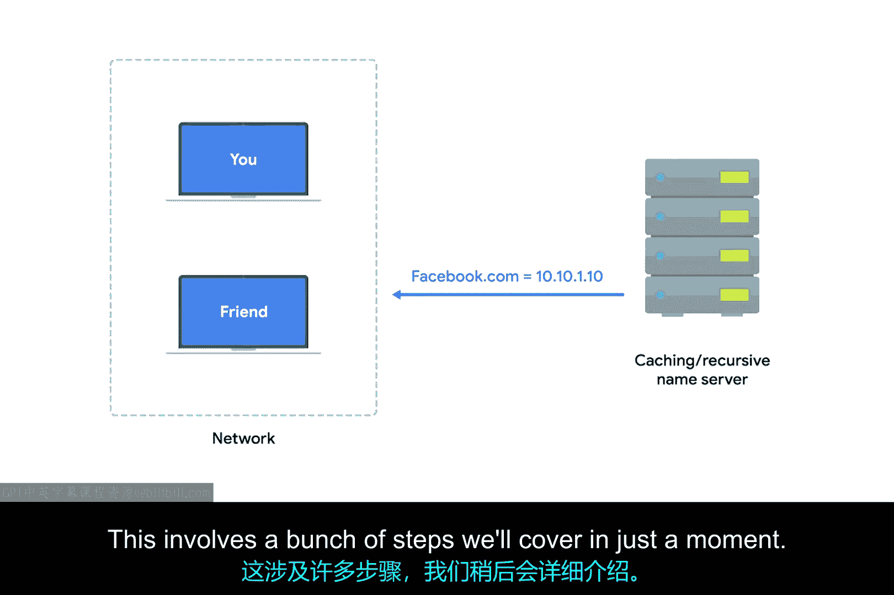

This IP is then both delivered to your friend's computer and stored locally in a cache。

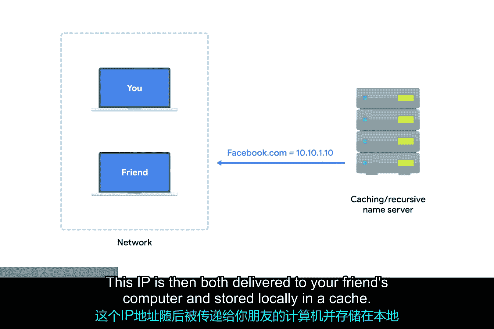

A few minutes later， you answer www do Facebook do com into a web browser。 Again。

 your computer needs to know the I for this domain。 So your computer asked the local name server。

 it's been configured with， which is the same one your friend's computer was just talking to。

Since the domain name， Www Facebook do com had just been looked up。

 the local name server still has the I that it resolve to stored and is able to deliver that back to your computer without having to perform a full lookup。

 This is how the same servers act as a caching server。

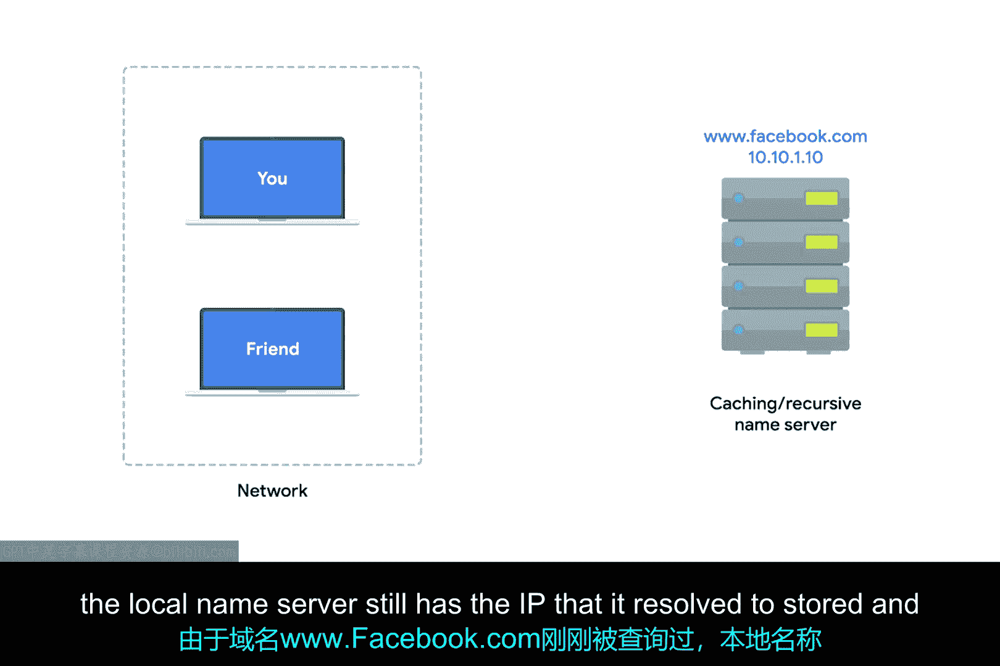

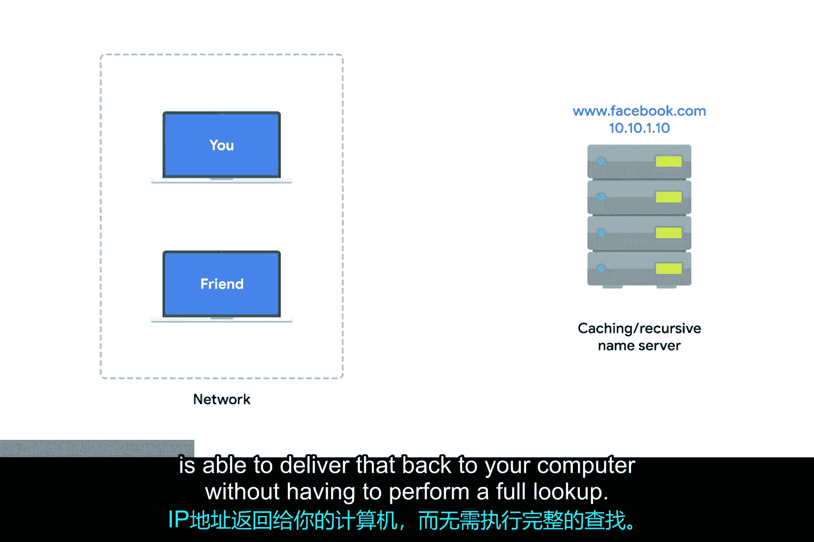

All domain names in the global DNS system have a TTL or time to live。

This is a value in seconds that can be configured by the owner of a domain name for how long a name server is allowed to cache an entry before it should discard it and perform a full resolution again。

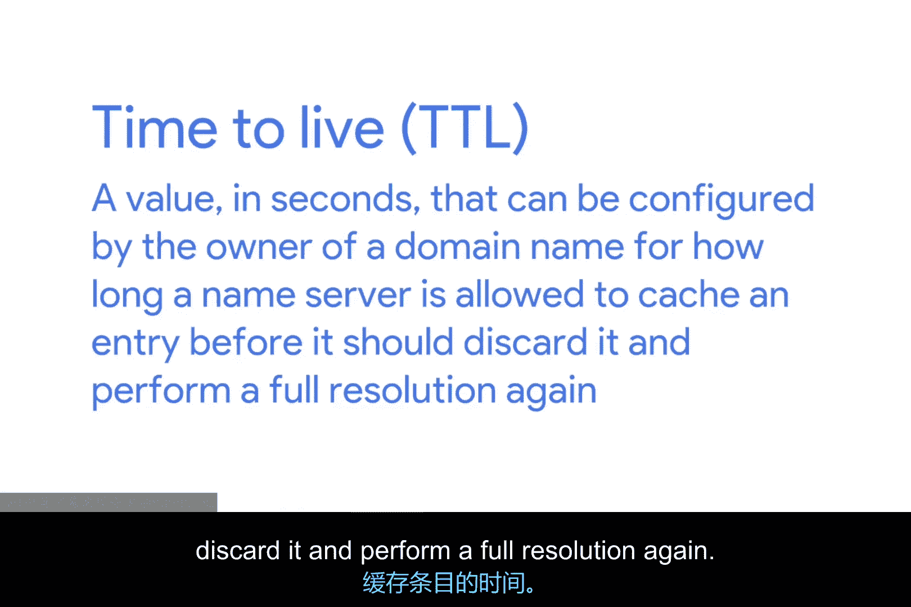

Several years ago， it was normal for these TTLs to be really long， sometimes a full day or more。

This is because the general bandwidth available on the internet was just much less。

 so network administrators didn't want to waste what bandwidth was available to them by constantly performing full DNS liups。

As the internet has grown and gotten faster， these TTLs for most domains have dropped to anywhere from a few minutes to a few hours。

 but it's important to know that sometimes you still run into a domain names with very lengthy TTLs。

 it means that it can take up to the length of a total TTL for a change in DNS record to be known to the entire internet。

Now， let's look at what happens when your local recursive server needs to perform a full recursive resolution。

The first step is always to contact a root name server。 There are 13 total root name servers。

 and they're responsible for directing quiries toward the appropriate TLD name server。 In the past。

 these 13 root servers were distributed to very specific geographic regions， but today。

 they're mostly distributed across the globe via anycast。

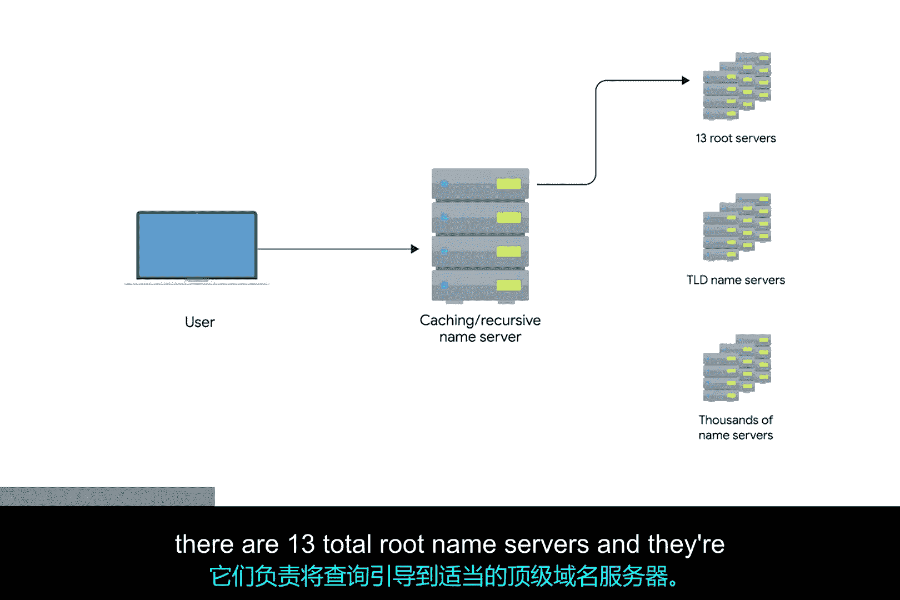

Anycast is a technique that's used to route traffic to different destinations。

 depending on factors like location， congestion， or link health。

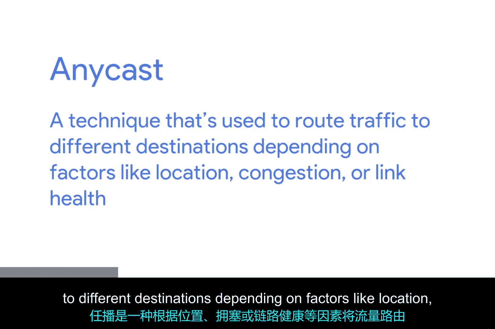

Using anycast， a computer can send a datagram to a specific IP。

 but could see it routed to one of many different actual destinations， depending on a few factors。

This should also make it clear that there aren't really only 13 physical root name servers anymore。

 it's better to think of them as 13 authorities that provide root name lookups as a service。

The root servers will respond to a DNS lookup with the TLD name server that should be queried TLD stands for top level domain and represents the top of the hierarchical DNS name resolution system。

A TLD is the last part of any domain name using www。facebook。com as an example again。

 the docom portion should be thought of as the TLD。

We'll go into more details about the different components of a domain name in an upcoming lesson。

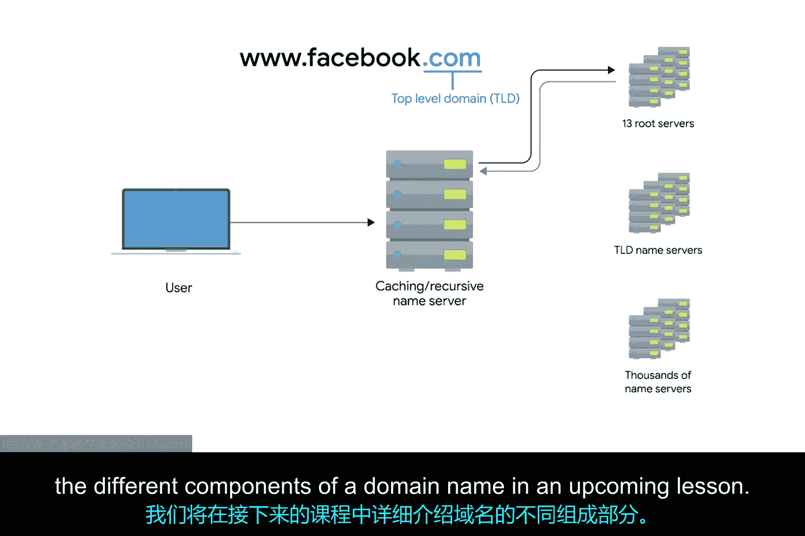

For each TLD in existence， there's a TLD name server， but just like with root servers。

 this doesn't mean there's only physically one server in question。

 it's most likely a global distribution of any cast accessible servers responsible for each TLD。

The TLD Na servers will respond again with a redirect。

 this time informing the computer performing the name lookup with what authoritative name server to contact？

Authorative name servers are responsible for the last two parts of any domain name。

 which is the resolution at which a single organization may be responsible for DNS lookups。Using www。

weather。com as an example， the TLD name server would point a look up at the authorative server for Weather。

com， which would likely be controlled by the weatherer channel。

 the organization itself that runs the site。Finally。

 the DNS lookup could be redirected at the authoritative server forWeather。com。

 which would finally provide the actual IP of the server in question。

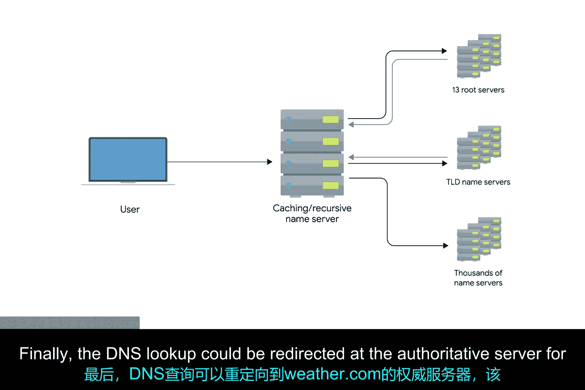

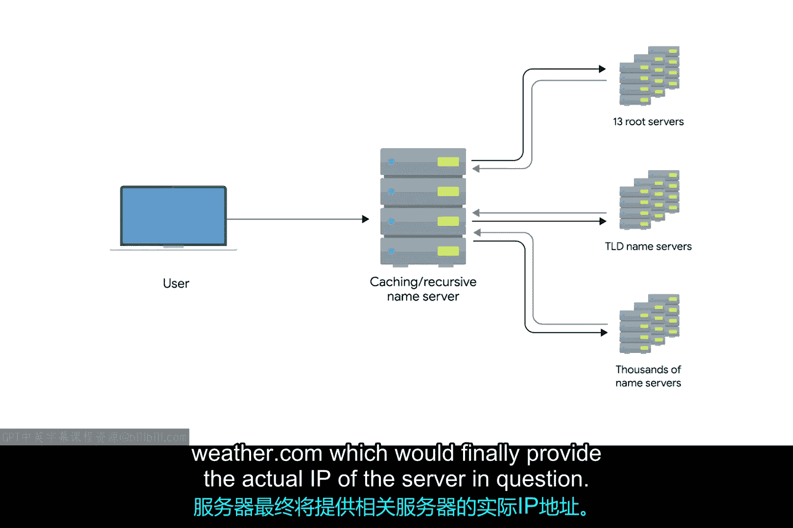

This strict hierarchy is very important to the stability of the internet。

 Making sure that all full DNS resolutions go through a strictly regulated and controlled series of lookups to get the correct responses is the best way to protect against malicious parties redirecting traffic。

Your computer will blindly send traffic to whatever IP it's told to。

 so by using a hierarchical system controlled by trusted entities in the way DNS does。

 we can better ensure that the responses to DNS lookups are accurate。

Now that you see how many steps are involved， it should make sense why we trust our local name servers to cache DNS lookups。

It's so that full lookup path doesn't have to happen for every single TCP connection。In fact。

 your local computer from your phone to a desktop will generally have its own temporary DNS cache as well。

 that way it doesn't have to bother its local name server for every TCP connection either。

