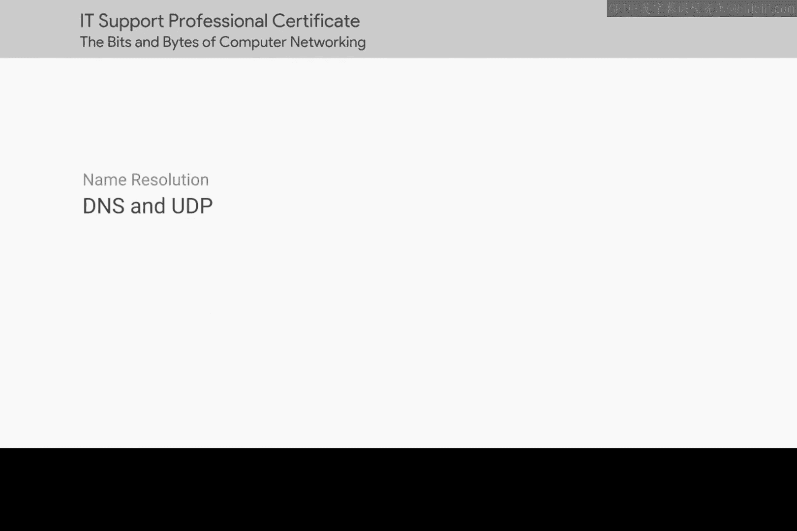
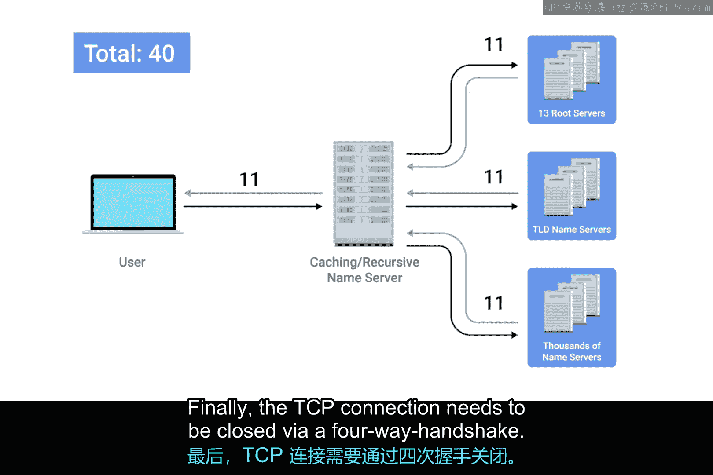
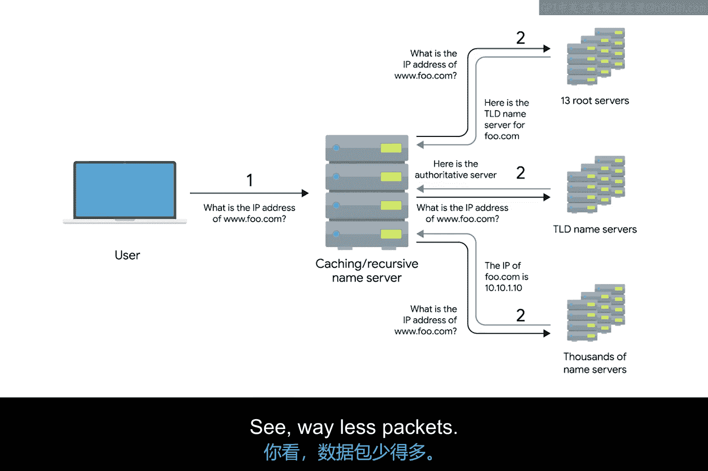

# 谷歌《IT支持（计算机网络⧸操作系统，第2、3课⧸共5课）｜Google IT Support》中英字幕deepseek p49 47_DNS与UDP.zh_en -BV1uyqcYpExr_p49-

Yeah。DNS is a great example of an application layer service that uses UDP for the transport layer instead of TCP。

This can be broken down into a few simple reasons。Remember that the biggest difference between TCP and UDP is that UDP is connectionless。

This means there's no setup or teardown of a connection。

 so much less traffic needs to be transmitted overall。

A single DNS request and its response can usually fit inside of a single UDP datagram。

 making it an ideal candidate for a connectionless protocol。

It's also worth calling out that DNS can generate a lot of traffic。

It's true that caches of DNS entries are stored both on local machines and caching name servers。

 but it's also true that if the full resolution needs to be processed。

 we're talking about a lot more traffic。Let's see what it would look like for a full DNS lookup to take place via TCP。

First， the host that's making the DNS resolution request would send a S packet to the local name server on port 53。

 which is the port that DNS listens on。This name server would then need to respond with a S act packet。

 That means the original host would have to respond with an act in order to complete the three way handshake that's three packets。

Now that the connection has been established。The original host would have to send the actual request。

 I'd like the IP address for F。com， please。When it receives this request。

 the name server would have to respond with another a I got your request forfo。com。

 we up to five packets sent now。In our scenario， the first caching name server doesn't have anything cacheed forfo。

com， so it needs to talk to a root name server to find out who's responsible for the docom TLD。

This would require a three way handshake， the actual request， the act of the request， the response。

 and then the act of the response。of Finally， the connection would have to be closed via a four way handshake。

 That's 11 more packets or 16 total。Now that the recursive name server has the correct TLD name server。

 it needs to repeat that entire process to discover the proper authorative name server。

 that's 11 more packets bringing us up to 27 so far。Finally。

 the recursive name server would have to repeat the entire process one more time while talking to the authorative name server in order to actually get the IP offo。

com， this is 11 more packets for a running total of 38。

Now that the local name server finally has the IP address of food。com。

 it can finally respond to the initial request。A response to the DNS Rer that originally made the request。

 and then this computer sends an a back to confirm that it received the response that's two more packets。

 putting us at 40。Finally， the TCP connection needs to be closed via a four way handshake。

This brings us to a grand total of 44 packets at the minimum in order for a fully recursive DNS request to be fulfilled via TCP 44 packets isn't really a huge number in terms of how fastmod networks operate。

 but it heads up fast， as you can see。Remember that DNS traffic is just a precursor to actual traffic。

 a computer almost always performs a DNS lookup because it needs to know the IP of a domain name in order to send it additional data。

 not just because it's curious。Now， let's check out how this would look with UDP spoiler alert。

 It doesn't take as many packets。The original computer sends a UDP packet to its local name server on port 53。

 asking for the IP forfo。com， that's one packet。The local name server acts as a recursive server and sends up a UDP packet to the root server。

 which sends a response containing the proper TLD name server that's three packets。

The recursive name server sends a packet to the TLD server and receives back a response containing the correct authorative server。

 we're now at five packets。Next， the recursive name server sends its final request to the author name server。

 which sends a response containing the IP forfo。com that's seven packets。Finally。

 the local name server responds to the DNS Rer that made the request in the first place with the IP forfo。

com that brings us to a grand total of eight packets， see way less packets。

You can see now how much overhead TCP really requires， and for something as simple as DNS。

 it's just not needed。It's the perfect example for why protocols like UDP exist in addition to the more robust TCP。

You might be wondering how error recovery plays into this since UDP doesn't have any。

 the answer is pretty simple， the DNS Rer just asks again if it doesn't get a response。

 basically the same functionality that TP provides at the transport layer is provided by DNS at the application layer in the most simple manner。

A DNS server never needs to care about doing anything but responding to incoming lookups。

And a DNS resolver simply needs to perform lookups and repeat them if they don't succeed。

 a real showcase of the simplicity of both DNS and UDP。

I should call out that DNS over TCP does in fact exist and is also in use all over。

As the web has gotten more complex， it's no longer the case that all DNS lookup responses can fit in a single UDP datagram In these situations a DNS name server would respond with a packet explaining that the response is too large the DNS client would then establish a TCP connection in order to perform the lookup。

