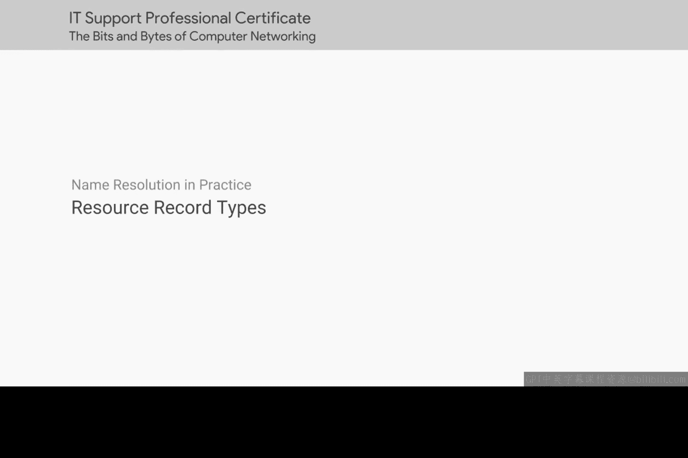
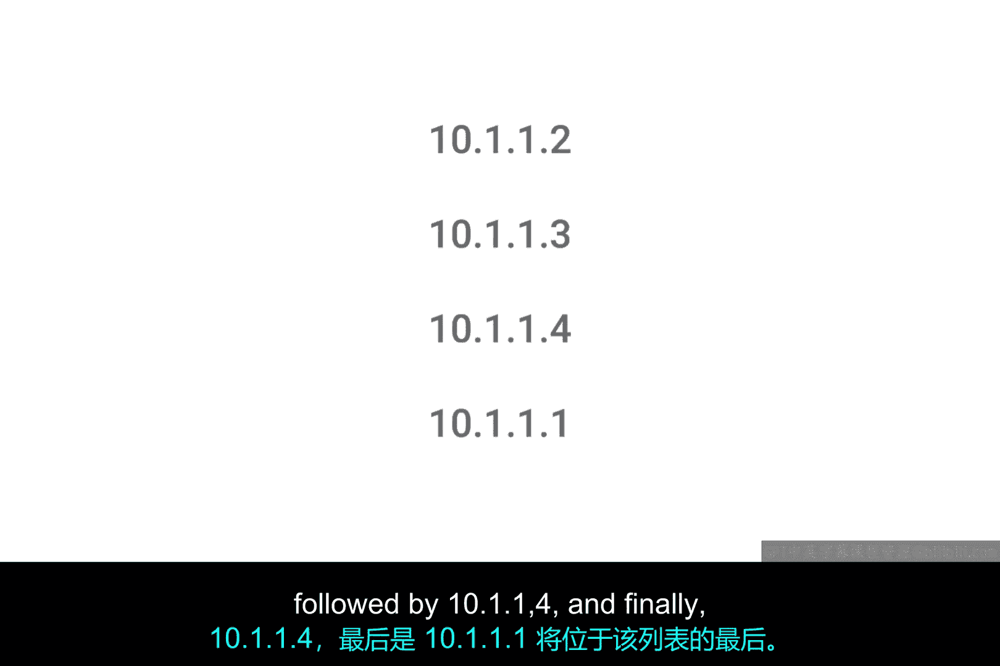

# 谷歌《IT支持（计算机网络⧸操作系统，第2、3课⧸共5课）｜Google IT Support》中英字幕deepseek p51 49_资源记录类型.zh_en -BV1uyqcYpExr_p51-

Remember， DNS is one of the most important technologies that an IT support specialist needs to know in order to troubleshoot networking issues。

 so let's get into the nitty gritty。DNS， in practice。

 operates with a set of defined resource record types。

These allow for different kinds of DNS resolutions to take place。

There are dozens of different resource record types defined。

 but a lot of them only serve very specialized purposes we'll cover the most basic ones here the most common resource record is known as an A record。

An A record is used to point a certain domain name at a certain IPV4 IP address。

In our earlier discussions of DNS， we made the assumption that the DNS resolveolr was asking for the A record for a domain name in its most basic use。

 a single A record is configured for a single domain name。

But a single domain name can have multiple A records too。

This allows for a technique known as DNS Round Robbin to be used to balance traffic across multiple Is。

Round Robbin is a concept that involves iterating over a list of items one by one in an orderly fashion。

 The hope is that this ensures a fairly equal balance of each entry on the list that's selected。

Let's say we're in charge of a domain name， www。Mirosoft。com。

Microsoft is a large company and their website likely sees a lot of traffic。

To help balance this traffic across multiple servers， we can4 a records for www。microsoft。

com at the authorativename server for the Microsoftsoft。com domain we'll use the IPs 10。1。1。1， 10。1。

1。2， 10。1。1。3 and 10。1。1。4。When a DNS Rer performs a lookup of www。Mirosoft。com。

 all four Is would be returned in the order first configured。10。1。1。1 followed by 10。1。1。2。

 followed by 10。1。1。3 and finally 10。1。1。4。The DNS resolving computer would know that it should try to use the first entry 10。

1。1。1， but it knows about all four， just in case a connection to 10。1。1。1 fails。

The next computer to perform a lookup for www。microsoft。

com would also receive all four Is in the response， but the ordering will have changed。

 the first entry would be 10。1。1。2， followed by 10。1。1。3 followed by 10。1。1。4 and finally 10。1。1。

1 would be last on that list。

This pattern would continue for every DNS resolution attempt。

 cycling through all of the A records configured and balancing the traffic across these Is。

That's the basics of how DNS round Robin logic works。

Another resource record type that's becoming more and more popular is the Quad A record。

A Quad A record is very similar to an A record， except that it returns an IPV6 address instead of an IPV4 address will cover the details of IPV6 in a future module。

The C name record is also super common， a Cname record is used to redirect traffic from one domain to another。

Let's say that Microsoft runs their web servers at www。microsoft。

com they also want to make sure that anyone that enters just Microsoftsoft。

com into their web browser will get properly redirected。By configuring a Cname record for Microsoft。

com that resolves to www。microsoft。com， the resolving client would then know to perform another resolution attempt this time for www。

microsoft。com and then use the IP returned by that second attempt。

C names are really useful because they ensure you only have to change the canonical IP address of a server in one place In fact。

 Cname is just shorthand for canonical name。If we look again at our original example of making sure that visitors to both Microsoftsoft。

com and www。microsoft。com get to the same place， we could do this in two ways。

We could set up identical A records for both Microsoftsoft。com and www。microsoft。com domain names。

And this would work just fine， but if the underlying IP address ever changes。

 we need to change it in two places， the A records for both Microsoftsoft。com and www。microsoft。com。

By setting up a Cname that points Microsoftsoft。com at www。microsoft。com。

 you'd only have to change the a record for www。microsoft。com。

 and youd know that clients pointing at either domain would get the new IP address。

This might not seem like a huge deal with just two records to worry about。

 but large companies with complex presences on the web might have dozens of these kinds of redirections。

 it's always easier to only have one source of truth。

Another important resource record type is the MX record。

MX stands for Ma Exchange and this resource record is used in order to deliver email to the correct server。

Many companies run their web and mail servers on different machines with different Is。

So the MX record makes it easy to ensure that email gets delivered to a company's mail server while other traffic like web traffic would get delivered to their web server。

A record type very similar to the MX record is the SRV record SRV stands for service record and it's used to define the location of various specific services。

It serves the exact same purpose as the MX resource record type， except for one thing。

 while MX is only for mail services， an SRV record can be defined to return the specifics of many different service types。

 for example。SRV records are often used to return the records of services like CalDAab。

 which is a calendar and scheduling service。The text record type is an interesting one。

TXT stands for textext and was originally intended to be used only for associating some descriptive text with a domain name for human consumption The idea was that you could leave notes or messages that humans could discover and read to learn more about arbitrary specifics of your network。

 but over the years as the internet and services that run on it have become more and more complex。

 the text record has been increasingly used to convey additional data intended for other computers to process。

Since the text record has a field that's entirely free form。

 clever engineers have figured out ways to use it to communicate data not originally intended to be communicated by a system like DNS。

 It's pretty clever， right？This text record is often used to communicate configuration preferences about network services that you've entrusted other organizations to handle for your domain。

 For example， it's common for the text record to be used to convey additional info to an email as a service provider。

Which is a company that handles your email delivery for you。

There are lots of other DNS resource record types in common use， like the NSS or SOA records。

 which are used to define authorative information about DNS zones。

 we'll cover DNS zones in more detail in a future video， so stay tuned。

