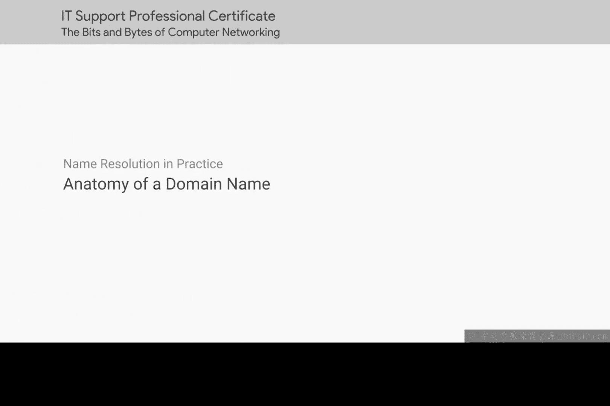
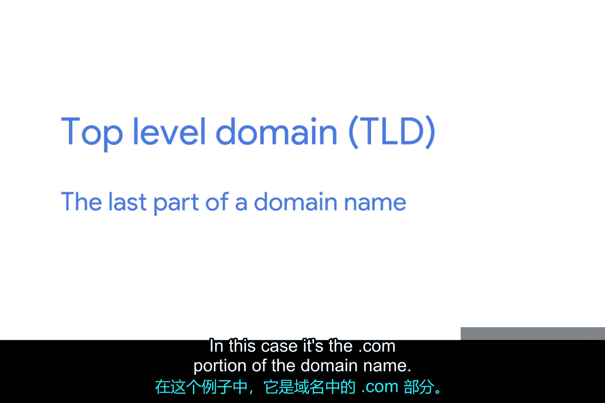
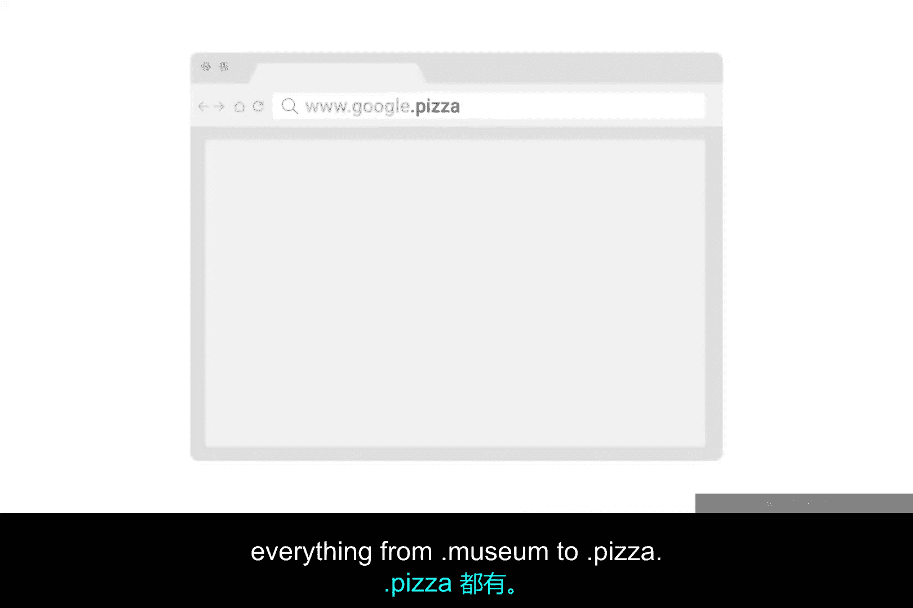
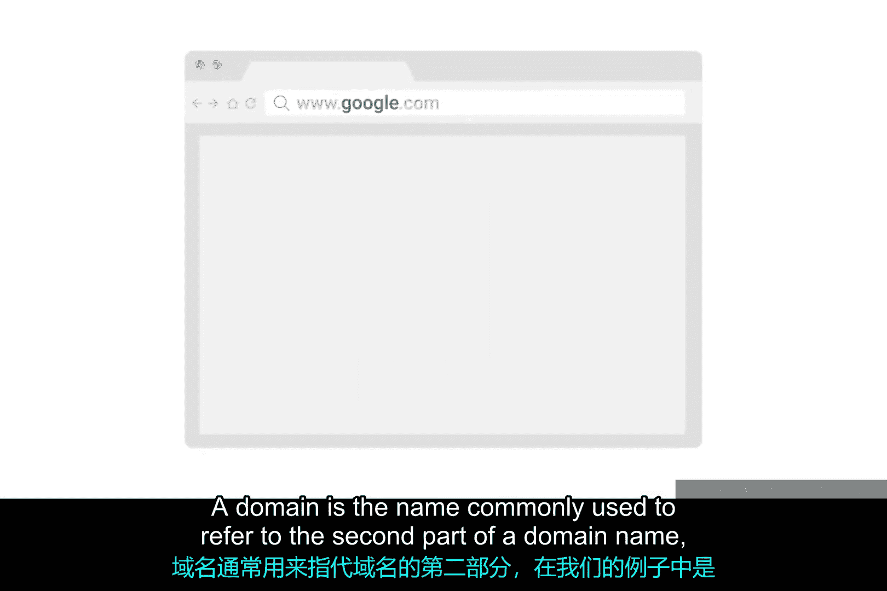
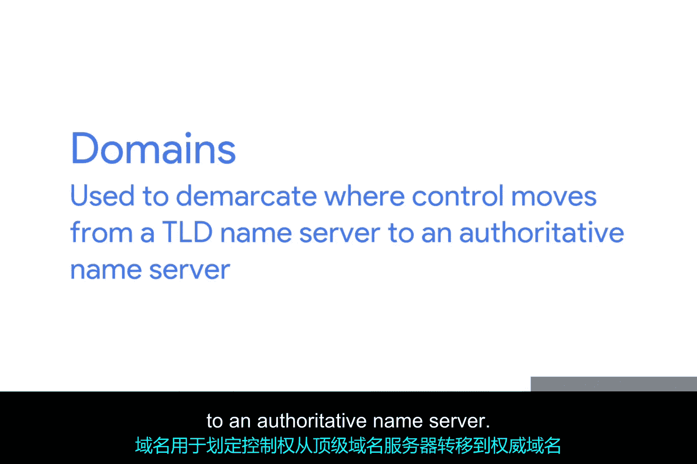
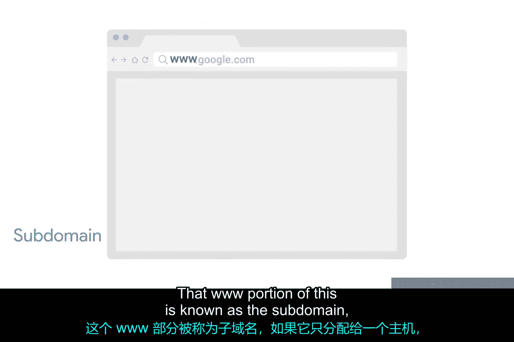
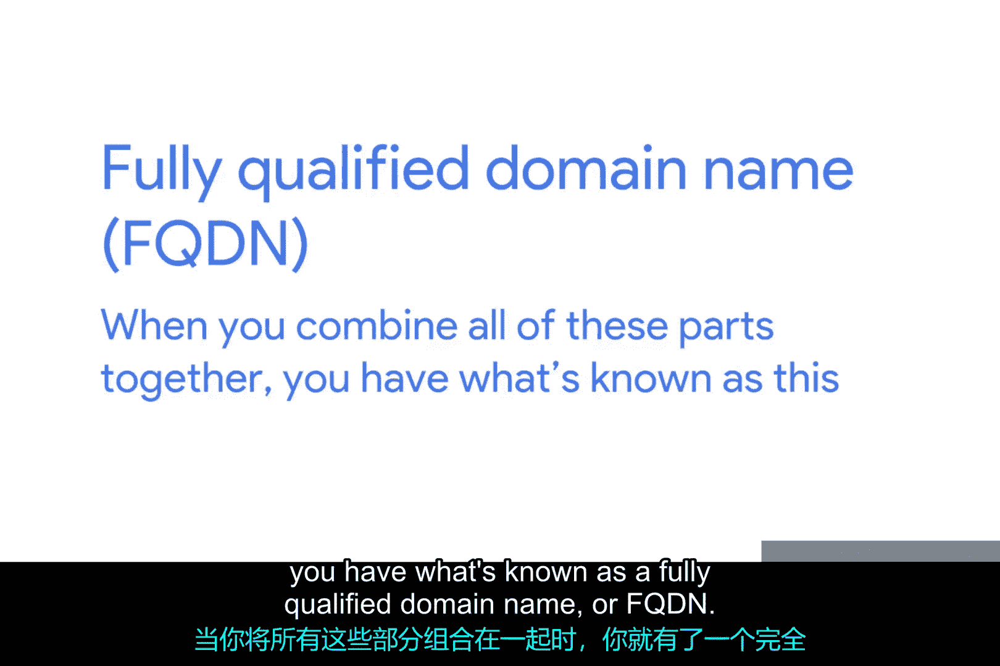
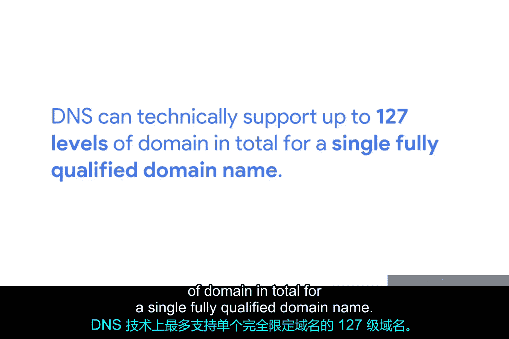

# 谷歌《IT支持（计算机网络⧸操作系统，第2、3课⧸共5课）｜Google IT Support》中英字幕deepseek p52 50_域名的结构.zh_en -BV1uyqcYpExr_p52-

Any given domain name has three primary parts， and they all serve specific purposes。

Let's take the domain name， www。go。 co。 The three parts here should be pretty easy to spot since they're each set off from each other by a period。

 They're WW，W， Google and Com。

The last part of a domain name is known as the TLD or top level domain。 In this case。

 it's the dot com portion of the domain name。

There are only a certain restricted number of defined TLDs available。

 although that number has been growing a lot in recent years。

The most common T L Ds are ones you've probably already familiar with dot com dot net E D U and so on。

 You've probably also seen some country specific T L Ds such as dot D E for Germany or dot C。

 N for China。Due to the growth of the internet， many of the TLDs originally defined have become very crowded。

 so today a number of vanity TLDs are available everything from dot museum to dot pizzaizz。

Administration and definition of TLDs is handled by a nonprofit organization known as ICN or the Internet Corporation for assigned namess and numbers。

 and I can tell you what they do。ICN is a sister organization to the IANA。

 and together they help define and control both the global IP spaces along with the global DNS system。

A domain is the name commonly used to refer to the second part of a domain name。

 which would be Google。 In our example， domains are used to demarcate where control moves from a T LD name server to an authoritative name server。

 This is typically under the control of an independent organization or someone outside of Ican。

Domains can be registered and chosen by any individual or company。

 but they must all end in one of the predefined TLDs。

The WWW portion of this is known as the subdomain， sometimes referred to as a host name if it's been assigned to only one host。

 when you combine all these parts together， you have what's known as a fully qualified domain name or FQDN while it costs money to officially register a domain with a registrar。

 subdomains can be freely chosen and assigned by anyone who controls such a registered domain。

A registrar is just a company that has an agreement with ICN to sell unregistered domain names。

We'll talk more about dealing with registrars in a future module。Technically。

 you can have lots of subdomain names， for example， host。sub。sub。subdomain。domain。

com could be completely valid， although you rarely see fully qualified domain names with that many levels。

DNS can technically support up to 127 levels of domain in total for a single fully qualified domain name。

There are some other restrictions in place for how a domain name can be specified。

 Each individual section can only be 63 characters long。

 and a complete FQDN is limited to a total of 255 characters。

