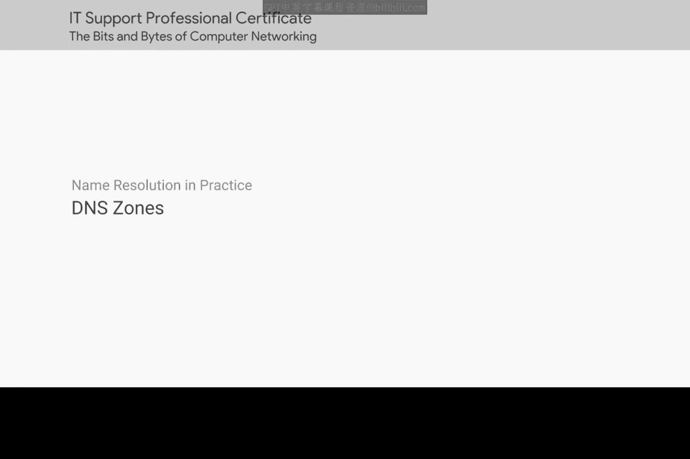
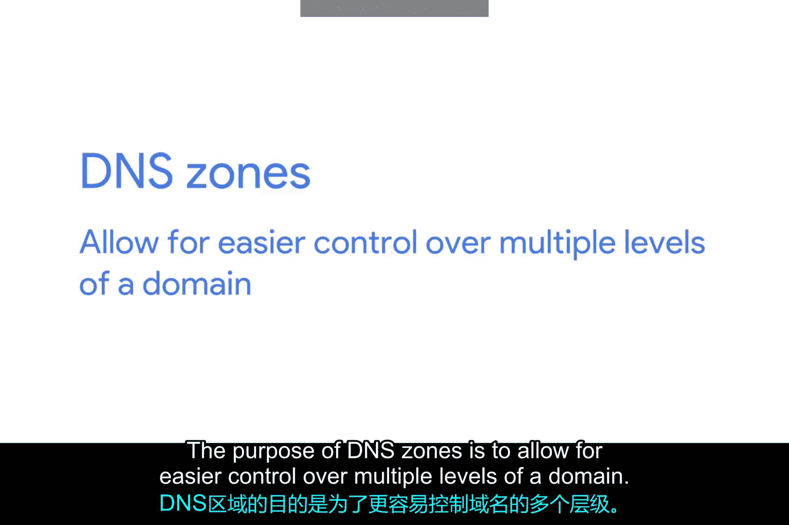
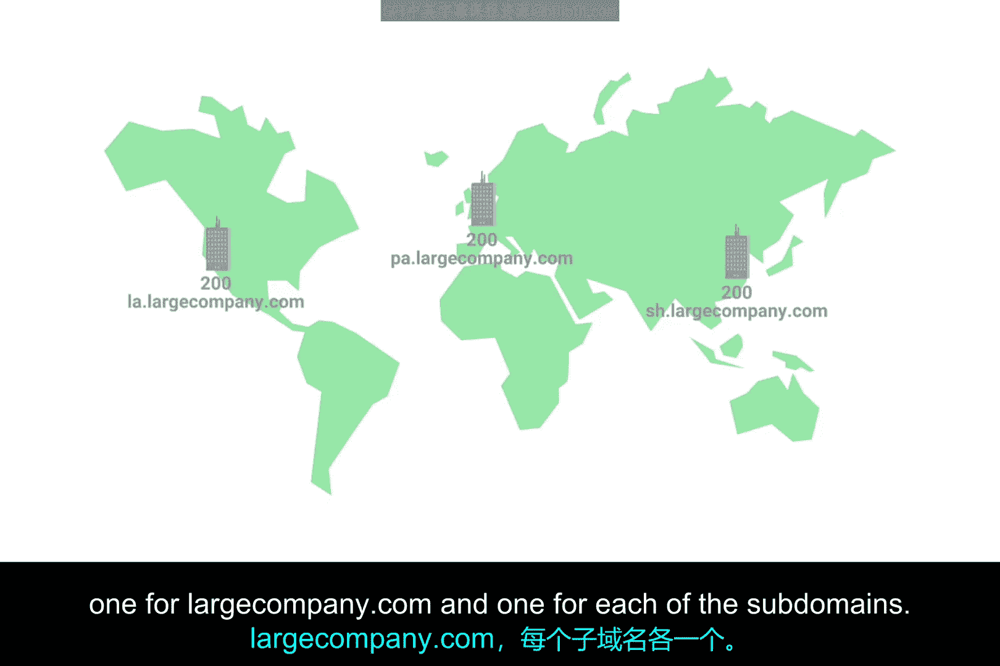
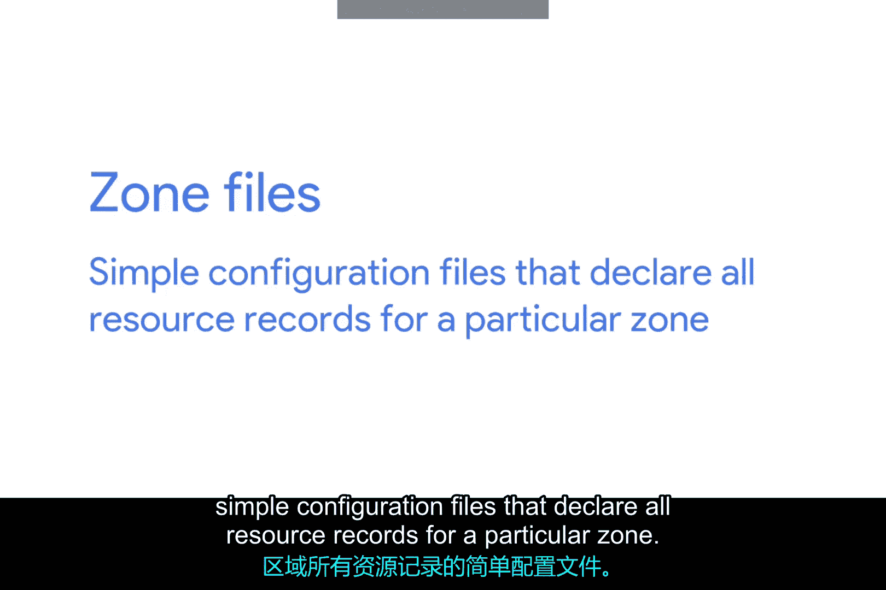
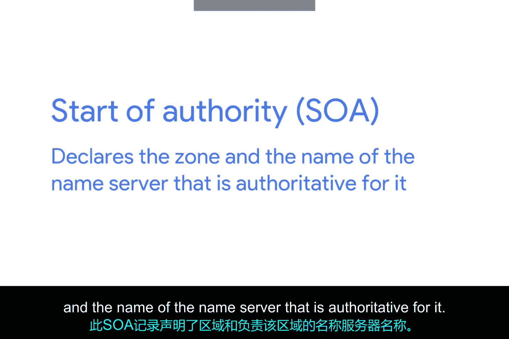
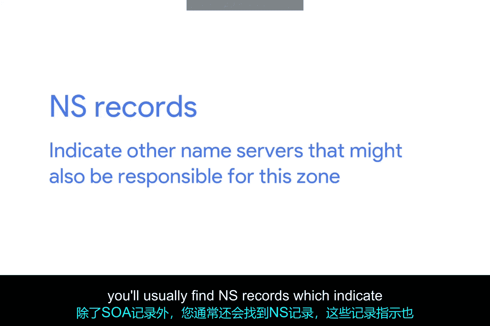
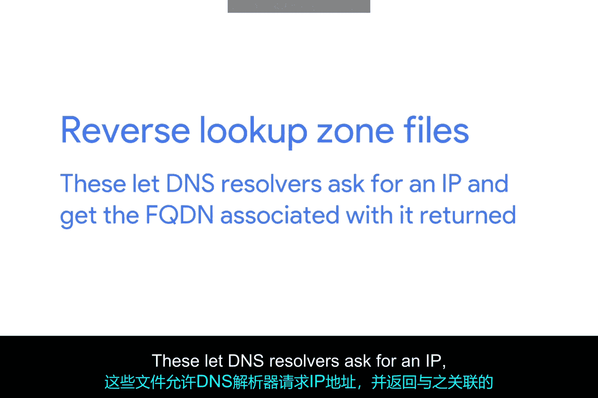
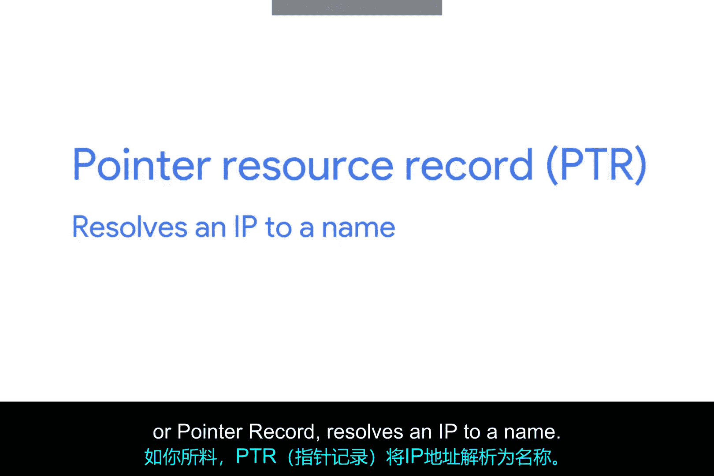

# 谷歌《IT支持（计算机网络⧸操作系统，第2、3课⧸共5课）｜Google IT Support》中英字幕deepseek p53 51_DNS区域.zh_en -BV1uyqcYpExr_p53-

We've covered how author of name servers are responsible for responding to name resolution requests for specific domains。

 but they do more than that an authorative name server is actually responsible for a specific DNS zone。

DN S zones are a hierarchical concept。 The root name servers we covered earlier are responsible for the root zone。

 Each T LD name server is responsible for the zone covering its specific T LD。

 and what we refer to as authoritative name servers are responsible for some even finer grain zones underneath that。

The root and TLD name servers are actually just authorative name servers too。

 it's just that the zones that they're authoritative for are special cases。

I should call out that zones don't overlap， for example。

 the administrative authority of the TLD name server for the dot co TLD doesn't encompass the Google。

com domain。 Instead， it ends at the authorative server responsible for Google do com。

The purpose of DNS zones is to allow for easier control over multiple levels of a domain。

As the number of resource records in a single domain increases。

 it becomes more of a headache to manage them all network administrators can ease this pain by splitting up their configurations into multiple zones。

Let's imagine a large company that owns the domain largecompany。com。

This company has offices in Los Angeles， Paris and Shanghai， very cosmopolitan。

Let's say each office has around 200 people with their own uniquely named desktop computer。

 this would be 600 a records to keep track of if it was all configured as a single zone。

What the company could do instead is put up each office into their own zone。So now we could have la。

largecompany。com PA。largecompany。com and S。largecompany。

com as subdomains each with their own DNS zone， a total of four authorativename servers would now be required for the setup。

 one for large companyy。com， and one for each of the subdomains。

Zs are configured through what are known as zone files。

 simple configuration files that declare all resource records for a particular zone。

 So a zone file has to contain an S OA or a start of authority resource record declaration。

 This S O A record declares the zone and the name of the name server that is authorit for it。

Along with the SOA record， you'll usually find NSs records。

 which indicate other name servers that might also be responsible for this zone。

For simplicity' sake， we've been referring to server in the singular when discussing what's responsible for his own。

 whether at the route， TLD or domain level， but there are often going to be multiple physical servers with their own FQDNs and I addresses involved。

 having multiple servers in place for something as important as DNS is pretty common。 Why？ Well。

 if one server were to have a problem or suffer a harbor failure。

 you could always rely on one of the other ones to serve DNS traffic。Besides SOA and NS records。

 you'll also find some or all of the other resource record types we've already covered， like A。

 Quad A， and C name records， along with configurations such as default TTL values for the records served by this zone。

Just like how subdomains can go many， many layers deep， zones can be configured to do this too。

But just like with sub domainomas， it's rare to see zones deeper than just a few levels。

Sometimes you'll also see what are known as reverse lookup zone files These let DNS Rers ask for an IP and get the FQDN associated with it returned These files are the same as zone files。

 except instead of A and Qd a records which resolve names to Is you'll find mostly pointer resource record declarations as you might have guessed a PTR or pointer record resolves an IP to a name up next a dynamic quiz for you before a dynamic new lesson on dynamic hosts configuration protocol see you there。

